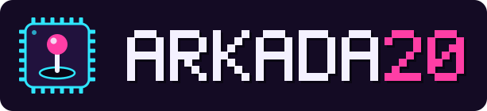

**English** | [Polski](README.pl.md)

<p align="center"></p>

# Arkada20: retro game console for the Banana Pro (Allwinner A20)

Arkada20 turns a LeMaker Banana Pro (Banana Pi Pro) with a LeMaker LCD panel into a retro game console, in the style of Lakka: the board boots straight into RetroArch, there is no desktop and no login. It is built on Armbian (Debian 13 trixie) with the LeMaker LCD support from this repository.

Made for two setups: a handheld with the 5" panel and an arcade cabinet with the 7" panel, both controlled with USB gamepads or arcade joysticks.

## Download

Ready image: [Releases](https://github.com/cyryllo/banana-a20/releases), tags starting with `arkada20-` (latest: [arkada20-v1.1-trixie-6.18.63](https://github.com/cyryllo/banana-a20/releases/tag/arkada20-v1.1-trixie-6.18.63)). Write it to an SD card with [USBImager](https://gitlab.com/bztsrc/usbimager) or balenaEtcher.

| What | Status |
|---|---|
| 7" panel (arcade cabinet) | tested: picture, sound, gamepads, Wi-Fi from the menu |
| 5" panel (handheld) | the panel works with the same overlay, not yet tested with Arkada20 |
| touchscreen in the menu | much improved in v1.1, still with occasional hiccups; off by default |
| Banana Pi (non-"Pro") | should work like the LCD images, not tested with Arkada20 |

## First boot

1. Write the image to an SD card, connect the panel and a USB gamepad, power on.
2. RetroArch starts on the LCD (the 7" panel is enabled by default, see [Screen](#screen) for the 5").
3. Connect to Wi-Fi in RetroArch: **Settings → Wi-Fi**. A USB keyboard works for typing the password, so does the on-screen keyboard.
4. Copy games over the network (see [Games](#games)).

There is no setup wizard. The default account for SSH is:

| User | Password |
|---|---|
| `gracz` | `gracz` |

You must choose a new password on the first SSH login (`ssh gracz@arkada20`). The `root` account has no password login, use `sudo` from `gracz`.

## Games

Put the games into the folder of their system. From Windows or Linux use the network share `\\arkada20\roms` (on Linux also `smb://arkada20.local/roms`; if the name is not found, use the IP address shown in RetroArch under **Information → Network Information**), or copy them over SSH to `/home/roms/<system>/`.

No password is needed from Linux (choose "Anonymous" when the file manager asks). Windows 11 blocks such guest access, there log in as `gracz` with the password `gracz`. This network password is separate from the SSH password, change it with `sudo smbpasswd gracz`.

Other network shares (also inside `roms`): `\\arkada20\bios` (BIOS files), `\\arkada20\zapisy` (game saves and save states, handy for backups) and `\\arkada20\zrzuty` (RetroArch screenshots).

| Folder | System | Core |
|---|---|---|
| `nes` | NES / Famicom | FCEUmm |
| `snes` | Super Nintendo | Snes9x 2010 |
| `gb` | Game Boy, Game Boy Color | Gambatte |
| `gba` | Game Boy Advance | gpSP |
| `megadrive` | Mega Drive / Genesis, 32X | PicoDrive |
| `mastersystem` | Master System | PicoDrive |
| `gamegear` | Game Gear | Genesis Plus GX |
| `psx` | PlayStation (`.cue`, `.chd`, `.pbp`, `.m3u`) | PCSX ReARMed |
| `mame2003` | Arcade, MAME 2003-Plus romset | MAME 2003-Plus |
| `fbneo` | Arcade, FBNeo romset | FBNeo |
| `bios` | BIOS files (e.g. for PlayStation) | |

Each folder with games gets its own icon (playlist) in the menu, the lists are updated automatically when files change. Arcade games keep their short ROM names (e.g. `sf2`). Arcade ROM sets must match the core version: MAME 2003-Plus and FBNeo need different sets.

The image contains no games. Only use games you are allowed to use.

## Controls

- Open the menu during a game: **Start + Select** on the gamepad.
- Gamepads are configured automatically for most known models (RetroArch joypad profiles). An unknown gamepad: **Settings → Input → Port 1 Controls → Set All Controls**, then **Save Controller Profile**.
- Turn the console off from the menu: **Main Menu → Zamknij system** (Shutdown) or **Restart**. Please shut down this way instead of pulling the power, so the SD card is not damaged.

## Menu style

Arkada20 uses **XMB** by default. RetroArch has four menu styles, switch them in **Settings → User Interface → Menu** and restart RetroArch:

| Menu | Look | Best for |
|---|---|---|
| **XMB** (default) | horizontal row of icons with vertical lists, like the PlayStation 3 and PSP; the classic Lakka look | gamepad, joystick |
| **Ozone** | modern, list of consoles on the left, games on the right | gamepad, joystick; the recommended alternative to XMB |
| **Material UI** (`glui`) | Android style, large items, tabs | touchscreen |
| **RGUI** | simple retro look, very light | slow systems, small screens |

All four work with a gamepad. The on-screen keyboard has all special keys (Backspace, Enter, Shift) in every menu.

## Touchscreen

Touch in the menu is **off by default**, the console is meant for a gamepad. Since v1.1 touch is much improved, but it still hiccups now and then. When turned on, a tap selects and opens an entry, dragging scrolls lists, and in XMB a left/right swipe changes the category. At the top level of the menu a slanted left/right swipe also switches the category (patch 0008). To turn touch on: **Settings → User Interface → Touch Support** (Polish: *Ustawienia → Interfejs użytkownika → Obsługa dotyku*, setting `menu_pointer_enable`).

Why off by default: after some hours the touch controller of the LeMaker panels (FT5x06) can lose its calibration and report many phantom contacts for one finger, until touch in the menu stops reacting (the gamepad keeps working). Arkada20 resets the touch controller every time RetroArch starts (`konsola-reset-dotyku`), so restarting RetroArch from the menu brings touch back. In v1.0 (RetroArch 1.20.0) touch itself was unreliable. The fixes for our reports [#20060](https://github.com/libretro/RetroArch/issues/20060) and [#20061](https://github.com/libretro/RetroArch/issues/20061) are now in RetroArch itself, and v1.1 uses a RetroArch build with them.

## Screen

Choose the panel in `/boot/armbianEnv.txt` (over SSH: `sudo nano /boot/armbianEnv.txt`, then reboot):

| Line | Panel |
|---|---|
| `overlays=lemaker-lcd5` | 5" RGB (handheld), also together with HDMI |
| `overlays=lemaker-lcd7` | 7" LVDS without HDMI |
| `overlays=lemaker-lcd7-hdmi` | 7" LVDS together with an HDMI monitor |

With an HDMI monitor connected too, also add `extraargs=video=HDMI-A-1:1920x1080@60`, otherwise the LCD flickers. `sudo armbian-config` can enable the overlays as well.

## Building the image

On a Linux x86 computer with Docker (requirements: [../armbian-build/README.md](../armbian-build/README.md#requirements-the-computer-you-build-on)), from the main folder of the repository:

```bash
arkada20/zbuduj-rdzenie.sh       # libretro cores for the A20 (cross-compiled)
arkada20/zbuduj-retroarch.sh     # RetroArch with the patches from arkada20/latki-retroarch/
armbian-build/zbuduj-obraz-pr.sh --pulpit brak --ekran 7 --konsola
```

The image is `~/armbian-build/output/images/Arkada20_<date>_bananapipro_trixie_<kernel>.img`. `--gry DIR` adds games from `DIR/<system>/` for your own use; never publish an image with games.

### What is different from stock RetroArch

RetroArch is built from source (no X11, KMS + OpenGL ES on the Mali-400 `lima` driver, udev input, Wi-Fi through NetworkManager). Since v1.1 it is the development version (`master`) at commit `4206fe8` (2026-11-12), tested on the board: the touch and display size fixes are only there, the last release (1.22.2) is from November 2025. Two patches are added:

| Patch | Fix |
|---|---|
| 0005 | menu: show Restart and Shutdown on Linux, not only on Lakka |
| 0008 | XMB touch: the drag direction is decided after about 3 mm instead of 1.5 mm, and at the top level a slanted swipe still switches the category |

Arkada20 v1.0 used RetroArch 1.20.0 with our own touch and DPI patches (0001, 0002, 0003, 0007) and a Polish label patch (0006); they are in the git history of the `arkada20-v1.0-trixie-6.18.62` tag. Menu icons, core info, gamepad profiles and game databases stay at 1.20.0, they work with the newer RetroArch.

The Debian fonts of the menus (Roboto) lack the on-screen keyboard symbols, the image links them to DejaVu Sans instead.

### Licenses

RetroArch and several cores are GPL: when you share a built image, also share the sources (the build scripts fetch exact versions, listed in `/usr/lib/arm-linux-gnueabihf/libretro/WERSJE-konsola.txt` and `/usr/local/share/retroarch-konsola-wersja.txt`). MAME 2003-Plus, FBNeo, Genesis Plus GX and Snes9x 2010 have non-commercial licenses: they may be shared for free, but an image or device with them must not be sold.

### Files in this folder

| File | What it is |
|---|---|
| `customize-konsola.sh` | runs inside the image while it is built: packages, RetroArch, cores, accounts, Samba, settings |
| `retroarch.cfg` | RetroArch settings of the image (only the values that differ from the defaults) |
| `retroarch-konsola.service` | starts RetroArch on the screen at boot |
| `konsola-listy`, `konsola-listy.service`, `.path` | builds the game lists (one icon per system) and updates them when files change |
| `konsola-reset-dotyku` | resets the touch controller before RetroArch starts (fresh calibration) |
| `avahi-samba.service` | announces the network shares (`arkada20.local`) |
| `autoconfig/udev/` | extra gamepad profiles |
| `zbuduj-rdzenie.sh` | cross-compiles the libretro cores into `rdzenie/` |
| `zbuduj-retroarch.sh` | cross-compiles RetroArch with the patches into `retroarch-bin/` |
| `latki-retroarch/` | RetroArch patches (Restart/Shutdown in the menu, XMB touch swipe), and the text of our reports [#20060](https://github.com/libretro/RetroArch/issues/20060) and [#20061](https://github.com/libretro/RetroArch/issues/20061) (fixed upstream) |
| `logo/` | the logo and its generator |

`rdzenie/` and `retroarch-bin/` are build results, not in git.

## Logo

`logo/` contains the Arkada20 logo (SVG and PNG, with and without background, and a square icon). It is generated by `logo/generuj-logo.py`: the letters are drawn from pixels, so the logo does not depend on installed fonts.
