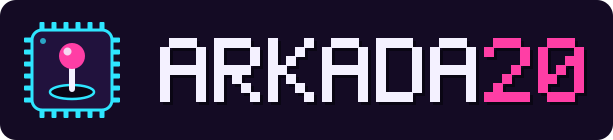

<p align="center"></p>

# Arkada20: retro game console for the Banana Pro (Allwinner A20)

Arkada20 turns a LeMaker Banana Pro (Banana Pi Pro) with a LeMaker LCD panel into a retro game console, in the style of Lakka: the board boots straight into RetroArch, there is no desktop and no login. It is built on Armbian (Debian 13 trixie) with the LeMaker LCD support from this repository.

Made for two setups: a handheld with the 5" panel and an arcade cabinet with the 7" panel, both controlled with USB gamepads or arcade joysticks.

## First boot

1. Write the image to an SD card, connect the panel and a USB gamepad, power on.
2. RetroArch starts on the LCD (the 7" panel is enabled by default, see [Screen](#screen) for the 5").
3. Connect to Wi-Fi in RetroArch: **Settings → Wi-Fi**. A USB keyboard works for typing the password, so does the on-screen keyboard.
4. Copy games over the network (see [Games](#games)).

There is no setup wizard. The default account for SSH is:

| User | Password |
|---|---|
| `gracz` | `gracz` |

You must choose a new password on the first SSH login (`ssh gracz@arkada20`). The `root` account has no password login, use `sudo` from `gracz`.

## Games

Put the games into the folder of their system. From Windows or Linux use the network share `\\arkada20\roms` (on Linux also `smb://arkada20.local/roms`; if the name is not found, use the IP address shown in RetroArch under **Information → Network Information**), or copy them over SSH to `/home/roms/<system>/`.

No password is needed from Linux (choose "Anonymous" when the file manager asks). Windows 11 blocks such guest access, there log in as `gracz` with the password `gracz`. This network password is separate from the SSH password, change it with `sudo smbpasswd gracz`.

Other network shares (also inside `roms`): `\\arkada20\bios` (BIOS files), `\\arkada20\zapisy` (game saves and save states, handy for backups) and `\\arkada20\zrzuty` (RetroArch screenshots).

| Folder | System | Core |
|---|---|---|
| `nes` | NES / Famicom | FCEUmm |
| `snes` | Super Nintendo | Snes9x 2010 |
| `gb` | Game Boy, Game Boy Color | Gambatte |
| `gba` | Game Boy Advance | gpSP |
| `megadrive` | Mega Drive / Genesis, 32X | PicoDrive |
| `mastersystem` | Master System | PicoDrive |
| `gamegear` | Game Gear | Genesis Plus GX |
| `psx` | PlayStation (`.cue`, `.chd`, `.pbp`, `.m3u`) | PCSX ReARMed |
| `mame2003` | Arcade, MAME 2003-Plus romset | MAME 2003-Plus |
| `fbneo` | Arcade, FBNeo romset | FBNeo |
| `bios` | BIOS files (e.g. for PlayStation) | |

Each folder with games gets its own icon (playlist) in the menu, the lists are updated automatically when files change. Arcade games keep their short ROM names (e.g. `sf2`). Arcade ROM sets must match the core version: MAME 2003-Plus and FBNeo need different sets.

The image contains no games. Only use games you are allowed to use.

## Controls

- Open the menu during a game: **Start + Select** on the gamepad.
- Gamepads are configured automatically for most known models (RetroArch joypad profiles). An unknown gamepad: **Settings → Input → Port 1 Controls → Set All Controls**, then **Save Controller Profile**.
- Turn the console off from the menu: **Main Menu → Zamknij system** (Shutdown) or **Restart**. Please shut down this way instead of pulling the power, so the SD card is not damaged.

## Menu style

Arkada20 uses **XMB** by default. RetroArch has four menu styles, switch them in **Settings → User Interface → Menu** and restart RetroArch:

| Menu | Look | Best for |
|---|---|---|
| **XMB** (default) | horizontal row of icons with vertical lists, like the PlayStation 3 and PSP; the classic Lakka look | gamepad, joystick |
| **Ozone** | modern, list of consoles on the left, games on the right | gamepad, joystick; the recommended alternative to XMB |
| **Material UI** (`glui`) | Android style, large items, tabs | touchscreen |
| **RGUI** | simple retro look, very light | slow systems, small screens |

All four work with a gamepad. The on-screen keyboard has all special keys (Backspace, Enter, Shift) in every menu.

## Touchscreen (experimental)

Touch in the menu is **off by default**. The touch controller of the LeMaker panels (FocalTech FT5x06) reports phantom second contacts, and with two contacts the RetroArch menu can freeze. To try it anyway: **Settings → User Interface → Touch Support** (Polish: *Ustawienia → Interfejs użytkownika → Obsługa dotyku*, setting `menu_pointer_enable`). It takes effect immediately. Touch works best with Material UI and Ozone; XMB is designed for a gamepad (a tap only moves the selection).

## Screen

Choose the panel in `/boot/armbianEnv.txt` (over SSH: `sudo nano /boot/armbianEnv.txt`, then reboot):

| Line | Panel |
|---|---|
| `overlays=lemaker-lcd5` | 5" RGB (handheld), also together with HDMI |
| `overlays=lemaker-lcd7` | 7" LVDS without HDMI |
| `overlays=lemaker-lcd7-hdmi` | 7" LVDS together with an HDMI monitor |

With an HDMI monitor connected too, also add `extraargs=video=HDMI-A-1:1920x1080@60`, otherwise the LCD flickers. `sudo armbian-config` can enable the overlays as well.

## Building the image

On a Linux x86 computer with Docker (see [../README.md](../README.md) for the requirements):

```bash
cd armbian-build
konsola/zbuduj-rdzenie.sh       # libretro cores for the A20 (cross-compiled)
konsola/zbuduj-retroarch.sh     # RetroArch with the patches from konsola/latki-retroarch/
./zbuduj-obraz-pr.sh --pulpit brak --ekran 7 --konsola
```

The image is `~/armbian-build/output/images/Arkada20_<date>_bananapipro_trixie_<kernel>.img`. `--gry DIR` adds games from `DIR/<system>/` for your own use; never publish an image with games.

### What is different from stock RetroArch

RetroArch 1.20.0 is built from source (no X11, KMS + OpenGL ES on the Mali-400 `lima` driver, udev input, Wi-Fi through NetworkManager) with these patches:

| Patch | Fix |
|---|---|
| 0001 | touch: release the pointer after the last contact |
| 0002 | touch: report the pointer position and press state (a stray `break` returned 0) |
| 0003 | KMS: report the display size and DPI, needed for dragging and swipe gestures |
| 0005 | menu: show Restart and Shutdown on Linux, not only on Lakka |
| 0006 | Polish label "Zamknij system" for Shutdown |
| 0007 | touch: ignore the kernel single-touch emulation on multi-touch devices |

The Debian fonts of the menus (Roboto) lack the on-screen keyboard symbols, the image links them to DejaVu Sans instead.

### Licenses

RetroArch and several cores are GPL: when you share a built image, also share the sources (the build scripts fetch exact versions, listed in `/usr/lib/arm-linux-gnueabihf/libretro/WERSJE-konsola.txt` and `/usr/local/share/retroarch-konsola-wersja.txt`). MAME 2003-Plus, FBNeo, Genesis Plus GX and Snes9x 2010 have non-commercial licenses: they may be shared for free, but an image or device with them must not be sold.

## Logo

`logo/` contains the Arkada20 logo (SVG and PNG, with and without background, and a square icon). It is generated by `logo/generuj-logo.py`: the letters are drawn from pixels, so the logo does not depend on installed fonts.
