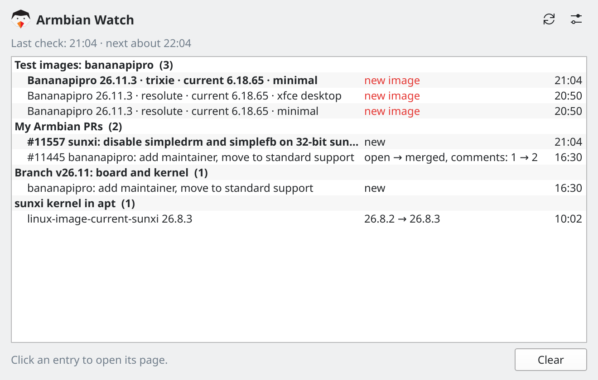
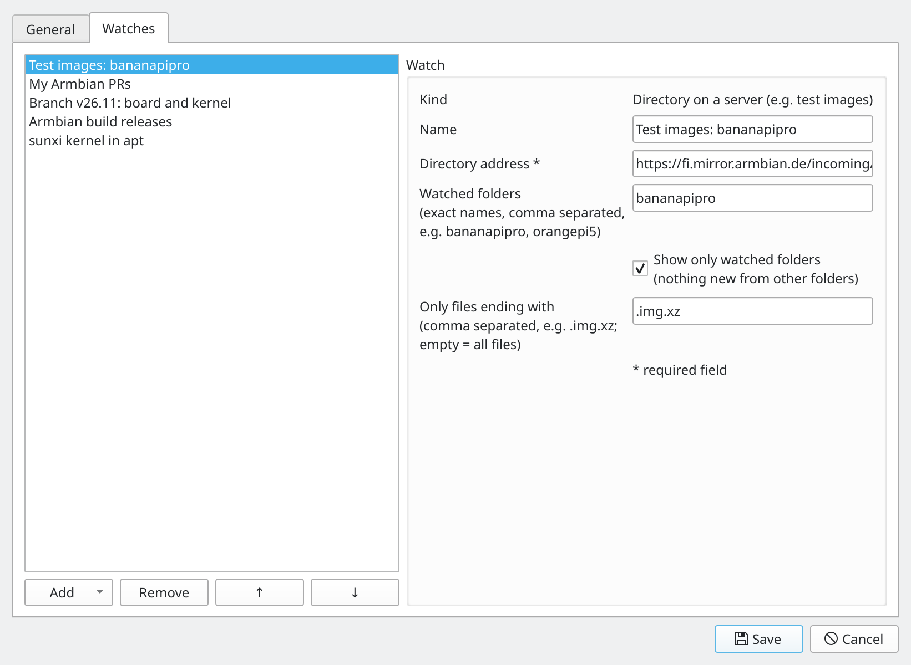
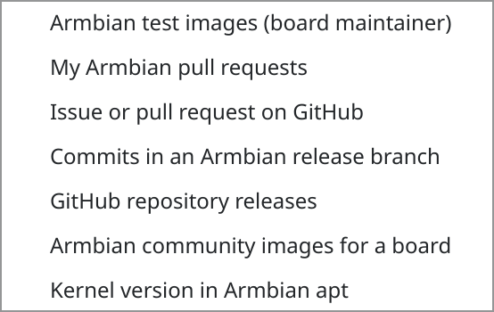
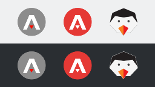
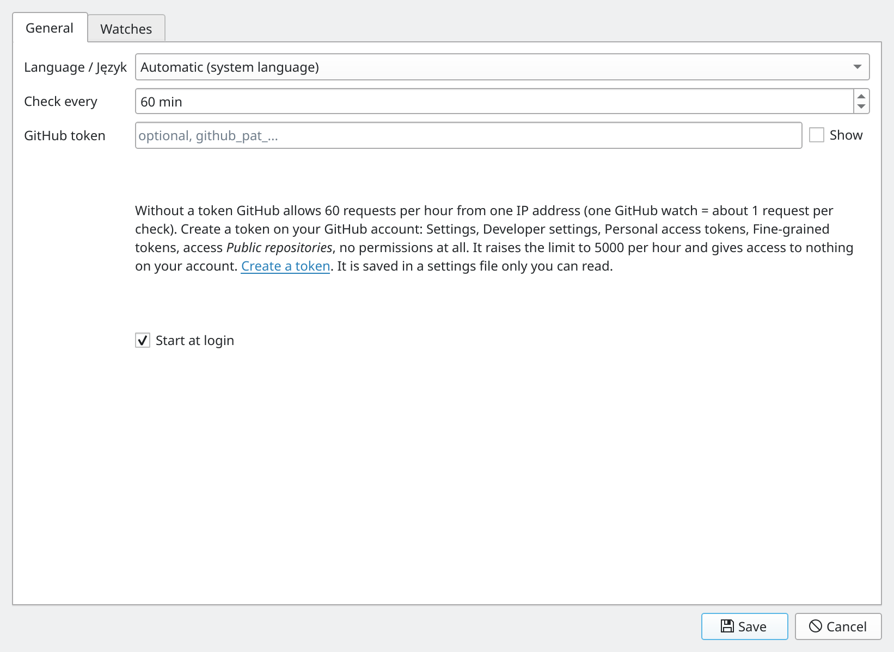

**English** | [Polski](README.pl.md)

# Armbian Watch

A system tray icon that keeps an eye on what an Armbian board maintainer usually checks again and again: test images before a release, your pull requests, issues, changes to your board's files and the kernel version in apt. It checks everything right after start and then every hour. When something changes, it shows a notification and the icon changes colour. For a new test image the Armbian penguin shows up.



The program speaks English and Polish and runs on any desktop with a system tray (KDE Plasma, XFCE, Cinnamon, MATE, LXQt, GNOME with an extension). It also watches any other GitHub project, file directory and apt repository. It is not an official Armbian project.

## Contents

- [Installation](#installation)
- [Quick start for a board maintainer](#quick-start-for-a-board-maintainer)
- [Icon, window and notifications](#icon-window-and-notifications)
- [Watch types and examples](#watch-types-and-examples)
- [Example settings file](#example-settings-file)
- [GitHub token](#github-token)
- [Checking from a terminal](#checking-from-a-terminal)
- [How it works](#how-it-works)
- [Questions and problems](#questions-and-problems)
- [Files, uninstalling, building](#files-uninstalling-building)

## Installation

Debian 12/13, Ubuntu and derivatives, Armbian with a desktop. Install it on your own computer, not on the board:

```bash
wget https://github.com/cyryllo/banana-a20/raw/master/armbian-watch/dist/armbian-watch_1.3.1_all.deb
sudo apt install ./armbian-watch_1.3.1_all.deb
```

`apt` pulls in `python3` and `python3-pyqt6`. The program shows up in the menu as **Armbian Watch**.

**GNOME** has no tray by default: install the "AppIndicator and KStatusNotifierItem Support" extension (package `gnome-shell-extension-appindicator`) and log out and back in. Other desktops have a tray out of the box.

**Without the package** Python 3 and PyQt6 are enough (`sudo apt install python3-pyqt6`), then `python3 armbian-watch.py`.

**Upgrading from Czujka Armbian** (the program's name up to version 1.2.0): quit the old version ("Quit" in the tray icon menu) and install the package as above. `apt` removes `czujka-armbian` by itself, and on first start Armbian Watch moves your settings, saved state and autostart entry.

## Quick start for a board maintainer

The example uses the `bananapipro` board. Put your board's name instead (as in `config/boards/<board>.conf` in [armbian/build](https://github.com/armbian/build)).

1. Start **Armbian Watch** from the menu. A grey circle with the "A" mark appears in the tray, and the settings window opens shortly after.
2. On the **Watches** tab select **Armbian test images** and type `bananapipro` in **Watched folders**. The rest is already set: the directory where test images land before a release, **Show only watched folders** ticked and the `.img.xz` ending.

   

3. **Add** → **My Armbian pull requests**, put your login in **Author's GitHub login**.
4. **Add** → **Commits in an Armbian release branch**: the release branch (e.g. `v26.11`) and your board's files, one per line, e.g.:
   ```
   config/boards/bananapipro.conf
   config/kernel/linux-sunxi-current.config
   patch/kernel/archive/sunxi-6.18
   ```
5. Click **Save**. The program checks everything right away and remembers how things are now. You get notifications about changes from then on.



**Where to find the names for your board:**

| What | Where to find it | Example for Banana Pi Pro |
|---|---|---|
| board name (image folder) | the file name `config/boards/<board>.conf` (or `.csc`, `.wip`) | `bananapipro` |
| kernel family | `LINUXFAMILY` in `config/sources/families/<BOARDFAMILY>.conf`, with `BOARDFAMILY` from the board file | `BOARDFAMILY="sun7i"` → `sunxi` |
| kernel config | `config/kernel/linux-<family>-<branch>.config` | `config/kernel/linux-sunxi-current.config` |
| kernel patches | `patch/kernel/archive/<family>-<version>` | `patch/kernel/archive/sunxi-6.18` |
| kernel package in apt | `linux-image-<branch>-<family>` (on the board: `dpkg -l 'linux-image*'`) | `linux-image-current-sunxi` |

## Icon, window and notifications



| Icon | Meaning |
|---|---|
| grey circle with "A" | everything checked, nothing new |
| red circle with "A" | there are new events |
| Armbian penguin | there is a new test image (a new file in a watched folder) |

**Left click** on the icon opens the events window (screenshot at the top), and the icon goes back to the grey circle:

- at the top: time of the last and next check, **Check now** and **Settings** buttons, and any errors below them (e.g. no network, GitHub limit),
- events grouped by watch, with a short description of the change and the time; the ones added since you last opened the window are bold,
- long image names are shortened to what tells them apart: `Bananapipro 26.11.3 · trixie · current 6.18.65 · minimal` instead of `Armbian_26.11.3_Bananapipro_trixie_current_6.18.65_minimal.img.xz`; the full name and address show when you hover over an entry,
- clicking an entry opens its page (image on the server, PR, commit), **Clear** empties the list, the window hides when you click elsewhere or press Esc.

**Right click** opens the menu: time of the last check, **Show events**, **Check now**, **Open: ...** (quick links to watched directories), **Settings…**, **Start with the desktop**, **Quit**.

**Notifications.** A new test image gives a notification with the penguin that stays until you close or click it (clicking opens the image on the server). Other changes give a normal 15-second notification listing up to 5 changes, e.g.:

```
Armbian Watch: new events: 2
• My Armbian PRs: #11445 bananapipro: add maintainer, move to standard support (open → merged, comments: 1 → 2)
• sunxi kernel in apt: linux-image-current-sunxi 26.8.3 (26.8.2 → 26.8.3)
```

## Watch types and examples

Each watch can be added many times (e.g. once per board or branch). The watch name shows up in the window and in notifications, so keep it short and clear. Fields marked with an asterisk are required.

### 1. Directory on a server (test images)

Reads the file listing of a web server (a plain Apache or nginx directory listing). Before an Armbian release, test images land in `https://fi.mirror.armbian.de/incoming/igorpecovnik/<board>/` (usually in an `archive/` subfolder).

| Field | What to enter |
|---|---|
| Directory address | `https://fi.mirror.armbian.de/incoming/igorpecovnik/` |
| Watched folders | exact folder names, comma separated: `bananapipro` or `bananapipro, bananapi, cubietruck` |
| Show only watched folders | tick it if you don't want to hear about new folders of other boards |
| Only files ending with | `.img.xz` (images only, without `.asc`, `.sha`, `.torrent`); empty = all files and folders |

In a watched folder the program also looks into subfolders (up to 3 levels, e.g. `bananapipro/archive/`). Every new file there is an **important** event: the penguin and a notification that stays until you see it.

How names are matched (case does not matter):

| Entered | Folder or file on the server | Matches? |
|---|---|---|
| `bananapipro` | `bananapipro/` | yes |
| `bananapi` | `bananapipro/`, `bananapif3/` | no (the folder name must be exactly the same) |
| `bananapipro` | `Armbian_26.11.3_Bananapipro_trixie_current_6.18.65_minimal.img.xz` (a file directly in the directory) | yes (the name is a separate part) |
| `bananapi` | `Armbian_26.11.3_Bananapipro_...img.xz` | no |

Example setups:

- **one board, images only:** folders `bananapipro`, "only watched" ticked, ending `.img.xz`; the window shows `Bananapipro 26.11.3 · trixie · current 6.18.65 · minimal`, new image,
- **several boards:** folders `bananapipro, bananapi`; each gets the penguin for a new image,
- **the whole directory:** "only watched" not ticked; you also get normal (not important) events about new folders of other boards, e.g. `orangepi5/`, new folder,
- **another server:** any address where the server shows a file listing, e.g. a program's release directory; the ending `.tar.gz` or `.deb` picks only the packages.

### 2. Author's pull requests in a GitHub repository

| Field | Example |
|---|---|
| Repository | `armbian/build` |
| Author's GitHub login | your login |

Notifies about a new PR, a new comment, a merge and a close (it checks the author's 30 most recently updated PRs). The window shows what changed:

```
#11557 sunxi: disable simpledrm and simplefb on 32-bit sunxi        new
#11445 bananapipro: add maintainer, move to standard support        open → merged, comments: 1 → 2
```

Comments in the PR conversation are counted. GitHub counts review comments on lines of code separately and they don't show here.

### 3. Issue or pull request on GitHub

| Field | Example |
|---|---|
| Repository | `armbian/build` or e.g. `libretro/RetroArch` |
| Number | `11557` |

For keeping an eye on one item, also in someone else's project: the developers' reply to your bug report, a PR merge. An event looks like this: `#20060 Touch input broken ...`, `comments: 4 → 5`.

### 4. New commits in a GitHub branch

| Field | Example |
|---|---|
| Repository | `armbian/build` |
| Branch | `v26.11` (release branch) or `main` |
| Paths | one per line; a directory covers everything inside |

Example paths for a board maintainer:

```
config/boards/bananapipro.conf
config/kernel/linux-sunxi-current.config
patch/kernel/archive/sunxi-6.18
```

Notifies about every new commit touching these files (e.g. someone changed your board config or kernel patches before a release). The window shows the first line of the commit message, and clicking opens the commit on GitHub. A branch that doesn't exist yet is not an error, so you can add a watch for the next release branch early. When the branch appears you get its latest commits touching these files once (up to 10 per path).

### 5. GitHub repository releases

| Field | Example |
|---|---|
| Repository | `armbian/build` or `armbian/community` |
| Only releases with files for the board | empty or a board name, e.g. `bananapipro` |

Checks the last 5 releases. With a board name it only reports releases that have files for that board, e.g. `26.11.0-trunk.130: bananapipro images: 3`. The name is matched like folders: as a separate part of the file name, regardless of case, so `bananapi` will not match `Bananapipro` or `Bananapim3` images.

Note: `armbian/build` and `armbian/community` publish test (`trunk`) releases often, even several times a week.

### 6. Package version in an apt repository

| Field | Example |
|---|---|
| Packages.gz address | `https://apt.armbian.com/dists/trixie/main/binary-armhf/Packages.gz` |
| Package name | `linux-image-current-sunxi` (full name) |

The address is made of the system release (`trixie`, `bookworm`, `noble`, `resolute`) and the architecture (`armhf` for 32-bit boards, e.g. A20; `arm64` for 64-bit ones). Examples:

| Board | Address | Package |
|---|---|---|
| A20 (sunxi, 32-bit) | `https://apt.armbian.com/dists/trixie/main/binary-armhf/Packages.gz` | `linux-image-current-sunxi` |
| Allwinner 64-bit | `https://apt.armbian.com/dists/trixie/main/binary-arm64/Packages.gz` | `linux-image-current-sunxi64` |
| Rockchip 64-bit | `https://apt.armbian.com/dists/trixie/main/binary-arm64/Packages.gz` | `linux-image-current-rockchip64` |
| Debian | `https://deb.debian.org/debian/dists/trixie/main/binary-amd64/Packages.gz` | e.g. `firefox-esr` |

Notifies about a new version, e.g. `linux-image-current-sunxi 26.8.3`, `26.8.2 → 26.8.3`. The template has an unfinished name `linux-image-current-`: add the family. If the package is not at that address, the window shows the error `no package ... in ...`.

## Example settings file

Settings live in `~/.config/armbian-watch/settings.json`. Usually you change them in the settings window, but you can also edit the file by hand or pass it to a colleague (without the token!). An example for a Banana Pi Pro maintainer:

```json
{
  "co_ile_minut": 60,
  "github_token": "",
  "jezyk": "auto",
  "obserwacje": [
    {"typ": "katalog", "nazwa": "Test images: bananapipro",
     "url": "https://fi.mirror.armbian.de/incoming/igorpecovnik/",
     "plytki": ["bananapipro"], "tylko_wybrane": true, "koncowki": [".img.xz"]},
    {"typ": "github_pr_autora", "nazwa": "My Armbian PRs",
     "repo": "armbian/build", "autor": "your-login"},
    {"typ": "github_commity", "nazwa": "Branch v26.11: board and kernel",
     "repo": "armbian/build", "galaz": "v26.11",
     "sciezki": ["config/boards/bananapipro.conf",
                 "config/kernel/linux-sunxi-current.config",
                 "patch/kernel/archive/sunxi-6.18"]},
    {"typ": "github_wydania", "nazwa": "Community images bananapipro",
     "repo": "armbian/community", "zasob_zawiera": "bananapipro"},
    {"typ": "apt_pakiet", "nazwa": "sunxi kernel in apt",
     "url": "https://apt.armbian.com/dists/trixie/main/binary-armhf/Packages.gz",
     "pakiet": "linux-image-current-sunxi"}
  ]
}
```

The keys are in Polish (the program started in Polish):

| Key | Meaning |
|---|---|
| `co_ile_minut` | check every N minutes (15 to 1440) |
| `github_token` | GitHub token, optional (see below) |
| `jezyk` | language: `auto` (system language), `pl` or `en` |
| `obserwacje` | the list of watches |
| `typ` | watch type: `katalog` (directory; `url`, `plytki` = watched folders, `tylko_wybrane` = only watched, `koncowki` = file endings), `github_pr_autora` (`repo`, `autor`), `github_zgloszenie` (issue: `repo`, `numer`), `github_commity` (`repo`, `galaz` = branch, `sciezki` = paths), `github_wydania` (releases: `repo`, `zasob_zawiera` = board name), `apt_pakiet` (`url`, `pakiet`) |
| `nazwa` | watch name; must be different for each |

The program reads the file on every check, so a change works right after **Check now**. Don't edit the file while the settings window is open: **Save** in the window overwrites your changes.

## GitHub token

Without a token GitHub allows 60 requests per hour from one IP address. One GitHub watch is about one request per check, so a few watches checked hourly fit within the limit. A token helps when you have many watches or when something else on the same connection also queries GitHub often (e.g. building Armbian). With a token the limit is 5000 requests per hour.



How to create a token:

1. Sign in to GitHub and open https://github.com/settings/personal-access-tokens/new
2. **Token name**: e.g. `armbian-watch`, **Expiration**: e.g. a year.
3. **Repository access**: **Public repositories**. **Permissions**: tick nothing.
4. **Generate token**, copy it (GitHub shows it only once) and paste it into **GitHub token** on the **General** tab.

Such a token gives access to nothing on your account; it only counts towards the limit. Still, treat it like a password. The program keeps it in a settings file that only your user can read. Instead of the settings, the token can also come from the `GITHUB_TOKEN` variable.

When the limit runs out, the window shows an error with the time of the next try. Until then the program does not query GitHub, and the other watches keep working.

## Checking from a terminal

`armbian-watch --once` runs one check without the icon and prints the changes. Useful for testing your settings or in a script. Output (real, from the day a new `trixie` image appeared; the watch name is the author's own):

```
$ armbian-watch --once
[!] Obrazy do testu (Igor): Bananapipro 26.11.3 · trixie · current 6.18.65 · minimal
    https://fi.mirror.armbian.de/incoming/igorpecovnik/bananapipro/archive/Armbian_26.11.3_Bananapipro_trixie_current_6.18.65_minimal.img.xz
Events: 1, errors: 0, watches in state: 10, time: 8.8 s
```

`[!]` marks an important event (an image in a watched folder). `--once` saves the state just like the icon does, so events printed in the terminal will not show up in the window later. `armbian-watch --version` prints the version.

## How it works

- **The first check is silent.** On the first check of a watch the program only remembers how things are now. Otherwise every image and every PR would be "new".
- **Changing a watch's settings is silent too.** After adding a folder, a path or a filter, what is already on the server will not show up as new. Renaming a watch starts it over (the name is the key in the state).
- **The state** (what was already there) is in `~/.local/state/armbian-watch/state.json` and survives a restart. The list in the window lives only in memory: it starts empty after the program restarts.
- **An error in one watch** (no network, server not responding) doesn't stop the others. On the next check the program tries again and loses nothing: it compares with the last successful state.
- **The program sends nothing** apart from ordinary requests to the watched addresses and the GitHub API (with a generic `User-Agent: armbian-watch` header, without your data; the token only goes to `api.github.com`).

## Questions and problems

**I can't see the icon.** Check that your desktop has a tray (GNOME: AppIndicator extension, see Installation). Start the program from a terminal with `armbian-watch` to see any errors.

**I get no notifications about images.** Check in a browser that your board's folder exists at the directory address (e.g. `https://fi.mirror.armbian.de/incoming/igorpecovnik/bananapipro/`) and that the name in **Watched folders** is exactly the same. Remember the first check is silent.

**The window says "fill in the settings".** A required field (marked with an asterisk) of a watch is empty, or "only watched" is ticked with no folders entered.

**The window says "GitHub request limit".** Add a token (see above) or check less often.

**The window says "no package".** The package name or the `Packages.gz` address is wrong. Check the name on the board: `dpkg -l 'linux-image*'`.

**Too many notifications.** Tick "only watched folders", add the `.img.xz` ending, narrow the paths in the commits watch or remove the watch for `trunk` releases.

**I want to start over.** Quit the program and delete `~/.local/state/armbian-watch/state.json`. The program will remember everything again, without notifications.

## Files, uninstalling, building

| File | Contents |
|---|---|
| `~/.config/armbian-watch/settings.json` | settings and watches (readable only by the owner, since it may contain a token) |
| `~/.local/state/armbian-watch/state.json` | saved state of the watches |
| `~/.config/autostart/armbian-watch.desktop` | start at login (when enabled) |

Uninstalling (first **Quit** in the tray icon menu):

```bash
sudo apt remove armbian-watch
# also the settings (with the token), state and autostart:
rm -r ~/.config/armbian-watch ~/.local/state/armbian-watch ~/.config/autostart/armbian-watch.desktop
```

Building the package from source:

```bash
./zbuduj-deb.sh        # output: dist/armbian-watch_<version>_all.deb
```

The version comes from the `WERSJA` variable in `armbian-watch.py`, the package maintainer from `git config` (or `DEBFULLNAME` and `DEBEMAIL`). The program is a single Python file; the English texts are in the `EN` dictionary near its top.

## License

GPL-3.0-or-later.

The "A" mark in the icon is redrawn after the Armbian logo, and the penguin is the user icon from the [armbian/build](https://github.com/armbian/build) repository (GPL-2.0). Armbian is a trademark of its project; Armbian Watch is not an official Armbian project.
