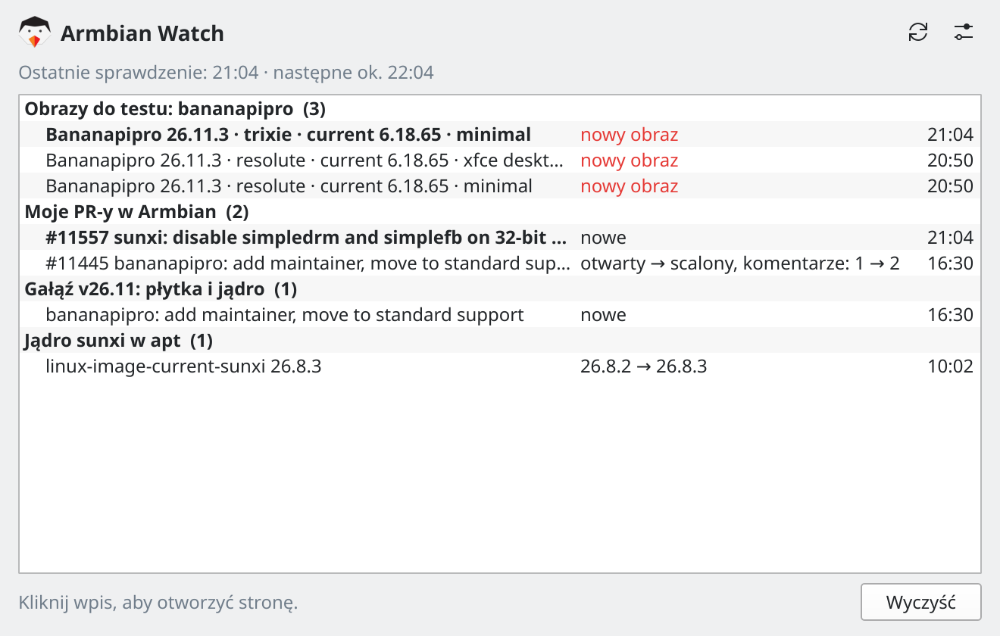
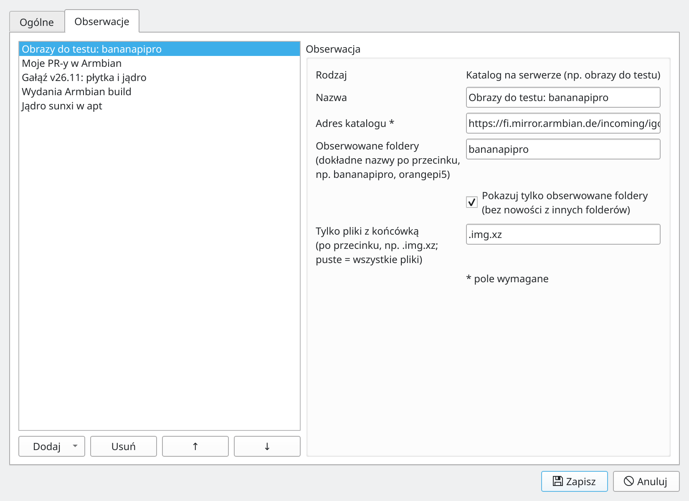
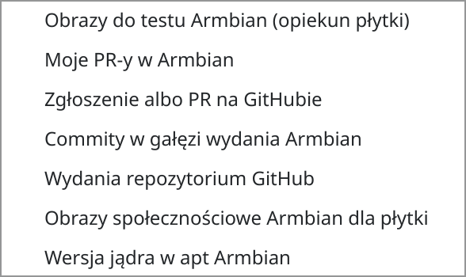
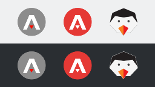
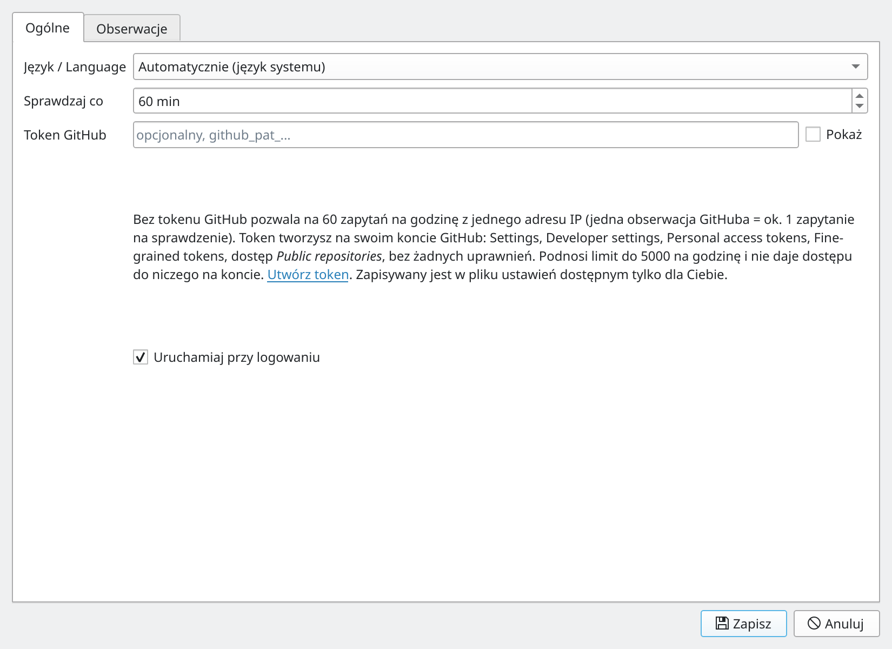

[English](README.md) | **Polski**

# Armbian Watch

Ikona w zasobniku systemowym, która pilnuje za Ciebie tego, na co opiekun płytki w Armbianie zwykle zagląda co chwilę: obrazów do testu przed wydaniem, swoich pull requestów, zgłoszeń, zmian w plikach płytki i wersji jądra w apt. Sprawdza wszystko zaraz po starcie i potem co godzinę. Gdy coś się zmieni, pokazuje powiadomienie, a ikona zmienia kolor. Przy nowym obrazie do testu pojawia się pingwin Armbiana.



Program działa po polsku i po angielsku, na każdym pulpicie z zasobnikiem (KDE Plasma, XFCE, Cinnamon, MATE, LXQt, GNOME z rozszerzeniem). Obserwuje też dowolne inne projekty na GitHubie, katalogi plików i repozytoria apt. Nie jest oficjalnym programem Armbiana.

## Spis treści

- [Instalacja](#instalacja)
- [Szybki start dla opiekuna płytki](#szybki-start-dla-opiekuna-płytki)
- [Ikona, okienko i powiadomienia](#ikona-okienko-i-powiadomienia)
- [Rodzaje obserwacji i przykłady](#rodzaje-obserwacji-i-przykłady)
- [Przykładowy plik ustawień](#przykładowy-plik-ustawień)
- [Token GitHub](#token-github)
- [Sprawdzanie w terminalu](#sprawdzanie-w-terminalu)
- [Jak to działa](#jak-to-działa)
- [Pytania i problemy](#pytania-i-problemy)
- [Pliki, odinstalowanie, budowanie](#pliki-odinstalowanie-budowanie)

## Instalacja

Debian 12/13, Ubuntu i pochodne, Armbian z pulpitem. Program instalujesz na swoim komputerze, nie na płytce:

```bash
wget https://github.com/cyryllo/banana-a20/raw/master/armbian-watch/dist/armbian-watch_1.3.1_all.deb
sudo apt install ./armbian-watch_1.3.1_all.deb
```

`apt` sam doinstaluje `python3` i `python3-pyqt6`. Program pojawi się w menu jako **Armbian Watch**.

**GNOME** domyślnie nie ma zasobnika: zainstaluj rozszerzenie „AppIndicator and KStatusNotifierItem Support” (pakiet `gnome-shell-extension-appindicator`) i wyloguj się. Inne pulpity mają zasobnik od razu.

**Bez pakietu** wystarczy Python 3 i PyQt6 (`sudo apt install python3-pyqt6`), potem `python3 armbian-watch.py`.

**Aktualizacja z Czujki Armbian** (tak program nazywał się do wersji 1.2.0): zamknij starą wersję („Zakończ” w menu ikony) i zainstaluj pakiet jak wyżej. `apt` sam usunie `czujka-armbian`, a Armbian Watch przy pierwszym starcie przeniesie Twoje ustawienia, zapamiętany stan i autostart.

## Szybki start dla opiekuna płytki

Przykład dla płytki `bananapipro`. Wstaw nazwę swojej płytki (tak jak w `config/boards/<płytka>.conf` w [armbian/build](https://github.com/armbian/build)).

1. Uruchom **Armbian Watch** z menu. W zasobniku pojawi się szare kółko ze znakiem „A”, a za chwilę okno ustawień.
2. W zakładce **Obserwacje** zaznacz **Obrazy do testu Armbian** i w polu **Obserwowane foldery** wpisz `bananapipro`. Reszta jest już ustawiona: katalog, do którego przed wydaniem trafiają obrazy do testu, zaznaczone **Pokazuj tylko obserwowane foldery** i końcówka `.img.xz`.

   

3. **Dodaj** → **Moje PR-y w Armbian**, w polu **Login GitHub autora** wpisz swój login.
4. **Dodaj** → **Commity w gałęzi wydania Armbian**: gałąź wydania (np. `v26.11`) i pliki Twojej płytki, po jednym w wierszu, np.:
   ```
   config/boards/bananapipro.conf
   config/kernel/linux-sunxi-current.config
   patch/kernel/archive/sunxi-6.18
   ```
5. Kliknij **Zapisz**. Program od razu sprawdzi wszystko i zapamięta, jak jest teraz. Powiadomienia dostaniesz o zmianach od tej chwili.



**Skąd wziąć nazwy dla swojej płytki:**

| Co | Gdzie to znaleźć | Przykład dla Banana Pi Pro |
|---|---|---|
| nazwa płytki (folder z obrazami) | nazwa pliku `config/boards/<płytka>.conf` (albo `.csc`, `.wip`) | `bananapipro` |
| rodzina jądra | `LINUXFAMILY` w `config/sources/families/<BOARDFAMILY>.conf`, a `BOARDFAMILY` w pliku płytki | `BOARDFAMILY="sun7i"` → `sunxi` |
| konfiguracja jądra | `config/kernel/linux-<rodzina>-<gałąź>.config` | `config/kernel/linux-sunxi-current.config` |
| łatki jądra | `patch/kernel/archive/<rodzina>-<wersja>` | `patch/kernel/archive/sunxi-6.18` |
| pakiet jądra w apt | `linux-image-<gałąź>-<rodzina>` (na płytce: `dpkg -l 'linux-image*'`) | `linux-image-current-sunxi` |

## Ikona, okienko i powiadomienia



| Ikona | Znaczenie |
|---|---|
| szare kółko z „A” | wszystko sprawdzone, nic nowego |
| czerwone kółko z „A” | są nowe zdarzenia |
| pingwin Armbiana | jest nowy obraz do testu (nowy plik w obserwowanym folderze) |

**Lewy przycisk** na ikonie otwiera okienko ze zdarzeniami (zrzut na górze), a ikona wraca do szarego kółka:

- u góry: godzina ostatniego i następnego sprawdzenia, przyciski **Sprawdź teraz** i **Ustawienia**, pod nimi ewentualne błędy (np. brak sieci, limit GitHuba),
- zdarzenia pogrupowane według obserwacji, z krótkim opisem zmiany i godziną; pogrubione są te, które doszły od ostatniego otwarcia okienka,
- długie nazwy obrazów są skrócone do tego, co je odróżnia: `Bananapipro 26.11.3 · trixie · current 6.18.65 · minimal` zamiast `Armbian_26.11.3_Bananapipro_trixie_current_6.18.65_minimal.img.xz`; pełna nazwa i adres pokazują się po najechaniu myszą,
- kliknięcie wpisu otwiera stronę (obraz na serwerze, PR, commit), **Wyczyść** czyści listę, okienko chowa się po kliknięciu gdzie indziej albo klawiszem Esc.

**Prawy przycisk** otwiera menu: godzina ostatniego sprawdzenia, **Pokaż zdarzenia**, **Sprawdź teraz**, **Otwórz: ...** (szybki link do obserwowanych katalogów), **Ustawienia…**, **Uruchamiaj przy starcie**, **Zakończ**.

**Powiadomienia.** Nowy obraz do testu daje powiadomienie z pingwinem, które nie znika samo, dopóki go nie zamkniesz albo nie klikniesz (kliknięcie otwiera obraz na serwerze). Inne zmiany dają zwykłe powiadomienie na 15 sekund z listą do 5 zmian, np.:

```
Armbian Watch: nowe zdarzenia: 2
• Moje PR-y w Armbian: #11445 bananapipro: add maintainer, move to standard support (otwarty → scalony, komentarze: 1 → 2)
• Jądro sunxi w apt: linux-image-current-sunxi 26.8.3 (26.8.2 → 26.8.3)
```

## Rodzaje obserwacji i przykłady

Każdą obserwację można dodać wiele razy (np. osobno dla każdej płytki albo gałęzi). Nazwa obserwacji pojawia się w okienku i w powiadomieniach, więc nadaj krótką i jasną. Pola z gwiazdką są wymagane.

### 1. Katalog na serwerze (obrazy do testu)

Sprawdza listę plików na serwerze WWW (zwykły listing katalogu Apache albo nginx). Przed wydaniem Armbiana obrazy do testu trafiają do `https://fi.mirror.armbian.de/incoming/igorpecovnik/<płytka>/` (zwykle do podkatalogu `archive/`).

| Pole | Co wpisać |
|---|---|
| Adres katalogu | `https://fi.mirror.armbian.de/incoming/igorpecovnik/` |
| Obserwowane foldery | dokładne nazwy folderów, po przecinku: `bananapipro` albo `bananapipro, bananapi, cubietruck` |
| Pokazuj tylko obserwowane foldery | zaznacz, jeśli nie chcesz wiedzieć o nowych folderach innych płytek |
| Tylko pliki z końcówką | `.img.xz` (same obrazy, bez `.asc`, `.sha`, `.torrent`); puste = wszystkie pliki i foldery |

W obserwowanym folderze program zagląda też do podfolderów (do 3 poziomów, np. `bananapipro/archive/`). Każdy nowy plik stamtąd to **ważne** zdarzenie: pingwin i powiadomienie, które nie znika samo.

Jak dopasowywane są nazwy (wielkość liter nie ma znaczenia):

| Wpisane | Folder albo plik na serwerze | Pasuje? |
|---|---|---|
| `bananapipro` | `bananapipro/` | tak |
| `bananapi` | `bananapipro/`, `bananapif3/` | nie (folder musi się nazywać dokładnie tak) |
| `bananapipro` | `Armbian_26.11.3_Bananapipro_trixie_current_6.18.65_minimal.img.xz` (plik wprost w katalogu) | tak (nazwa jest osobnym członem) |
| `bananapi` | `Armbian_26.11.3_Bananapipro_...img.xz` | nie |

Przykłady ustawień:

- **jedna płytka, tylko obrazy:** foldery `bananapipro`, zaznaczone „tylko obserwowane”, końcówka `.img.xz`; w okienku zobaczysz `Bananapipro 26.11.3 · trixie · current 6.18.65 · minimal`, nowy obraz,
- **kilka płytek:** foldery `bananapipro, bananapi`; każda dostaje pingwina przy nowym obrazie,
- **cały katalog:** bez zaznaczenia „tylko obserwowane”; dostaniesz też zwykłe (nie ważne) zdarzenia o nowych folderach innych płytek, np. `orangepi5/`, nowy folder,
- **inny serwer:** każdy adres, pod którym serwer pokazuje listę plików, np. katalog z wydaniami programu; końcówka `.tar.gz` albo `.deb` wybierze same paczki.

### 2. PR-y autora w repozytorium GitHub

| Pole | Przykład |
|---|---|
| Repozytorium | `armbian/build` |
| Login GitHub autora | Twój login |

Daje znać o nowym PR, nowym komentarzu, scaleniu i zamknięciu (sprawdza 30 ostatnio zmienionych PR-ów autora). W okienku widać, co się zmieniło:

```
#11557 sunxi: disable simpledrm and simplefb on 32-bit sunxi        nowe
#11445 bananapipro: add maintainer, move to standard support        otwarty → scalony, komentarze: 1 → 2
```

Liczone są komentarze w rozmowie pod PR. Komentarze recenzji przy liniach kodu GitHub liczy osobno i ich tu nie widać.

### 3. Zgłoszenie albo PR na GitHubie

| Pole | Przykład |
|---|---|
| Repozytorium | `armbian/build` albo np. `libretro/RetroArch` |
| Numer | `11557` |

Do pilnowania jednej sprawy, także w cudzym projekcie: odpowiedź twórców na Twoje zgłoszenie błędu, scalenie PR. Zdarzenie wygląda np. tak: `#20060 Touch input broken ...`, `komentarze: 4 → 5`.

### 4. Nowe commity w gałęzi GitHub

| Pole | Przykład |
|---|---|
| Repozytorium | `armbian/build` |
| Gałąź | `v26.11` (gałąź wydania) albo `main` |
| Ścieżki | po jednej w wierszu; katalog obejmuje wszystko w środku |

Przykładowe ścieżki dla opiekuna płytki:

```
config/boards/bananapipro.conf
config/kernel/linux-sunxi-current.config
patch/kernel/archive/sunxi-6.18
```

Daje znać o każdym nowym commicie, który dotyka tych plików (np. ktoś zmienił konfigurację Twojej płytki albo łatki jądra przed wydaniem). W okienku widać pierwszą linię opisu commita, kliknięcie otwiera go na GitHubie. Gałąź, której jeszcze nie ma, nie jest błędem, więc obserwację gałęzi następnego wydania można dodać wcześniej. Gdy gałąź się pojawi, dostaniesz jednorazowo jej ostatnie commity w tych plikach (do 10 na ścieżkę).

### 5. Wydania repozytorium GitHub

| Pole | Przykład |
|---|---|
| Repozytorium | `armbian/build` albo `armbian/community` |
| Tylko wydania z plikami płytki | puste albo nazwa płytki, np. `bananapipro` |

Sprawdza 5 ostatnich wydań. Z nazwą płytki zgłasza tylko wydania, które mają jej pliki, np. `26.11.0-trunk.130: obrazy bananapipro: 3`. Nazwa jest dopasowywana jak przy folderach: jako osobny człon nazwy pliku, bez względu na wielkość liter, więc `bananapi` nie złapie obrazów `Bananapipro` ani `Bananapim3`.

Uwaga: `armbian/build` i `armbian/community` publikują wydania testowe (`trunk`) często, nawet kilka razy w tygodniu.

### 6. Wersja pakietu w repozytorium apt

| Pole | Przykład |
|---|---|
| Adres pliku Packages.gz | `https://apt.armbian.com/dists/trixie/main/binary-armhf/Packages.gz` |
| Nazwa pakietu | `linux-image-current-sunxi` (pełna nazwa) |

Adres składa się z wydania systemu (`trixie`, `bookworm`, `noble`, `resolute`) i architektury (`armhf` dla płytek 32-bitowych, np. A20; `arm64` dla 64-bitowych). Przykłady:

| Płytka | Adres | Pakiet |
|---|---|---|
| A20 (sunxi, 32-bit) | `https://apt.armbian.com/dists/trixie/main/binary-armhf/Packages.gz` | `linux-image-current-sunxi` |
| Allwinner 64-bit | `https://apt.armbian.com/dists/trixie/main/binary-arm64/Packages.gz` | `linux-image-current-sunxi64` |
| Rockchip 64-bit | `https://apt.armbian.com/dists/trixie/main/binary-arm64/Packages.gz` | `linux-image-current-rockchip64` |
| Debian | `https://deb.debian.org/debian/dists/trixie/main/binary-amd64/Packages.gz` | np. `firefox-esr` |

Daje znać o nowej wersji, np. `linux-image-current-sunxi 26.8.3`, `26.8.2 → 26.8.3`. Szablon ma niedokończoną nazwę `linux-image-current-`: dopisz rodzinę. Jeśli pakietu nie ma pod tym adresem, w okienku pojawi się błąd `nie ma pakietu ... w ...`.

## Przykładowy plik ustawień

Ustawienia są w `~/.config/armbian-watch/settings.json`. Zwykle zmieniasz je w oknie ustawień, ale plik można też edytować ręcznie albo przekazać koledze (bez tokenu!). Przykład dla opiekuna Banana Pi Pro:

```json
{
  "co_ile_minut": 60,
  "github_token": "",
  "jezyk": "auto",
  "obserwacje": [
    {"typ": "katalog", "nazwa": "Obrazy do testu: bananapipro",
     "url": "https://fi.mirror.armbian.de/incoming/igorpecovnik/",
     "plytki": ["bananapipro"], "tylko_wybrane": true, "koncowki": [".img.xz"]},
    {"typ": "github_pr_autora", "nazwa": "Moje PR-y w Armbian",
     "repo": "armbian/build", "autor": "twoj-login"},
    {"typ": "github_commity", "nazwa": "Gałąź v26.11: płytka i jądro",
     "repo": "armbian/build", "galaz": "v26.11",
     "sciezki": ["config/boards/bananapipro.conf",
                 "config/kernel/linux-sunxi-current.config",
                 "patch/kernel/archive/sunxi-6.18"]},
    {"typ": "github_wydania", "nazwa": "Obrazy społecznościowe bananapipro",
     "repo": "armbian/community", "zasob_zawiera": "bananapipro"},
    {"typ": "apt_pakiet", "nazwa": "Jądro sunxi w apt",
     "url": "https://apt.armbian.com/dists/trixie/main/binary-armhf/Packages.gz",
     "pakiet": "linux-image-current-sunxi"}
  ]
}
```

| Klucz | Znaczenie |
|---|---|
| `co_ile_minut` | co ile minut sprawdzać (15 do 1440) |
| `github_token` | token GitHub, opcjonalny (opis niżej) |
| `jezyk` | `auto` (język systemu), `pl` albo `en` |
| `typ` | `katalog`, `github_pr_autora`, `github_zgloszenie` (pola `repo`, `numer`), `github_commity`, `github_wydania`, `apt_pakiet` |
| `nazwa` | nazwa obserwacji; musi być inna dla każdej |

Program czyta plik przy każdym sprawdzeniu, więc zmiana działa od razu po **Sprawdź teraz**. Nie edytuj pliku przy otwartym oknie ustawień: **Zapisz** w oknie nadpisze Twoje zmiany.

## Token GitHub

Bez tokenu GitHub pozwala na 60 zapytań na godzinę z jednego adresu IP. Jedna obserwacja GitHuba to ok. jedno zapytanie na sprawdzenie, więc kilka obserwacji co godzinę mieści się w limicie. Token przydaje się, gdy masz dużo obserwacji albo gdy z tego samego łącza coś jeszcze często pyta GitHuba (np. budowanie Armbiana). Z tokenem limit to 5000 zapytań na godzinę.



Jak zrobić token:

1. Zaloguj się na GitHubie i otwórz https://github.com/settings/personal-access-tokens/new
2. **Token name**: np. `armbian-watch`, **Expiration**: np. rok.
3. **Repository access**: **Public repositories**. **Permissions**: niczego nie zaznaczaj.
4. **Generate token**, skopiuj go (GitHub pokaże go tylko raz) i wklej w pole **Token GitHub** w zakładce **Ogólne**.

Taki token nie daje dostępu do niczego na Twoim koncie, służy tylko do liczenia limitu. Mimo to traktuj go jak hasło. Program trzyma go w pliku ustawień, który może czytać tylko Twój użytkownik. Zamiast w ustawieniach token można podać w zmiennej `GITHUB_TOKEN`.

Gdy limit się skończy, w okienku pojawi się błąd z godziną kolejnej próby. Do tej godziny program nie pyta GitHuba, a inne obserwacje działają dalej.

## Sprawdzanie w terminalu

`armbian-watch --once` robi jedno sprawdzenie bez ikony i wypisuje zmiany. Przydaje się do testu ustawień albo w skrypcie. Wynik (prawdziwy, z dnia, gdy pojawił się nowy obraz `trixie`):

```
$ armbian-watch --once
[!] Obrazy do testu (Igor): Bananapipro 26.11.3 · trixie · current 6.18.65 · minimal
    https://fi.mirror.armbian.de/incoming/igorpecovnik/bananapipro/archive/Armbian_26.11.3_Bananapipro_trixie_current_6.18.65_minimal.img.xz
Zdarzeń: 1, błędów: 0, obserwacji w stanie: 10, czas: 8.7 s
```

`[!]` oznacza ważne zdarzenie (obraz w obserwowanym folderze). `--once` zapisuje stan tak samo jak ikona, więc zdarzenia wypisane w terminalu nie pojawią się potem w okienku. `armbian-watch --version` pokazuje wersję.

## Jak to działa

- **Pierwsze sprawdzenie jest ciche.** Przy pierwszym sprawdzeniu obserwacji program tylko zapamiętuje, jak jest teraz. Inaczej każdy obraz i każdy PR byłby „nowy”.
- **Zmiana ustawień obserwacji też jest cicha.** Po dopisaniu folderu, ścieżki albo filtra to, co już jest na serwerze, nie pojawi się jako nowość. Zmiana samej nazwy obserwacji zaczyna ją od nowa (nazwa jest kluczem w stanie).
- **Stan** (co już było) jest w `~/.local/state/armbian-watch/state.json` i przetrwa restart. Lista w okienku jest tylko w pamięci: po zamknięciu programu zaczyna się od nowa.
- **Błąd jednej obserwacji** (brak sieci, serwer nie odpowiada) nie zatrzymuje innych. Przy następnym sprawdzeniu program spróbuje jeszcze raz i niczego nie zgubi: porównuje z ostatnim udanym stanem.
- **Program niczego nie wysyła** poza zwykłymi zapytaniami do obserwowanych adresów i API GitHuba (z ogólnym nagłówkiem `User-Agent: armbian-watch`, bez Twoich danych; token tylko do `api.github.com`).

## Pytania i problemy

**Nie widzę ikony.** Sprawdź, czy pulpit ma zasobnik (GNOME: rozszerzenie AppIndicator, opis w Instalacji). Uruchom program z terminala poleceniem `armbian-watch`, żeby zobaczyć ewentualne błędy.

**Nie dostaję powiadomień o obrazach.** Sprawdź w przeglądarce, czy folder płytki istnieje pod adresem katalogu (np. `https://fi.mirror.armbian.de/incoming/igorpecovnik/bananapipro/`) i czy nazwa w **Obserwowanych folderach** jest dokładnie taka sama. Pamiętaj, że pierwsze sprawdzenie jest ciche.

**W okienku jest „uzupełnij w ustawieniach”.** W obserwacji jest puste wymagane pole (z gwiazdką) albo zaznaczone „tylko obserwowane” bez wpisanych folderów.

**W okienku jest „limit zapytań GitHuba”.** Dodaj token (opis wyżej) albo sprawdzaj rzadziej.

**W okienku jest „nie ma pakietu”.** Nazwa pakietu albo adres `Packages.gz` się nie zgadza. Sprawdź nazwę na płytce: `dpkg -l 'linux-image*'`.

**Za dużo powiadomień.** Zaznacz „tylko obserwowane foldery”, dopisz końcówkę `.img.xz`, ogranicz ścieżki w obserwacji commitów albo usuń obserwację wydań `trunk`.

**Chcę zacząć od nowa.** Zamknij program i usuń `~/.local/state/armbian-watch/state.json`. Program zapamięta wszystko jeszcze raz, bez powiadomień.

## Pliki, odinstalowanie, budowanie

| Plik | Zawartość |
|---|---|
| `~/.config/armbian-watch/settings.json` | ustawienia i obserwacje (prawa tylko dla właściciela, bo może zawierać token) |
| `~/.local/state/armbian-watch/state.json` | zapamiętany stan obserwacji |
| `~/.config/autostart/armbian-watch.desktop` | uruchamianie przy logowaniu (gdy włączone) |

Odinstalowanie (najpierw **Zakończ** w menu ikony):

```bash
sudo apt remove armbian-watch
# także ustawienia (z tokenem), stan i autostart:
rm -r ~/.config/armbian-watch ~/.local/state/armbian-watch ~/.config/autostart/armbian-watch.desktop
```

Budowanie pakietu ze źródeł:

```bash
./zbuduj-deb.sh        # wynik: dist/armbian-watch_<wersja>_all.deb
```

Wersja pochodzi ze zmiennej `WERSJA` w `armbian-watch.py`, opiekun pakietu z `git config` (albo `DEBFULLNAME` i `DEBEMAIL`). Program to jeden plik Pythona; teksty angielskie są w słowniku `EN` na jego początku.

## Licencja

GPL-3.0-or-later.

Znak „A” w ikonie jest odrysowany z logo Armbiana, a pingwin to ikona użytkownika z repozytorium [armbian/build](https://github.com/armbian/build) (GPL-2.0). Armbian jest znakiem swojego projektu; Armbian Watch nie jest oficjalnym programem Armbiana.
