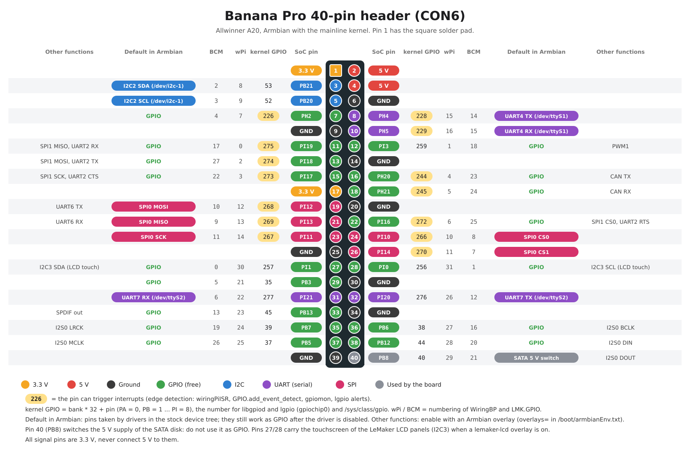

**English** | [Polski](README.pl.md)

# GPIO on the Banana Pro

Everything to use the 40-pin header of the **LeMaker Banana Pro** (Allwinner A20) on a current Armbian (Debian 13, mainline kernel):

- a [pinout](#pinout) picture and table: which pin is what, numbers for every library
- the standard Linux tools [libgpiod](#1-libgpiod-the-standard-linux-way) (`gpioset`, `gpiomon`, Python `gpiod`)
- [WiringBP](#2-wiringbp-c-library-and-the-gpio-command): the WiringPi port for the Banana Pro (C library and the `gpio` command, `gpio readall`)
- [LMK.GPIO](#3-lmkgpio-python-rpigpio-api): the RPi.GPIO port for the Banana Pro (Python)
- [lg (lgpio, rgpio)](#4-lg-lgpio-and-rgpio-instead-of-pigpio): the successor of pigpio by the same author, for any Linux board: software PWM and servos on any pin, alerts, remote control over the network
- [example programs](examples/) for all of them, and how to enable [I2C, SPI, UART and PWM](#i2c-spi-uart-and-hardware-pwm)

WiringBP and LMK.GPIO were written by LeMaker for the old sunxi 3.4 kernel and had not been updated since 2016-2019. The versions here are fixed for the mainline kernel and Python 3.13 (see [Changes](#changes-against-the-original-versions)). lg needed one fix for the A20 (GPIO numbers above 255). Everything on this page was tested on a Banana Pro with Armbian 6.18.62 (November 2026).

## Contents

- [Pinout](#pinout)
- [Pin numbers](#pin-numbers)
- [Safety](#safety)
- [Which tool to use](#which-tool-to-use)
- [Test circuit for the examples](#test-circuit-for-the-examples)
- [1. libgpiod: the standard Linux way](#1-libgpiod-the-standard-linux-way)
- [2. WiringBP: C library and the gpio command](#2-wiringbp-c-library-and-the-gpio-command)
- [3. LMK.GPIO: Python, RPi.GPIO API](#3-lmkgpio-python-rpigpio-api)
- [4. lg: lgpio and rgpio instead of pigpio](#4-lg-lgpio-and-rgpio-instead-of-pigpio)
- [I2C, SPI, UART and hardware PWM](#i2c-spi-uart-and-hardware-pwm)
- [Troubleshooting](#troubleshooting)
- [Changes against the original versions](#changes-against-the-original-versions)
- [Licenses](#licenses)

## Pinout



([SVG](pinout/bananapro-pinout.svg), generated by [pinout/generuj-pinout.py](pinout/generuj-pinout.py) together with the table below; Polish version: [bananapro-pinout-pl.png](pinout/bananapro-pinout-pl.png).)

<!-- PINS START -->
<!-- Generated by pinout/generuj-pinout.py, do not edit by hand. -->

| Pin | SoC pin | Kernel GPIO | wPi | BCM | Interrupt | Default in Armbian | Other functions |
|---:|---|---:|---:|---:|:---:|---|---|
| 1 | **3.3 V** | | | | | | |
| 2 | **5 V** | | | | | | |
| 3 | PB21 | 53 | 8 | 2 |  | I2C2 SDA (/dev/i2c-1) |  |
| 4 | **5 V** | | | | | | |
| 5 | PB20 | 52 | 9 | 3 |  | I2C2 SCL (/dev/i2c-1) |  |
| 6 | **GND** | | | | | | |
| 7 | PH2 | 226 | 7 | 4 | yes | GPIO |  |
| 8 | PH4 | 228 | 15 | 14 | yes | UART4 TX (/dev/ttyS1) |  |
| 9 | **GND** | | | | | | |
| 10 | PH5 | 229 | 16 | 15 | yes | UART4 RX (/dev/ttyS1) |  |
| 11 | PI19 | 275 | 0 | 17 | yes | GPIO | SPI1 MISO, UART2 RX |
| 12 | PI3 | 259 | 1 | 18 |  | GPIO | PWM1 |
| 13 | PI18 | 274 | 2 | 27 | yes | GPIO | SPI1 MOSI, UART2 TX |
| 14 | **GND** | | | | | | |
| 15 | PI17 | 273 | 3 | 22 | yes | GPIO | SPI1 SCK, UART2 CTS |
| 16 | PH20 | 244 | 4 | 23 | yes | GPIO | CAN TX |
| 17 | **3.3 V** | | | | | | |
| 18 | PH21 | 245 | 5 | 24 | yes | GPIO | CAN RX |
| 19 | PI12 | 268 | 12 | 10 | yes | SPI0 MOSI | UART6 TX |
| 20 | **GND** | | | | | | |
| 21 | PI13 | 269 | 13 | 9 | yes | SPI0 MISO | UART6 RX |
| 22 | PI16 | 272 | 6 | 25 | yes | GPIO | SPI1 CS0, UART2 RTS |
| 23 | PI11 | 267 | 14 | 11 | yes | SPI0 SCK |  |
| 24 | PI10 | 266 | 10 | 8 | yes | SPI0 CS0 |  |
| 25 | **GND** | | | | | | |
| 26 | PI14 | 270 | 11 | 7 | yes | SPI0 CS1 |  |
| 27 | PI1 | 257 | 30 | 0 |  | GPIO | I2C3 SDA (LCD touch) |
| 28 | PI0 | 256 | 31 | 1 |  | GPIO | I2C3 SCL (LCD touch) |
| 29 | PB3 | 35 | 21 | 5 |  | GPIO |  |
| 30 | **GND** | | | | | | |
| 31 | PI21 | 277 | 22 | 6 |  | UART7 RX (/dev/ttyS2) |  |
| 32 | PI20 | 276 | 26 | 12 |  | UART7 TX (/dev/ttyS2) |  |
| 33 | PB13 | 45 | 23 | 13 |  | GPIO | SPDIF out |
| 34 | **GND** | | | | | | |
| 35 | PB7 | 39 | 24 | 19 |  | GPIO | I2S0 LRCK |
| 36 | PB6 | 38 | 27 | 16 |  | GPIO | I2S0 BCLK |
| 37 | PB5 | 37 | 25 | 26 |  | GPIO | I2S0 MCLK |
| 38 | PB12 | 44 | 28 | 20 |  | GPIO | I2S0 DIN |
| 39 | **GND** | | | | | | |
| 40 | PB8 | 40 | 29 | 21 |  | SATA 5 V switch | I2S0 DOUT |
<!-- PINS END -->

**Default in Armbian** means the stock Armbian device tree for the Banana Pro already gives the pin to a driver: I2C2 on pins 3/5, the serial ports UART4 (pins 8/10) and UART7 (pins 31/32), SPI0 (pins 19-26). These pins can still be switched to GPIO by WiringBP and LMK.GPIO, but then the driver stops working until reboot. **Other functions** are enabled with an [Armbian overlay](#i2c-spi-uart-and-hardware-pwm).

## Pin numbers

A pin has several numbers, and each tool uses a different one. Example, physical pin 11:

| Name | Pin 11 | Used by |
|---|---|---|
| physical (board) | 11 | LMK.GPIO `GPIO.BOARD`, WiringBP `wiringPiSetupPhys()`, `gpio -1` |
| SoC pin | PI19 | datasheet, Armbian overlay parameters (`param_w1_pin=PI19`) |
| kernel GPIO | 275 | libgpiod (`gpiochip0` line 275), `/sys/class/gpio/gpio275` |
| wPi | 0 | WiringBP `wiringPiSetup()`, `gpio` command default |
| BCM | 17 | LMK.GPIO `GPIO.BCM`, WiringBP `wiringPiSetupGpio()`, `gpio -g` |

The kernel GPIO number is computed from the SoC pin: **bank × 32 + pin**, with PA = 0, PB = 1 ... PI = 8. PI19 = 8 × 32 + 19 = 275. The wPi and BCM numbers copy the Raspberry Pi numbering of the same header position, so that programs written for the Raspberry Pi work with few changes.

## Safety

- **All signal pins are 3.3 V.** Never connect 5 V to them (5 V sensors need a level shifter). Pins 2 and 4 are a 5 V supply output.
- A GPIO pin gives only a few mA: an LED always with a resistor (330 Ω), motors and relays through a transistor or a driver board.
- **Pin 40 (PB8) switches the 5 V supply of the SATA disk.** Do not use it as GPIO, writing 0 cuts the power of the disk.
- **Pins 27/28** are the touch controller bus of the LeMaker LCD panels (I2C3) when a `lemaker-lcd` overlay is enabled. Do not use them as GPIO then.
- WiringBP and LMK.GPIO write the GPIO registers directly (`/dev/mem`), so they need root (`sudo`) and the kernel does not know about their changes. Do not switch pins that a driver uses (see the table) unless you mean it.

## Which tool to use

| | libgpiod | WiringBP | LMK.GPIO | lg (lgpio) |
|---|---|---|---|---|
| Language | shell, C, Python, C++ | C, shell (`gpio`) | Python 3 | C, Python, shell (`rgs`) |
| Install | `apt install` | build from this repository | build from this repository | build from this repository |
| Pin numbers | kernel GPIO (275) | wPi, BCM or physical | physical or BCM | kernel GPIO (275) |
| Pull-up / pull-down | yes | yes | yes | yes |
| Interrupts (edges) | yes | yes (`wiringPiISR`) | yes (`add_event_detect`) | yes (alerts, ns time stamps) |
| PWM | kernel PWM (`/sys/class/pwm`) | hardware PWM on pin 12, software PWM on any pin | software PWM on any pin | software PWM, servo pulses and pulse trains on any pin |
| Pin overview | `gpioinfo` (numbers only) | **`gpio readall`** (table with modes and levels) | `GPIO.gpio_function()` | `gpio_get_line_info()` |
| Ported from Raspberry Pi | | WiringPi programs | RPi.GPIO programs | lgpio programs; pigpio programs after changing the calls to the similar lgpio ones |
| Remote control over the network | | | | yes (`rgpiod` + `rgpio`) |
| Needs root | yes (`/dev/gpiochip0`) | yes | yes | yes (`/dev/gpiochip0`) |

- New programs: **libgpiod**. It is the official kernel interface, comes with Debian and does not touch the hardware behind the kernel's back.
- Existing Raspberry Pi programs: **LMK.GPIO** for Python (change the import), **WiringBP** for C, **lg** for programs written for lgpio or pigpio.
- Servos, PWM on many pins, control from another computer: **lg**.
- Looking at the pins: **`gpio readall`**.

## Test circuit for the examples

All examples use the same two parts, so one breadboard setup works for everything:

```
 pin 11 (PI19) ──[ 330 Ω ]──►|── pin 9 (GND)       LED, long leg (+) towards the resistor
 pin 13 (PI18) ──[ button ]───── pin 14 (GND)      push button, the internal pull-up is used
```

| Part | Physical | SoC | Kernel GPIO | wPi | BCM |
|---|---:|---|---:|---:|---:|
| LED | 11 | PI19 | 275 | 0 | 17 |
| Button | 13 | PI18 | 274 | 2 | 27 |

Both pins are free in Armbian and can raise interrupts. The button pulls the pin to GND, so a press is a *falling edge*.

The examples are in [examples/](examples/) and were run on the board (the button presses were simulated by switching the internal pull resistor).

## 1. libgpiod: the standard Linux way

Install (Debian 13 has libgpiod 2.2):

```bash
sudo apt install gpiod python3-libgpiod
```

### Command line

```bash
sudo gpiodetect                          # list GPIO controllers
sudo gpioinfo -c gpiochip0 275           # state of one line (pin 11)
sudo gpioset -c gpiochip0 -t 0 275=1     # pin 11 high, then exit (the pin keeps its level)
sudo gpioset -c gpiochip0 -t 0 275=0     # pin 11 low
sudo gpioget -c gpiochip0 -b pull-up 274 # read pin 13 with the internal pull-up
sudo gpiomon -c gpiochip0 -b pull-up -e falling -p 200ms 274   # print every button press, Ctrl+C to stop
```

`gpiochip0` is the A20 GPIO controller (288 lines, kernel GPIO numbers 0-287). `gpiochip1` is the AXP209 power chip, not the header. The lines have no names on this board, use the numbers from the pinout. Without `-t 0`, `gpioset` keeps running and holds the pin until you press Ctrl+C.

Output from the board:

```
$ sudo gpiomon -c gpiochip0 -b pull-up -e falling -p 200ms 274
2760.484051478	falling	gpiochip0 274
2761.320056049	falling	gpiochip0 274
```

### Python

```python
import time
import gpiod
from gpiod.line import Direction, Value

LED = 275   # physical pin 11
with gpiod.request_lines("/dev/gpiochip0", consumer="blink",
                         config={LED: gpiod.LineSettings(direction=Direction.OUTPUT)}) as req:
    req.set_value(LED, Value.ACTIVE)
    time.sleep(1)
    req.set_value(LED, Value.INACTIVE)
```

Examples: [blink.sh](examples/libgpiod/blink.sh), [button.sh](examples/libgpiod/button.sh), [blink_gpiod.py](examples/libgpiod/blink_gpiod.py), [button_gpiod.py](examples/libgpiod/button_gpiod.py) (edge events with debounce). Run them with `sudo`.

The libgpiod documentation: https://libgpiod.readthedocs.io/

## 2. WiringBP: C library and the gpio command

### Install

```bash
sudo apt install git build-essential
git clone https://github.com/cyryllo/banana-a20.git
cd banana-a20/gpio/WiringBP
sudo ./build
gpio -v          # "Banana Pro Details: Type: Banana Pro, Revision: 1.2, Memory: 1024MB, Maker: LeMaker"
```

`./build` compiles and installs the library to `/usr/local/lib`, the headers to `/usr/local/include` and the `gpio` command to `/usr/local/bin`. To remove it: `sudo rm /usr/local/lib/libwiringPi* /usr/local/lib/libwiringPiDev* /usr/local/bin/gpio && sudo ldconfig`.

### The gpio command

```bash
sudo gpio readall        # table of the whole header: modes (IN/OUT/ALT) and levels
sudo gpio mode 0 out     # wPi 0 (pin 11) as output
sudo gpio write 0 1      # high
sudo gpio read 0         # read the level
sudo gpio toggle 0       # invert
sudo gpio mode 2 up      # wPi 2 (pin 13): pull-up (also: down, tri = none)
sudo gpio mode 0 in      # back to input
sudo gpio -1 read 11     # -1: physical pin numbers, -g: BCM numbers
sudo gpio edge 17 falling   # kernel edge detection on BCM 17 (pin 11), for wiringPiISR in other programs
sudo gpio unexportall    # release all pins from /sys/class/gpio
sudo gpio i2cdetect      # scan the I2C bus on pins 3/5 (needs i2c-tools; ignore "I2C kernel module(s) are not loaded")
```

Live view of the header: `watch -n 0.5 sudo gpio readall`.

Part of the `gpio readall` output:

```
 +-----+-----+---------+------+---+--Banana Pro--+---+------+---------+-----+-----+
 | BCM | wPi |   Name  | Mode | V | Physical | V | Mode | Name    | wPi | BCM |
 +-----+-----+---------+------+---+----++----+---+------+---------+-----+-----+
 |     |     |    3.3v |      |   |  1 || 2  |   |      | 5v      |     |     |
 |   2 |   8 |   SDA.1 | ALT5 | 1 |  3 || 4  |   |      | 5V      |     |     |
 |   3 |   9 |   SCL.1 | ALT5 | 1 |  5 || 6  |   |      | 0v      |     |     |
 |   4 |   7 | GPIO. 7 |   IN | 0 |  7 || 8  | 0 | ALT0 | TxD     | 15  | 14  |
 |     |     |      0v |      |   |  9 || 10 | 0 | ALT0 | RxD     | 16  | 15  |
 |  17 |   0 | GPIO. 0 |   IN | 0 | 11 || 12 | 0 | IN   | GPIO. 1 | 1   | 18  |
```

The names in `readall` (SDA.1, TxD, MOSI...) are the Raspberry Pi names of the same positions. On the Banana Pro the real functions are in the [pinout](#pinout) (for example pins 8/10 are UART4).

### C library

```c
#include <wiringPi.h>

int main (void)
{
  wiringPiSetup () ;            /* wPi numbers; wiringPiSetupGpio () = BCM, wiringPiSetupPhys () = physical */
  pinMode (0, OUTPUT) ;         /* pin 11 */
  digitalWrite (0, HIGH) ;
  delay (1000) ;
  digitalWrite (0, LOW) ;
  return 0 ;
}
```

Build: `gcc -o blink blink.c -lwiringPi -lpthread -lm -lcrypt -lrt`, run with `sudo ./blink`.

Most used functions (the API is the same as WiringPi 2):

| Function | What it does |
|---|---|
| `wiringPiSetup()`, `wiringPiSetupGpio()`, `wiringPiSetupPhys()` | start, with wPi / BCM / physical numbers (root) |
| `pinMode(pin, INPUT / OUTPUT / PWM_OUTPUT)` | pin direction; `PWM_OUTPUT` only on pin 12 |
| `digitalWrite(pin, HIGH / LOW)`, `digitalRead(pin)` | write / read |
| `pullUpDnControl(pin, PUD_UP / PUD_DOWN / PUD_OFF)` | internal pull resistor |
| `wiringPiISR(pin, INT_EDGE_FALLING / RISING / BOTH, function)` | call `function` on every edge (in a thread) |
| `softPwmCreate(pin, 0, 100)`, `softPwmWrite(pin, value)` | software PWM on any pin (`#include <softPwm.h>`) |
| `pwmWrite(pin, value)` | hardware PWM on pin 12 (wPi 1), value 0-1024 |
| `delay(ms)`, `delayMicroseconds(us)`, `millis()` | timing |
| `wiringPiI2CSetup(address)` + `wiringPiI2CReadReg8()` ... | I2C on pins 3/5 (`#include <wiringPiI2C.h>`) |
| `wiringPiSPISetup(channel, speed)` | SPI through `/dev/spidev0.<channel>` (needs the `spi-spidev` overlay) |

Full description of the API: the original WiringPi documentation (archived) https://web.archive.org/web/2019/http://wiringpi.com/reference/ .

Examples ([examples/c-wiringbp/](examples/c-wiringbp/)), build with `make`:

| Program | What it shows |
|---|---|
| [blink.c](examples/c-wiringbp/blink.c) | LED on / off |
| [button_isr.c](examples/c-wiringbp/button_isr.c) | button with an interrupt and debounce, toggles the LED |
| [soft_pwm.c](examples/c-wiringbp/soft_pwm.c) | LED fading with software PWM |

The old LeMaker and WiringPi examples are in [WiringBP/examples/](WiringBP/examples/) (not all were checked).

## 3. LMK.GPIO: Python, RPi.GPIO API

### Install

```bash
sudo apt install git build-essential python3-dev python3-setuptools python3-pip
git clone https://github.com/cyryllo/banana-a20.git     # if not done yet
cd banana-a20/gpio/LMK.GPIO
python3 -m pip wheel --no-deps --no-build-isolation -w dist .
sudo pip install --break-system-packages dist/*.whl
```

The first `pip` builds a package (`dist/lmk_gpio-...whl`) as a normal user, the second installs it for all users (also for `sudo python3`). `--break-system-packages` is needed because Debian 13 protects the system Python from `pip`; LMK.GPIO is not in Debian, so there is no conflict. Do not run the build with `sudo`, it leaves files owned by root in the source folder. To remove: `sudo pip uninstall --break-system-packages LMK.GPIO`.

### Use

The API is the same as RPi.GPIO, programs for the Raspberry Pi only need the import changed:

```python
import LMK.GPIO as GPIO        # instead of: import RPi.GPIO as GPIO

GPIO.setmode(GPIO.BOARD)       # physical numbers; GPIO.BCM = Raspberry Pi BCM numbers
GPIO.setup(11, GPIO.OUT)
GPIO.output(11, GPIO.HIGH)
GPIO.setup(13, GPIO.IN, pull_up_down=GPIO.PUD_UP)
print(GPIO.input(13))
GPIO.cleanup()                 # back to inputs at the end
```

| Function | What it does |
|---|---|
| `GPIO.setmode(GPIO.BOARD / GPIO.BCM)` | pin numbering |
| `GPIO.setup(pin, GPIO.IN / GPIO.OUT, pull_up_down=GPIO.PUD_UP / PUD_DOWN / PUD_OFF, initial=...)` | pin direction and pull resistor |
| `GPIO.output(pin, value)`, `GPIO.input(pin)` | write / read |
| `GPIO.add_event_detect(pin, GPIO.FALLING / RISING / BOTH, callback=f, bouncetime=ms)` | call `f(pin)` on every edge, in a thread |
| `GPIO.wait_for_edge(pin, edge)` | wait for one edge |
| `GPIO.event_detected(pin)` | was there an edge since the last call (with `add_event_detect` without callback) |
| `GPIO.remove_event_detect(pin)` | stop edge detection |
| `pwm = GPIO.PWM(pin, freq)`, `pwm.start(duty)`, `pwm.ChangeDutyCycle(duty)`, `pwm.stop()` | software PWM, duty in percent |
| `GPIO.gpio_function(pin)` | current mode: `GPIO.IN`, `GPIO.OUT`, `GPIO.I2C`, `GPIO.SPI`... |
| `GPIO.cleanup()` | reset the pins used by the program |
| `GPIO.setwarnings(False)` | no warnings about pins already in use |
| `GPIO.VERSION`, `GPIO.LMK_REVISION` | library version (1.0.0), board revision |

Interrupt pins: only the pins with a yellow kernel GPIO number in the pinout support `add_event_detect` (physical 7, 8, 10, 11, 13, 15, 16, 18, 19, 21, 22, 23, 24, 26).

Examples ([examples/python-lmk/](examples/python-lmk/)), run with `sudo python3 <file>`:

| Program | What it shows |
|---|---|
| [blink.py](examples/python-lmk/blink.py) | LED on / off |
| [button.py](examples/python-lmk/button.py) | button with an event callback and `bouncetime`, toggles the LED |
| [pwm_led.py](examples/python-lmk/pwm_led.py) | LED fading with software PWM |
| [inputs.py](examples/python-lmk/inputs.py) | live levels of all free pins, no wiring needed |

The old LeMaker tests are in [LMK.GPIO/test/](LMK.GPIO/test/).

## 4. lg: lgpio and rgpio instead of pigpio

[pigpio](https://github.com/joan2937/pigpio) cannot run on the Banana Pro: its precise timing comes from the DMA controller of the Raspberry Pi chip (paced by its PWM/PCM unit, with memory from the VideoCore), and the A20 has nothing to replace it with. The A20 DMA cannot run endless chains of transfers, and the A20 GPIO has one data register per bank instead of separate set/clear registers. pigpio is also no longer developed (last release v79, March 2021) and does not run on the Raspberry Pi 5 either.

Its author (joan2937) wrote a successor for any Linux board: **[lg](https://github.com/joan2937/lg)**, included here in [lg/](lg/). It uses only the standard kernel interface (`/dev/gpiochip`), so it works on the A20 as it is, with one fix from this repository (alerts on GPIO numbers above 255, see [Changes](#changes-against-the-original-versions), reported as [lg#49](https://github.com/joan2937/lg/issues/49)). It contains:

- **lgpio**: C library and Python module: GPIO, alerts with kernel time stamps, software PWM, servo pulses and pulse trains on any pin, I2C, SPI, serial, notifications,
- **rgpiod** + **rgpio**: a daemon on the board and a C/Python client to control the pins from another computer over the network (like `pigpiod`), and the `rgs` shell command.

### Install

```bash
sudo apt install git build-essential python3-dev python3-setuptools swig
git clone https://github.com/cyryllo/banana-a20.git     # if not done yet
cd banana-a20/gpio/lg
make
sudo make install
```

This installs `liblgpio`/`librgpio` to `/usr/local/lib`, the headers to `/usr/local/include`, `rgpiod` and `rgs` to `/usr/local/bin` and the `lgpio` and `rgpio` Python modules (a few minutes on the board). Use this copy, not the original: the original reports pins above 255 (bank PI, most header pins) with a wrong number, so Python callbacks on them never run.

lgpio keeps its notification pipes (`.lgd-nfy*`) in the **current folder** and changes into it: run programs from a folder you can write to (not `/`), or set `LG_WD`, e.g. `sudo LG_WD=/tmp python3 program.py`.

### Use

```python
import lgpio

h = lgpio.gpiochip_open(0)                 # gpiochip0 = the A20 GPIO
lgpio.gpio_claim_output(h, 275, 0)         # pin 11
lgpio.gpio_write(h, 275, 1)
lgpio.tx_pwm(h, 275, 200, 25)              # 200 Hz, 25 %
lgpio.tx_servo(h, 275, 1500, 50)           # servo pulse 1500 us, 50 Hz

lgpio.gpio_claim_alert(h, 274, lgpio.FALLING_EDGE, lgpio.SET_PULL_UP)   # pin 13
cb = lgpio.callback(h, 274, lgpio.FALLING_EDGE,
                    lambda chip, gpio, level, timestamp: print(gpio, level, timestamp))
```

In C: `#include <lgpio.h>`, functions `lgGpiochipOpen`, `lgGpioClaimOutput`, `lgGpioWrite`, `lgTxPwm`, `lgTxServo`, `lgGpioClaimAlert`, `lgGpioSetAlertsFunc`..., build with `-llgpio`. In alert callbacks use `report.gpio16` (full number), `report.gpio` only holds the low 8 bits. Full documentation: [lg/README.md](lg/README.md), `man lgpio`, `man rgpio`, and online: https://abyz.me.uk/lg/

**Remote control.** On the board: `sudo rgpiod -n <IP of your computer>` (port 8889). Without `-n` (or `-l` for local connections only) **anyone in the network can switch the pins**. On the computer: `rgpio.sbc("<IP of the board>")`, then the same functions as in lgpio, see [remote_blink.py](examples/python-lgpio/remote_blink.py).

### Timing accuracy

PWM and servo pulses are timed in software (a thread with `clock_nanosleep`), so they depend on the CPU load. Measured on the board (pin 11, level read 1.7 million times per second):

| Signal | Set | Idle board | Busy board (RetroArch with a game) |
|---|---|---|---|
| PWM 50 Hz, 25 % | 5000 µs high | 50.0 Hz, 5086-5169 µs | 45.9-50.1 Hz, 5265-5629 µs |
| PWM 1 kHz, 50 % | 500 µs high | 900-992 Hz, 508-509 µs | 934-1009 Hz, 469-526 µs |
| servo 1500 µs | 1500 µs | 1505-1533 µs | 1418-1816 µs |
| servo 1000 µs | 1000 µs | 1007-1027 µs | 983-1123 µs |
| pulses 100 µs / 900 µs | 100 µs | about 177 µs | |

Good for LEDs, motors with drivers and servos on an idle board. Servos on a busy board jitter, and short pulses (under about 200 µs) come out too long. For exact signals use the hardware PWM on pin 12 (see [I2C, SPI, UART and hardware PWM](#i2c-spi-uart-and-hardware-pwm)) or a PCA9685 servo/PWM board on I2C (pins 3/5). Input events (alerts) are exact: they carry the kernel time stamp in nanoseconds.

Examples ([examples/python-lgpio/](examples/python-lgpio/)), run with `sudo python3 <file>`:

| Program | What it shows |
|---|---|
| [blink.py](examples/python-lgpio/blink.py) | LED on / off |
| [button_alert.py](examples/python-lgpio/button_alert.py) | button with an alert, kernel time stamp and debounce, toggles the LED |
| [pwm_led.py](examples/python-lgpio/pwm_led.py) | LED fading with software PWM |
| [servo.py](examples/python-lgpio/servo.py) | servo: both ends and the centre |
| [remote_blink.py](examples/python-lgpio/remote_blink.py) | LED controlled from another computer (rgpiod + rgpio) |

The original lg examples are in [lg/EXAMPLES/](lg/EXAMPLES/).

## I2C, SPI, UART and hardware PWM

These are used through the normal Linux devices. Functions that are off by default are enabled with Armbian overlays in `/boot/armbianEnv.txt` (`sudo nano /boot/armbianEnv.txt`, then reboot). The overlays go on one `overlays=` line, separated by spaces, together with the LCD panel if there is one:

```
overlays=lemaker-lcd7 pwm spi-spidev
param_spidev_spi_bus=0
```

All A20 overlays and their parameters: `/boot/dtb/allwinner/overlay/README.sun7i-a20-overlays` on the board.

<!-- KERNEL START -->
| Function | Pins | Enable | Device | Checked on the board |
|---|---|---|---|---|
| I2C2 | 3 (SDA), 5 (SCL) | on by default | `/dev/i2c-1` | yes (`i2cdetect -y 1`) |
| I2C3 | 27 (SDA), 28 (SCL) | `i2c3` overlay, or a `lemaker-lcd` overlay (touchscreen) | `/dev/i2c-2` | yes (LCD touch) |
| UART4 | 8 (TX), 10 (RX) | on by default | `/dev/ttyS1` | device present |
| UART7 | 32 (TX), 31 (RX) | on by default | `/dev/ttyS2` | device present |
| SPI0 | 19 (MOSI), 21 (MISO), 23 (SCK), 24 (CS0), 26 (CS1) | `spi-spidev` + `param_spidev_spi_bus=0` | `/dev/spidev0.0` | device present |
| PWM1 | 12 | `pwm` | `/sys/class/pwm/pwmchip0/pwm1` | yes, together with the LCD backlight |
| SPI1 | 13 (MOSI), 11 (MISO), 15 (SCK), 22 (CS0) | `spi1` + `spi-spidev` + `param_spidev_spi_bus=1` | `/dev/spidev1.0` | no (Armbian docs) |
| UART2 | 13 (TX), 11 (RX) | `uart2` | next free `/dev/ttyS*` | no (Armbian docs) |
| CAN | 16 (TX), 18 (RX) | `can` | `can0` | no (Armbian docs) |
| 1-Wire | any free pin | `w1-gpio` + `param_w1_pin=PI19` | `/sys/bus/w1/devices/` | no (Armbian docs) |
<!-- KERNEL END -->

Notes:

- The I2C and serial device numbers are given in the order the kernel finds the controllers. They can change when you enable more buses: check with `ls -l /sys/class/i2c-dev/` (TWI2 = `1c2b400.i2c`) and `ls -l /sys/class/tty/ttyS*/device`.
- `/dev/ttyS0` is the debug console (UART0, on its own small connector), not on the 40-pin header.
- **PWM and the LCD backlight:** the A20 has two PWM channels, PWM0 drives the backlight of the LeMaker LCD panels (PB2, not on the header), PWM1 is pin 12. With an LCD, keep the default of the `pwm` overlay (both channels). `param_pwm_pins=1` would take PB2 away from the backlight and the screen goes dark.
- WiringBP hardware PWM (`gpio mode 1 pwm`) and the kernel PWM driver use the same registers: use one of them, not both at once.

### Examples

```bash
sudo apt install i2c-tools
sudo i2cdetect -y 1                       # devices on the I2C bus of pins 3/5

# hardware PWM on pin 12: 1 kHz, 25 % (overlay "pwm")
echo 1 | sudo tee /sys/class/pwm/pwmchip0/export
echo 1000000 | sudo tee /sys/class/pwm/pwmchip0/pwm1/period       # ns
echo 250000  | sudo tee /sys/class/pwm/pwmchip0/pwm1/duty_cycle   # ns
echo 1 | sudo tee /sys/class/pwm/pwmchip0/pwm1/enable

# serial port on pins 8/10, 115200 baud
sudo apt install picocom
sudo picocom -b 115200 /dev/ttyS1         # exit: Ctrl+A Ctrl+X
```

## Troubleshooting

| Problem | Cause and fix |
|---|---|
| `Unable to open /dev/mem` / `No access to /dev/mem. Try running as root!` | run with `sudo` |
| `gpioset: ... Device or resource busy`, `Failed to add edge detection` | another program holds the pin. WiringBP `wiringPiISR` and `gpio edge` leave the pin in `/sys/class/gpio` after they end: `sudo gpio unexportall` |
| `gpio: command not found` | WiringBP not installed (`sudo ./build`), or `/usr/local/bin` missing in `PATH` of `sudo` |
| `wiringPiISR: pin not sunpprt on bananaPi` | the pin cannot raise interrupts, use one with a yellow number in the pinout |
| an lgpio callback for a pin never runs | use lg from this repository (not the original) and start the program from a folder you can write to, or with `LG_WD` |
| the screen goes dark | something reset PWM channel 0 (old WiringBP, `param_pwm_pins=1`); restore with `echo 0 \| sudo tee /sys/class/backlight/*/brightness; echo 200 \| sudo tee /sys/class/backlight/*/brightness` |
| `LMK.GPIO: not a Banana Pro/Pi ...` | the library only works on the A20 boards (and the LeMaker Guitar) |
| a pin used by I2C/SPI/UART does not react | the driver owns it; disable the function (overlay) or accept that the GPIO libraries take it over until reboot |

## Changes against the original versions

WiringBP ([LeMaker/WiringBP](https://github.com/LeMaker/WiringBP), branch `bananapro`, last change 2017), LMK.GPIO ([LeMaker/LMK.GPIO](https://github.com/LeMaker/LMK.GPIO), last change 2016) and lg ([joan2937/lg](https://github.com/joan2937/lg), commit `bcccd78` of February 2026) are included with their full history. Fixed for the mainline kernel (all tested on the board):

| Library | Problem on a current Armbian | Fix |
|---|---|---|
| both | `/sys/class/gpio` numbers of the old kernel: BCM 17 became PA17 (Ethernet) instead of PI19 | kernel GPIO numbers (bank × 32 + pin) for edges, exports and interrupts |
| WiringBP | interrupt handler called in an endless loop (hundreds of thousands of calls per second) | rewind the value file before clearing the interrupt |
| WiringBP | `wiringPiI2CSetup` opened `/dev/i2c-3` (HDMI DDC on the new kernel) | look up the bus of pins 3/5 by its address |
| WiringBP | hardware PWM switched off the LCD backlight (PWM channel 0) | touch only channel 1 |
| LMK.GPIO | board not detected (`Hardware : Allwinner sun7i (A20) Family`) | look for `sun7i` anywhere in the line |
| LMK.GPIO | does not build with Python 3.13, GCC 14, without distutils | build fixes, setuptools |
| LMK.GPIO | callbacks got the internal number instead of the pin, event detection failed when the pin was exported by another tool, unclear error on other boards | fixed |
| lg | alerts stored the GPIO number in 8 bits: pin 13 (274) came as 18, Python and rgpio callbacks on pins above 255 never ran | full number in a new `gpio16` field (former padding, same struct size), used by the Python modules and rgpio; reported upstream as [lg#49](https://github.com/joan2937/lg/issues/49) |

Not changed and not checked: the Banana Pi (non-Pro, 26-pin header) branch of WiringBP, the LeMaker Guitar code, the extension board drivers in `WiringBP/devLib/` and most old examples.

## Licenses

- WiringBP: GNU LGPL v3 ([WiringBP/COPYING.LESSER](WiringBP/COPYING.LESSER)), based on WiringPi by Gordon Henderson.
- LMK.GPIO: based on RPi.GPIO by Ben Croston. The source files and `setup.py` carry the MIT license (copyright LeMaker Team), the file [LMK.GPIO/LICENSE](LMK.GPIO/LICENSE) is GPL v2; both allow use, changes and sharing, the GPL v2 asks to share the sources together with programs built from them.
- lg: public domain ([The Unlicense](lg/UNLICENCE)), by joan2937.
- The pinout, the examples and this documentation: same terms as the rest of this repository.
