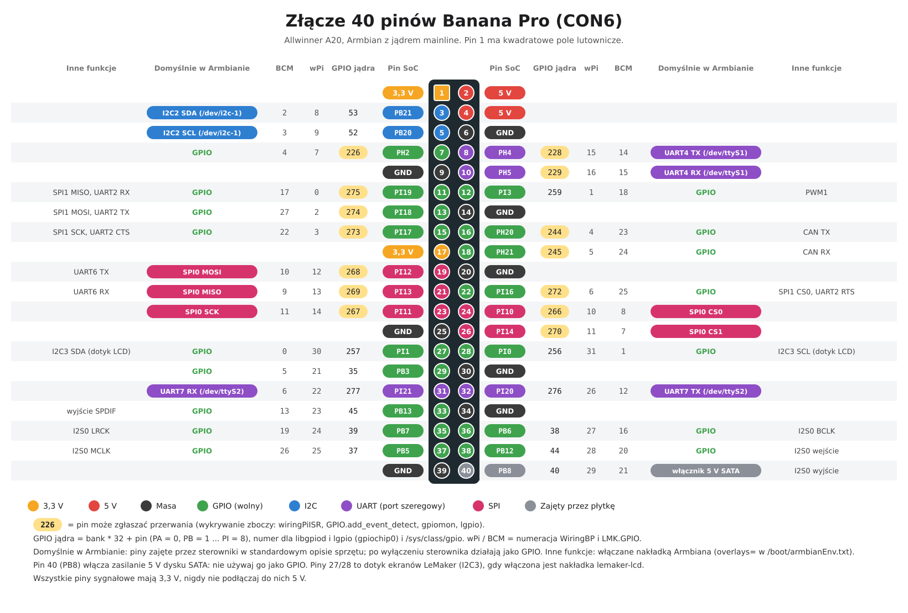

[English](README.md) | **Polski**

# GPIO w Banana Pro

Wszystko, czego potrzeba do korzystania ze złącza 40 pinów **LeMaker Banana Pro** (Allwinner A20) na obecnym Armbianie (Debian 13, jądro mainline):

- [grafika i tabela pinów](#piny): który pin to co, numery dla każdej biblioteki
- standardowe narzędzia Linuksa [libgpiod](#1-libgpiod-standardowy-sposób-linuksa) (`gpioset`, `gpiomon`, moduł Pythona `gpiod`)
- [WiringBP](#2-wiringbp-biblioteka-c-i-polecenie-gpio): WiringPi przerobione dla Banana Pro (biblioteka C i polecenie `gpio`, `gpio readall`)
- [LMK.GPIO](#3-lmkgpio-python-api-rpigpio): RPi.GPIO przerobione dla Banana Pro (Python)
- [lg (lgpio, rgpio)](#4-lg-lgpio-i-rgpio-zamiast-pigpio): następca pigpio od tego samego autora, dla każdej płytki z Linuksem: programowy PWM i serwa na dowolnym pinie, powiadomienia o zmianach stanu, sterowanie przez sieć
- [przykładowe programy](examples/) dla nich wszystkich i opis włączania [I2C, SPI, UART i PWM](#i2c-spi-uart-i-sprzętowy-pwm)

WiringBP i LMK.GPIO napisał LeMaker dla starego jądra sunxi 3.4 i nie były aktualizowane od lat 2016-2019. Wersje w tym repozytorium są poprawione pod jądro mainline i Pythona 3.13 (zobacz [Zmiany](#zmiany-względem-oryginalnych-wersji)). lg wymagał jednej poprawki dla A20 (numery GPIO powyżej 255). Wszystko na tej stronie sprawdziłem na Banana Pro z Armbianem 6.18.62 (listopad 2026).

## Spis treści

- [Piny](#piny)
- [Numery pinów](#numery-pinów)
- [Bezpieczeństwo](#bezpieczeństwo)
- [Którego narzędzia użyć](#którego-narzędzia-użyć)
- [Układ do przykładów](#układ-do-przykładów)
- [1. libgpiod: standardowy sposób Linuksa](#1-libgpiod-standardowy-sposób-linuksa)
- [2. WiringBP: biblioteka C i polecenie gpio](#2-wiringbp-biblioteka-c-i-polecenie-gpio)
- [3. LMK.GPIO: Python, API RPi.GPIO](#3-lmkgpio-python-api-rpigpio)
- [4. lg: lgpio i rgpio zamiast pigpio](#4-lg-lgpio-i-rgpio-zamiast-pigpio)
- [I2C, SPI, UART i sprzętowy PWM](#i2c-spi-uart-i-sprzętowy-pwm)
- [Rozwiązywanie problemów](#rozwiązywanie-problemów)
- [Zmiany względem oryginalnych wersji](#zmiany-względem-oryginalnych-wersji)
- [Licencje](#licencje)

## Piny



([SVG](pinout/bananapro-pinout-pl.svg), tworzone przez [pinout/generuj-pinout.py](pinout/generuj-pinout.py) razem z tabelą poniżej; wersja angielska: [bananapro-pinout.png](pinout/bananapro-pinout.png).)

<!-- PINS START -->
<!-- Wygenerowane przez pinout/generuj-pinout.py, nie zmieniaj ręcznie. -->

| Pin | Pin SoC | GPIO jądra | wPi | BCM | Przerwania | Domyślnie w Armbianie | Inne funkcje |
|---:|---|---:|---:|---:|:---:|---|---|
| 1 | **3,3 V** | | | | | | |
| 2 | **5 V** | | | | | | |
| 3 | PB21 | 53 | 8 | 2 |  | I2C2 SDA (/dev/i2c-1) |  |
| 4 | **5 V** | | | | | | |
| 5 | PB20 | 52 | 9 | 3 |  | I2C2 SCL (/dev/i2c-1) |  |
| 6 | **GND** | | | | | | |
| 7 | PH2 | 226 | 7 | 4 | tak | GPIO |  |
| 8 | PH4 | 228 | 15 | 14 | tak | UART4 TX (/dev/ttyS1) |  |
| 9 | **GND** | | | | | | |
| 10 | PH5 | 229 | 16 | 15 | tak | UART4 RX (/dev/ttyS1) |  |
| 11 | PI19 | 275 | 0 | 17 | tak | GPIO | SPI1 MISO, UART2 RX |
| 12 | PI3 | 259 | 1 | 18 |  | GPIO | PWM1 |
| 13 | PI18 | 274 | 2 | 27 | tak | GPIO | SPI1 MOSI, UART2 TX |
| 14 | **GND** | | | | | | |
| 15 | PI17 | 273 | 3 | 22 | tak | GPIO | SPI1 SCK, UART2 CTS |
| 16 | PH20 | 244 | 4 | 23 | tak | GPIO | CAN TX |
| 17 | **3,3 V** | | | | | | |
| 18 | PH21 | 245 | 5 | 24 | tak | GPIO | CAN RX |
| 19 | PI12 | 268 | 12 | 10 | tak | SPI0 MOSI | UART6 TX |
| 20 | **GND** | | | | | | |
| 21 | PI13 | 269 | 13 | 9 | tak | SPI0 MISO | UART6 RX |
| 22 | PI16 | 272 | 6 | 25 | tak | GPIO | SPI1 CS0, UART2 RTS |
| 23 | PI11 | 267 | 14 | 11 | tak | SPI0 SCK |  |
| 24 | PI10 | 266 | 10 | 8 | tak | SPI0 CS0 |  |
| 25 | **GND** | | | | | | |
| 26 | PI14 | 270 | 11 | 7 | tak | SPI0 CS1 |  |
| 27 | PI1 | 257 | 30 | 0 |  | GPIO | I2C3 SDA (dotyk LCD) |
| 28 | PI0 | 256 | 31 | 1 |  | GPIO | I2C3 SCL (dotyk LCD) |
| 29 | PB3 | 35 | 21 | 5 |  | GPIO |  |
| 30 | **GND** | | | | | | |
| 31 | PI21 | 277 | 22 | 6 |  | UART7 RX (/dev/ttyS2) |  |
| 32 | PI20 | 276 | 26 | 12 |  | UART7 TX (/dev/ttyS2) |  |
| 33 | PB13 | 45 | 23 | 13 |  | GPIO | wyjście SPDIF |
| 34 | **GND** | | | | | | |
| 35 | PB7 | 39 | 24 | 19 |  | GPIO | I2S0 LRCK |
| 36 | PB6 | 38 | 27 | 16 |  | GPIO | I2S0 BCLK |
| 37 | PB5 | 37 | 25 | 26 |  | GPIO | I2S0 MCLK |
| 38 | PB12 | 44 | 28 | 20 |  | GPIO | I2S0 wejście |
| 39 | **GND** | | | | | | |
| 40 | PB8 | 40 | 29 | 21 |  | włącznik 5 V SATA | I2S0 wyjście |
<!-- PINS END -->

**Domyślnie w Armbianie** oznacza, że standardowy opis sprzętu Banana Pro w Armbianie oddaje już ten pin sterownikowi: I2C2 na pinach 3/5, porty szeregowe UART4 (piny 8/10) i UART7 (piny 31/32), SPI0 (piny 19-26). WiringBP i LMK.GPIO mogą te piny przełączyć na GPIO, ale wtedy sterownik przestaje działać aż do restartu. **Inne funkcje** włącza się [nakładką Armbiana](#i2c-spi-uart-i-sprzętowy-pwm).

## Numery pinów

Pin ma kilka numerów, a każde narzędzie używa innego. Przykład, fizyczny pin 11:

| Nazwa | Pin 11 | Kto używa |
|---|---|---|
| fizyczny (na płytce) | 11 | LMK.GPIO `GPIO.BOARD`, WiringBP `wiringPiSetupPhys()`, `gpio -1` |
| pin SoC | PI19 | dokumentacja procesora, parametry nakładek Armbiana (`param_w1_pin=PI19`) |
| GPIO jądra | 275 | libgpiod i lgpio (`gpiochip0`, linia 275), `/sys/class/gpio/gpio275` |
| wPi | 0 | WiringBP `wiringPiSetup()`, domyślnie polecenie `gpio` |
| BCM | 17 | LMK.GPIO `GPIO.BCM`, WiringBP `wiringPiSetupGpio()`, `gpio -g` |

Numer GPIO jądra wylicza się z pinu SoC: **bank × 32 + pin**, gdzie PA = 0, PB = 1 ... PI = 8. PI19 = 8 × 32 + 19 = 275. Numery wPi i BCM powtarzają numerację Raspberry Pi dla tego samego miejsca na złączu, żeby programy pisane dla Raspberry Pi działały z niewielkimi zmianami.

## Bezpieczeństwo

- **Wszystkie piny sygnałowe mają 3,3 V.** Nigdy nie podłączaj do nich 5 V (czujniki na 5 V potrzebują konwertera poziomów). Piny 2 i 4 to wyjście zasilania 5 V.
- Pin GPIO daje tylko kilka mA: dioda LED zawsze z rezystorem (330 Ω), silniki i przekaźniki przez tranzystor albo moduł sterownika.
- **Pin 40 (PB8) włącza zasilanie 5 V dysku SATA.** Nie używaj go jako GPIO, wpisanie 0 odcina zasilanie dysku.
- **Piny 27/28** to magistrala układu dotyku ekranów LeMakera (I2C3), gdy włączona jest nakładka `lemaker-lcd`. Wtedy nie używaj ich jako GPIO.
- WiringBP i LMK.GPIO zapisują rejestry GPIO bezpośrednio (`/dev/mem`), więc wymagają roota (`sudo`), a jądro nie wie o ich zmianach. Nie przełączaj pinów używanych przez sterowniki (zobacz tabelę), chyba że wiesz, co robisz.

## Którego narzędzia użyć

| | libgpiod | WiringBP | LMK.GPIO | lg (lgpio) |
|---|---|---|---|---|
| Język | powłoka, C, Python, C++ | C, powłoka (`gpio`) | Python 3 | C, Python, powłoka (`rgs`) |
| Instalacja | `apt install` | kompilacja z tego repozytorium | kompilacja z tego repozytorium | kompilacja z tego repozytorium |
| Numery pinów | GPIO jądra (275) | wPi, BCM albo fizyczne | fizyczne albo BCM | GPIO jądra (275) |
| Podciąganie do 3,3 V / do masy | tak | tak | tak | tak |
| Przerwania (zbocza) | tak | tak (`wiringPiISR`) | tak (`add_event_detect`) | tak (powiadomienia, czas w ns) |
| PWM | PWM jądra (`/sys/class/pwm`) | sprzętowy PWM na pinie 12, programowy PWM na dowolnym pinie | programowy PWM na dowolnym pinie | programowy PWM, impulsy serw i ciągi impulsów na dowolnym pinie |
| Podgląd pinów | `gpioinfo` (same numery) | **`gpio readall`** (tabela z trybami i stanami) | `GPIO.gpio_function()` | `gpio_get_line_info()` |
| Przeniesione z Raspberry Pi | | programy dla WiringPi | programy dla RPi.GPIO | programy dla lgpio; programy dla pigpio po zamianie wywołań na podobne z lgpio |
| Sterowanie przez sieć | | | | tak (`rgpiod` + `rgpio`) |
| Wymaga roota | tak (`/dev/gpiochip0`) | tak | tak | tak (`/dev/gpiochip0`) |

- Nowe programy: **libgpiod**. To oficjalny interfejs jądra, jest w Debianie i nie zmienia sprzętu za plecami jądra.
- Gotowe programy z Raspberry Pi: **LMK.GPIO** dla Pythona (zmiana importu), **WiringBP** dla C, **lg** dla programów pisanych pod lgpio albo pigpio.
- Serwa, PWM na wielu pinach, sterowanie z innego komputera: **lg**.
- Podgląd pinów: **`gpio readall`**.

## Układ do przykładów

Wszystkie przykłady używają tych samych dwóch elementów, więc jeden układ na płytce stykowej pasuje do wszystkiego:

```
 pin 11 (PI19) ──[ 330 Ω ]──►|── pin 9 (GND)       dioda LED, dłuższa nóżka (+) od strony rezystora
 pin 13 (PI18) ──[ przycisk ]─── pin 14 (GND)      przycisk, używane jest wewnętrzne podciąganie do 3,3 V
```

| Element | Fizyczny | SoC | GPIO jądra | wPi | BCM |
|---|---:|---|---:|---:|---:|
| Dioda LED | 11 | PI19 | 275 | 0 | 17 |
| Przycisk | 13 | PI18 | 274 | 2 | 27 |

Oba piny są w Armbianie wolne i mogą zgłaszać przerwania. Przycisk zwiera pin do masy, więc naciśnięcie to *zbocze opadające*.

Przykłady są w [examples/](examples/) i były uruchomione na płytce (naciśnięcia przycisku symulowało przełączanie wewnętrznego rezystora podciągającego).

## 1. libgpiod: standardowy sposób Linuksa

Instalacja (Debian 13 ma libgpiod 2.2):

```bash
sudo apt install gpiod python3-libgpiod
```

### Wiersz poleceń

```bash
sudo gpiodetect                          # lista kontrolerów GPIO
sudo gpioinfo -c gpiochip0 275           # stan jednej linii (pin 11)
sudo gpioset -c gpiochip0 -t 0 275=1     # pin 11 w stan wysoki i koniec (pin zostaje w tym stanie)
sudo gpioset -c gpiochip0 -t 0 275=0     # pin 11 w stan niski
sudo gpioget -c gpiochip0 -b pull-up 274 # odczyt pinu 13 z wewnętrznym podciąganiem
sudo gpiomon -c gpiochip0 -b pull-up -e falling -p 200ms 274   # wypisuje każde naciśnięcie przycisku, Ctrl+C kończy
```

`gpiochip0` to kontroler GPIO procesora A20 (288 linii, numery GPIO jądra 0-287). `gpiochip1` to układ zasilania AXP209, nie złącze. Linie nie mają na tej płytce nazw, używaj numerów z tabeli pinów. Bez `-t 0` `gpioset` działa dalej i trzyma pin, aż naciśniesz Ctrl+C.

Wynik z płytki:

```
$ sudo gpiomon -c gpiochip0 -b pull-up -e falling -p 200ms 274
2760.484051478	falling	gpiochip0 274
2761.320056049	falling	gpiochip0 274
```

### Python

```python
import time
import gpiod
from gpiod.line import Direction, Value

LED = 275   # fizyczny pin 11
with gpiod.request_lines("/dev/gpiochip0", consumer="blink",
                         config={LED: gpiod.LineSettings(direction=Direction.OUTPUT)}) as req:
    req.set_value(LED, Value.ACTIVE)
    time.sleep(1)
    req.set_value(LED, Value.INACTIVE)
```

Przykłady: [blink.sh](examples/libgpiod/blink.sh), [button.sh](examples/libgpiod/button.sh), [blink_gpiod.py](examples/libgpiod/blink_gpiod.py), [button_gpiod.py](examples/libgpiod/button_gpiod.py) (zdarzenia zboczy z eliminacją drgań styków). Uruchamiaj je przez `sudo`.

Dokumentacja libgpiod: https://libgpiod.readthedocs.io/

## 2. WiringBP: biblioteka C i polecenie gpio

### Instalacja

```bash
sudo apt install git build-essential
git clone https://github.com/cyryllo/banana-a20.git
cd banana-a20/gpio/WiringBP
sudo ./build
gpio -v          # "Banana Pro Details: Type: Banana Pro, Revision: 1.2, Memory: 1024MB, Maker: LeMaker"
```

`./build` kompiluje i instaluje bibliotekę w `/usr/local/lib`, nagłówki w `/usr/local/include` i polecenie `gpio` w `/usr/local/bin`. Usuwanie: `sudo rm /usr/local/lib/libwiringPi* /usr/local/lib/libwiringPiDev* /usr/local/bin/gpio && sudo ldconfig`.

### Polecenie gpio

```bash
sudo gpio readall        # tabela całego złącza: tryby (IN/OUT/ALT) i stany
sudo gpio mode 0 out     # wPi 0 (pin 11) jako wyjście
sudo gpio write 0 1      # stan wysoki
sudo gpio read 0         # odczyt stanu
sudo gpio toggle 0       # odwrócenie stanu
sudo gpio mode 2 up      # wPi 2 (pin 13): podciąganie do 3,3 V (też: down = do masy, tri = brak)
sudo gpio mode 0 in      # z powrotem wejście
sudo gpio -1 read 11     # -1: numery fizyczne, -g: numery BCM
sudo gpio edge 17 falling   # wykrywanie zboczy w jądrze na BCM 17 (pin 11), dla wiringPiISR w innych programach
sudo gpio unexportall    # zwolnienie wszystkich pinów z /sys/class/gpio
sudo gpio i2cdetect      # skan magistrali I2C na pinach 3/5 (wymaga i2c-tools; komunikat "I2C kernel module(s) are not loaded" można pominąć)
```

Podgląd złącza na żywo: `watch -n 0.5 sudo gpio readall`.

Fragment wyniku `gpio readall`:

```
 +-----+-----+---------+------+---+--Banana Pro--+---+------+---------+-----+-----+
 | BCM | wPi |   Name  | Mode | V | Physical | V | Mode | Name    | wPi | BCM |
 +-----+-----+---------+------+---+----++----+---+------+---------+-----+-----+
 |     |     |    3.3v |      |   |  1 || 2  |   |      | 5v      |     |     |
 |   2 |   8 |   SDA.1 | ALT5 | 1 |  3 || 4  |   |      | 5V      |     |     |
 |   3 |   9 |   SCL.1 | ALT5 | 1 |  5 || 6  |   |      | 0v      |     |     |
 |   4 |   7 | GPIO. 7 |   IN | 0 |  7 || 8  | 0 | ALT0 | TxD     | 15  | 14  |
 |     |     |      0v |      |   |  9 || 10 | 0 | ALT0 | RxD     | 16  | 15  |
 |  17 |   0 | GPIO. 0 |   IN | 0 | 11 || 12 | 0 | IN   | GPIO. 1 | 1   | 18  |
```

Nazwy w `readall` (SDA.1, TxD, MOSI...) to nazwy tych samych miejsc w Raspberry Pi. Prawdziwe funkcje pinów Banana Pro są w [tabeli pinów](#piny) (np. piny 8/10 to UART4).

### Biblioteka C

```c
#include <wiringPi.h>

int main (void)
{
  wiringPiSetup () ;            /* numery wPi; wiringPiSetupGpio () = BCM, wiringPiSetupPhys () = fizyczne */
  pinMode (0, OUTPUT) ;         /* pin 11 */
  digitalWrite (0, HIGH) ;
  delay (1000) ;
  digitalWrite (0, LOW) ;
  return 0 ;
}
```

Kompilacja: `gcc -o blink blink.c -lwiringPi -lpthread -lm -lcrypt -lrt`, uruchomienie: `sudo ./blink`.

Najczęściej używane funkcje (API takie samo jak w WiringPi 2):

| Funkcja | Co robi |
|---|---|
| `wiringPiSetup()`, `wiringPiSetupGpio()`, `wiringPiSetupPhys()` | start, z numerami wPi / BCM / fizycznymi (root) |
| `pinMode(pin, INPUT / OUTPUT / PWM_OUTPUT)` | kierunek pinu; `PWM_OUTPUT` tylko na pinie 12 |
| `digitalWrite(pin, HIGH / LOW)`, `digitalRead(pin)` | zapis / odczyt |
| `pullUpDnControl(pin, PUD_UP / PUD_DOWN / PUD_OFF)` | wewnętrzny rezystor podciągający |
| `wiringPiISR(pin, INT_EDGE_FALLING / RISING / BOTH, funkcja)` | wywołuje `funkcja` przy każdym zboczu (w osobnym wątku) |
| `softPwmCreate(pin, 0, 100)`, `softPwmWrite(pin, wartość)` | programowy PWM na dowolnym pinie (`#include <softPwm.h>`) |
| `pwmWrite(pin, wartość)` | sprzętowy PWM na pinie 12 (wPi 1), wartość 0-1024 |
| `delay(ms)`, `delayMicroseconds(us)`, `millis()` | czas |
| `wiringPiI2CSetup(adres)` + `wiringPiI2CReadReg8()` ... | I2C na pinach 3/5 (`#include <wiringPiI2C.h>`) |
| `wiringPiSPISetup(kanał, prędkość)` | SPI przez `/dev/spidev0.<kanał>` (wymaga nakładki `spi-spidev`) |

Pełny opis API: oryginalna dokumentacja WiringPi (archiwum) https://web.archive.org/web/2019/http://wiringpi.com/reference/ .

Przykłady ([examples/c-wiringbp/](examples/c-wiringbp/)), kompilacja poleceniem `make`:

| Program | Co pokazuje |
|---|---|
| [blink.c](examples/c-wiringbp/blink.c) | miganie diodą |
| [button_isr.c](examples/c-wiringbp/button_isr.c) | przycisk na przerwaniu z eliminacją drgań styków, przełącza diodę |
| [soft_pwm.c](examples/c-wiringbp/soft_pwm.c) | płynne rozjaśnianie i ściemnianie diody programowym PWM |

Stare przykłady LeMakera i WiringPi są w [WiringBP/examples/](WiringBP/examples/) (nie wszystkie sprawdzone).

## 3. LMK.GPIO: Python, API RPi.GPIO

### Instalacja

```bash
sudo apt install git build-essential python3-dev python3-setuptools python3-pip
git clone https://github.com/cyryllo/banana-a20.git     # jeśli jeszcze nie
cd banana-a20/gpio/LMK.GPIO
python3 -m pip wheel --no-deps --no-build-isolation -w dist .
sudo pip install --break-system-packages dist/*.whl
```

Pierwszy `pip` buduje pakiet (`dist/lmk_gpio-...whl`) jako zwykły użytkownik, drugi instaluje go dla wszystkich (też dla `sudo python3`). `--break-system-packages` jest potrzebne, bo Debian 13 chroni systemowego Pythona przed `pip`; LMK.GPIO nie ma w Debianie, więc nie ma konfliktu. Nie uruchamiaj budowania przez `sudo`, bo zostawia w katalogu źródeł pliki należące do roota. Usuwanie: `sudo pip uninstall --break-system-packages LMK.GPIO`.

### Użycie

API jest takie samo jak w RPi.GPIO, w programach dla Raspberry Pi wystarczy zmienić import:

```python
import LMK.GPIO as GPIO        # zamiast: import RPi.GPIO as GPIO

GPIO.setmode(GPIO.BOARD)       # numery fizyczne; GPIO.BCM = numery BCM z Raspberry Pi
GPIO.setup(11, GPIO.OUT)
GPIO.output(11, GPIO.HIGH)
GPIO.setup(13, GPIO.IN, pull_up_down=GPIO.PUD_UP)
print(GPIO.input(13))
GPIO.cleanup()                 # na koniec z powrotem wejścia
```

| Funkcja | Co robi |
|---|---|
| `GPIO.setmode(GPIO.BOARD / GPIO.BCM)` | numeracja pinów |
| `GPIO.setup(pin, GPIO.IN / GPIO.OUT, pull_up_down=GPIO.PUD_UP / PUD_DOWN / PUD_OFF, initial=...)` | kierunek pinu i rezystor podciągający |
| `GPIO.output(pin, wartość)`, `GPIO.input(pin)` | zapis / odczyt |
| `GPIO.add_event_detect(pin, GPIO.FALLING / RISING / BOTH, callback=f, bouncetime=ms)` | wywołuje `f(pin)` przy każdym zboczu, w osobnym wątku |
| `GPIO.wait_for_edge(pin, zbocze)` | czeka na jedno zbocze |
| `GPIO.event_detected(pin)` | czy od ostatniego wywołania było zbocze (z `add_event_detect` bez funkcji) |
| `GPIO.remove_event_detect(pin)` | wyłącza wykrywanie zboczy |
| `pwm = GPIO.PWM(pin, częstotliwość)`, `pwm.start(wypełnienie)`, `pwm.ChangeDutyCycle(wypełnienie)`, `pwm.stop()` | programowy PWM, wypełnienie w procentach |
| `GPIO.gpio_function(pin)` | obecny tryb: `GPIO.IN`, `GPIO.OUT`, `GPIO.I2C`, `GPIO.SPI`... |
| `GPIO.cleanup()` | przywraca piny użyte przez program |
| `GPIO.setwarnings(False)` | bez ostrzeżeń o pinach już w użyciu |
| `GPIO.VERSION`, `GPIO.LMK_REVISION` | wersja biblioteki (1.0.0), wersja płytki |

Piny z przerwaniami: `add_event_detect` działa tylko na pinach z żółtym numerem GPIO jądra w tabeli pinów (fizyczne 7, 8, 10, 11, 13, 15, 16, 18, 19, 21, 22, 23, 24, 26).

Przykłady ([examples/python-lmk/](examples/python-lmk/)), uruchamianie: `sudo python3 <plik>`:

| Program | Co pokazuje |
|---|---|
| [blink.py](examples/python-lmk/blink.py) | miganie diodą |
| [button.py](examples/python-lmk/button.py) | przycisk z funkcją wywoływaną przy zdarzeniu i `bouncetime`, przełącza diodę |
| [pwm_led.py](examples/python-lmk/pwm_led.py) | płynne rozjaśnianie i ściemnianie diody programowym PWM |
| [inputs.py](examples/python-lmk/inputs.py) | stany wszystkich wolnych pinów na żywo, bez podłączania czegokolwiek |

Stare testy LeMakera są w [LMK.GPIO/test/](LMK.GPIO/test/).

## 4. lg: lgpio i rgpio zamiast pigpio

[pigpio](https://github.com/joan2937/pigpio) nie ruszy na Banana Pro: jego precyzyjne taktowanie bierze się z kontrolera DMA procesora Raspberry Pi (taktowanego przez jego układ PWM/PCM, z pamięcią od VideoCore), a A20 nie ma czym tego zastąpić. DMA w A20 nie potrafi wykonywać niekończących się łańcuchów transferów, a GPIO w A20 ma jeden rejestr danych na bank zamiast osobnych rejestrów do ustawiania i zerowania pinów. pigpio nie jest też już rozwijane (ostatnie wydanie v79, marzec 2021) i nie działa nawet na Raspberry Pi 5.

Jego autor (joan2937) napisał następcę dla każdej płytki z Linuksem: **[lg](https://github.com/joan2937/lg)**, dołączony tutaj w [lg/](lg/). Korzysta wyłącznie ze standardowego interfejsu jądra (`/dev/gpiochip`), więc działa na A20 bez zmian, poza jedną poprawką z tego repozytorium (powiadomienia na numerach GPIO powyżej 255, zobacz [Zmiany](#zmiany-względem-oryginalnych-wersji), zgłoszone jako [lg#49](https://github.com/joan2937/lg/issues/49)). Zawiera:

- **lgpio**: bibliotekę C i moduł Pythona: GPIO, powiadomienia o zmianach stanu ze znacznikami czasu z jądra, programowy PWM, impulsy serw i ciągi impulsów na dowolnym pinie, I2C, SPI, port szeregowy,
- **rgpiod** + **rgpio**: demona na płytce i klienta C/Python do sterowania pinami z innego komputera przez sieć (jak `pigpiod`), oraz polecenie powłoki `rgs`.

### Instalacja

```bash
sudo apt install git build-essential python3-dev python3-setuptools swig
git clone https://github.com/cyryllo/banana-a20.git     # jeśli jeszcze nie
cd banana-a20/gpio/lg
make
sudo make install
```

Instaluje `liblgpio`/`librgpio` w `/usr/local/lib`, nagłówki w `/usr/local/include`, `rgpiod` i `rgs` w `/usr/local/bin` oraz moduły Pythona `lgpio` i `rgpio` (kilka minut na płytce). Użyj tej kopii, nie oryginału: oryginał zgłasza piny powyżej 255 (bank PI, większość złącza) ze złym numerem, więc funkcje Pythona przypięte do tych pinów nigdy się nie wywołują.

lgpio trzyma swoje kanały powiadomień (`.lgd-nfy*`) w **bieżącym katalogu** i przechodzi do niego: uruchamiaj programy z katalogu z prawem zapisu (nie z `/`) albo ustaw `LG_WD`, np. `sudo LG_WD=/tmp python3 program.py`.

### Użycie

```python
import lgpio

h = lgpio.gpiochip_open(0)                 # gpiochip0 = GPIO procesora A20
lgpio.gpio_claim_output(h, 275, 0)         # pin 11
lgpio.gpio_write(h, 275, 1)
lgpio.tx_pwm(h, 275, 200, 25)              # 200 Hz, 25 %
lgpio.tx_servo(h, 275, 1500, 50)           # impuls serwa 1500 us, 50 Hz

lgpio.gpio_claim_alert(h, 274, lgpio.FALLING_EDGE, lgpio.SET_PULL_UP)   # pin 13
cb = lgpio.callback(h, 274, lgpio.FALLING_EDGE,
                    lambda chip, gpio, level, timestamp: print(gpio, level, timestamp))
```

W C: `#include <lgpio.h>`, funkcje `lgGpiochipOpen`, `lgGpioClaimOutput`, `lgGpioWrite`, `lgTxPwm`, `lgTxServo`, `lgGpioClaimAlert`, `lgGpioSetAlertsFunc`..., kompilacja z `-llgpio`. W funkcjach obsługi powiadomień używaj `report.gpio16` (pełny numer), `report.gpio` ma tylko dolne 8 bitów. Pełna dokumentacja (po angielsku): [lg/README.md](lg/README.md), `man lgpio`, `man rgpio` i w sieci: https://abyz.me.uk/lg/

**Sterowanie przez sieć.** Na płytce: `sudo rgpiod -n <IP Twojego komputera>` (port 8889). Bez `-n` (albo `-l` dla połączeń tylko z płytki) **każdy w sieci może przełączać piny**. Na komputerze: `rgpio.sbc("<IP płytki>")`, potem te same funkcje co w lgpio, zobacz [remote_blink.py](examples/python-lgpio/remote_blink.py).

### Dokładność czasu

PWM i impulsy serw są taktowane programowo (wątek z `clock_nanosleep`), więc zależą od obciążenia procesora. Pomiar na płytce (pin 11, stan odczytywany 1,7 mln razy na sekundę):

| Sygnał | Ustawione | Płytka bez obciążenia | Płytka obciążona (RetroArch z grą) |
|---|---|---|---|
| PWM 50 Hz, 25 % | 5000 µs w stanie wysokim | 50,0 Hz, 5086-5169 µs | 45,9-50,1 Hz, 5265-5629 µs |
| PWM 1 kHz, 50 % | 500 µs w stanie wysokim | 900-992 Hz, 508-509 µs | 934-1009 Hz, 469-526 µs |
| serwo 1500 µs | 1500 µs | 1505-1533 µs | 1418-1816 µs |
| serwo 1000 µs | 1000 µs | 1007-1027 µs | 983-1123 µs |
| impulsy 100 µs / 900 µs | 100 µs | ok. 177 µs | |

Wystarczy do diod, silników ze sterownikami i serw na nieobciążonej płytce. Na obciążonej płytce serwa drgają, a krótkie impulsy (poniżej ok. 200 µs) wychodzą za długie. Do dokładnych sygnałów użyj sprzętowego PWM na pinie 12 (zobacz [I2C, SPI, UART i sprzętowy PWM](#i2c-spi-uart-i-sprzętowy-pwm)) albo płytki PCA9685 do serw/PWM na I2C (piny 3/5). Powiadomienia o zmianach na wejściach są dokładne: niosą znacznik czasu z jądra w nanosekundach.

Przykłady ([examples/python-lgpio/](examples/python-lgpio/)), uruchamianie: `sudo python3 <plik>`:

| Program | Co pokazuje |
|---|---|
| [blink.py](examples/python-lgpio/blink.py) | miganie diodą |
| [button_alert.py](examples/python-lgpio/button_alert.py) | przycisk z powiadomieniem, czasem z jądra i eliminacją drgań, przełącza diodę |
| [pwm_led.py](examples/python-lgpio/pwm_led.py) | płynne rozjaśnianie i ściemnianie diody programowym PWM |
| [servo.py](examples/python-lgpio/servo.py) | serwo: oba skrajne położenia i środek |
| [remote_blink.py](examples/python-lgpio/remote_blink.py) | dioda sterowana z innego komputera (rgpiod + rgpio) |

Oryginalne przykłady lg są w [lg/EXAMPLES/](lg/EXAMPLES/).

## I2C, SPI, UART i sprzętowy PWM

Z tych funkcji korzysta się przez zwykłe urządzenia Linuksa. Funkcje domyślnie wyłączone włącza się nakładkami Armbiana w `/boot/armbianEnv.txt` (`sudo nano /boot/armbianEnv.txt`, potem restart). Nakładki wpisuje się w jednej linii `overlays=`, oddzielone spacjami, razem z ekranem LCD, jeśli jest:

```
overlays=lemaker-lcd7 pwm spi-spidev
param_spidev_spi_bus=0
```

Wszystkie nakładki A20 i ich parametry: `/boot/dtb/allwinner/overlay/README.sun7i-a20-overlays` na płytce.

| Funkcja | Piny | Włączenie | Urządzenie | Sprawdzone na płytce |
|---|---|---|---|---|
| I2C2 | 3 (SDA), 5 (SCL) | domyślnie włączone | `/dev/i2c-1` | tak (`i2cdetect -y 1`) |
| I2C3 | 27 (SDA), 28 (SCL) | nakładka `i2c3` albo `lemaker-lcd` (dotyk) | `/dev/i2c-2` | tak (dotyk LCD) |
| UART4 | 8 (TX), 10 (RX) | domyślnie włączone | `/dev/ttyS1` | urządzenie jest |
| UART7 | 32 (TX), 31 (RX) | domyślnie włączone | `/dev/ttyS2` | urządzenie jest |
| SPI0 | 19 (MOSI), 21 (MISO), 23 (SCK), 24 (CS0), 26 (CS1) | `spi-spidev` + `param_spidev_spi_bus=0` | `/dev/spidev0.0` | urządzenie jest |
| PWM1 | 12 | `pwm` | `/sys/class/pwm/pwmchip0/pwm1` | tak, razem z podświetleniem LCD |
| SPI1 | 13 (MOSI), 11 (MISO), 15 (SCK), 22 (CS0) | `spi1` + `spi-spidev` + `param_spidev_spi_bus=1` | `/dev/spidev1.0` | nie (dokumentacja Armbiana) |
| UART2 | 13 (TX), 11 (RX) | `uart2` | następny wolny `/dev/ttyS*` | nie (dokumentacja Armbiana) |
| CAN | 16 (TX), 18 (RX) | `can` | `can0` | nie (dokumentacja Armbiana) |
| 1-Wire | dowolny wolny pin | `w1-gpio` + `param_w1_pin=PI19` | `/sys/bus/w1/devices/` | nie (dokumentacja Armbiana) |

Uwagi:

- Numery urządzeń I2C i portów szeregowych są nadawane w kolejności, w jakiej jądro znajduje kontrolery. Mogą się zmienić po włączeniu kolejnych magistral: sprawdzisz je poleceniami `ls -l /sys/class/i2c-dev/` (TWI2 = `1c2b400.i2c`) i `ls -l /sys/class/tty/ttyS*/device`.
- `/dev/ttyS0` to konsola diagnostyczna (UART0, na osobnym małym złączu), nie na złączu 40 pinów.
- **PWM i podświetlenie LCD:** A20 ma dwa kanały PWM. PWM0 steruje podświetleniem ekranów LeMakera (PB2, nie ma go na złączu), PWM1 to pin 12. Z ekranem LCD zostaw domyślne ustawienie nakładki `pwm` (oba kanały). `param_pwm_pins=1` odebrałoby PB2 podświetleniu i ekran by zgasł.
- Sprzętowy PWM z WiringBP (`gpio mode 1 pwm`) i sterownik PWM jądra korzystają z tych samych rejestrów: używaj jednego z nich, nie obu naraz.

### Przykłady

```bash
sudo apt install i2c-tools
sudo i2cdetect -y 1                       # urządzenia na magistrali I2C pinów 3/5

# sprzętowy PWM na pinie 12: 1 kHz, 25 % (nakładka "pwm")
echo 1 | sudo tee /sys/class/pwm/pwmchip0/export
echo 1000000 | sudo tee /sys/class/pwm/pwmchip0/pwm1/period       # ns
echo 250000  | sudo tee /sys/class/pwm/pwmchip0/pwm1/duty_cycle   # ns
echo 1 | sudo tee /sys/class/pwm/pwmchip0/pwm1/enable

# port szeregowy na pinach 8/10, 115200 bodów
sudo apt install picocom
sudo picocom -b 115200 /dev/ttyS1         # wyjście: Ctrl+A Ctrl+X
```

## Rozwiązywanie problemów

| Problem | Przyczyna i rozwiązanie |
|---|---|
| `Unable to open /dev/mem` / `No access to /dev/mem. Try running as root!` | uruchom przez `sudo` |
| `gpioset: ... Device or resource busy`, `Failed to add edge detection` | inny program trzyma pin. `wiringPiISR` i `gpio edge` z WiringBP zostawiają pin w `/sys/class/gpio` po zakończeniu: `sudo gpio unexportall` |
| `gpio: command not found` | WiringBP nie jest zainstalowany (`sudo ./build`) albo `/usr/local/bin` nie ma w `PATH` dla `sudo` |
| `wiringPiISR: pin not sunpprt on bananaPi` | ten pin nie zgłasza przerwań, użyj pinu z żółtym numerem w tabeli pinów |
| funkcja lgpio dla pinu się nie wywołuje | użyj lg z tego repozytorium (nie oryginału) i uruchamiaj program z katalogu z prawem zapisu albo z `LG_WD` |
| ekran gaśnie | coś wyzerowało kanał PWM 0 (stary WiringBP, `param_pwm_pins=1`); przywrócenie: `echo 0 \| sudo tee /sys/class/backlight/*/brightness; echo 200 \| sudo tee /sys/class/backlight/*/brightness` |
| `LMK.GPIO: not a Banana Pro/Pi ...` | biblioteka działa tylko na płytkach z A20 (i LeMaker Guitar) |
| pin używany przez I2C/SPI/UART nie reaguje | pin należy do sterownika; wyłącz tę funkcję (nakładkę) albo pogódź się z tym, że biblioteki GPIO przejmą go do restartu |

## Zmiany względem oryginalnych wersji

WiringBP ([LeMaker/WiringBP](https://github.com/LeMaker/WiringBP), gałąź `bananapro`, ostatnia zmiana 2017), LMK.GPIO ([LeMaker/LMK.GPIO](https://github.com/LeMaker/LMK.GPIO), ostatnia zmiana 2016) i lg ([joan2937/lg](https://github.com/joan2937/lg), commit `bcccd78` z lutego 2026) są dołączone z pełną historią. Poprawione pod jądro mainline (wszystko sprawdzone na płytce):

| Biblioteka | Problem na obecnym Armbianie | Poprawka |
|---|---|---|
| WiringBP i LMK.GPIO | numery `/sys/class/gpio` ze starego jądra: BCM 17 trafiało w PA17 (Ethernet) zamiast PI19 | numery GPIO jądra (bank × 32 + pin) dla zboczy, eksportów i przerwań |
| WiringBP | funkcja przerwania wywoływana w kółko (setki tysięcy razy na sekundę) | przewinięcie pliku value przed skasowaniem przerwania |
| WiringBP | `wiringPiI2CSetup` otwierał `/dev/i2c-3` (magistrala DDC HDMI w nowym jądrze) | szukanie magistrali pinów 3/5 po jej adresie |
| WiringBP | sprzętowy PWM gasił podświetlenie LCD (kanał PWM 0) | zmiany tylko w kanale 1 |
| LMK.GPIO | płytka nierozpoznawana (`Hardware : Allwinner sun7i (A20) Family`) | szukanie `sun7i` w całej linii |
| LMK.GPIO | nie kompiluje się z Pythonem 3.13, GCC 14 i bez distutils | poprawki kompilacji, setuptools |
| LMK.GPIO | funkcje zdarzeń dostawały wewnętrzny numer zamiast numeru pinu, wykrywanie zboczy zawodziło, gdy pin był wyeksportowany przez inne narzędzie, niejasny błąd na innych płytkach | poprawione |
| lg | powiadomienia trzymały numer GPIO w 8 bitach: pin 13 (274) przychodził jako 18, funkcje Pythona i rgpio dla pinów powyżej 255 nigdy się nie wywoływały | pełny numer w nowym polu `gpio16` (dawne wypełnienie, ten sam rozmiar struktury), używany przez moduły Pythona i rgpio; zgłoszone autorowi jako [lg#49](https://github.com/joan2937/lg/issues/49) |

Bez zmian i niesprawdzone: gałąź WiringBP dla Banana Pi (bez „Pro”, złącze 26 pinów), kod dla LeMaker Guitar, sterowniki płytek rozszerzeń w `WiringBP/devLib/` i większość starych przykładów.

## Licencje

- WiringBP: GNU LGPL v3 ([WiringBP/COPYING.LESSER](WiringBP/COPYING.LESSER)), na bazie WiringPi Gordona Hendersona.
- LMK.GPIO: na bazie RPi.GPIO Bena Crostona. Pliki źródłowe i `setup.py` mają licencję MIT (copyright LeMaker Team), plik [LMK.GPIO/LICENSE](LMK.GPIO/LICENSE) to GPL v2; obie pozwalają używać, zmieniać i udostępniać, GPL v2 wymaga udostępnienia źródeł razem z programami z nich zbudowanymi.
- lg: domena publiczna ([The Unlicense](lg/UNLICENCE)), autor joan2937.
- Grafika pinów, przykłady i ta dokumentacja: na tych samych zasadach co reszta repozytorium.
