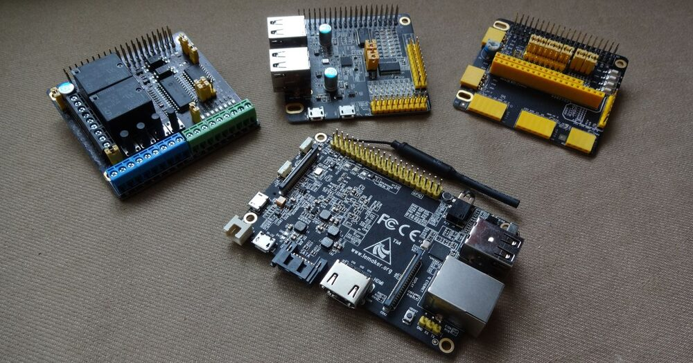
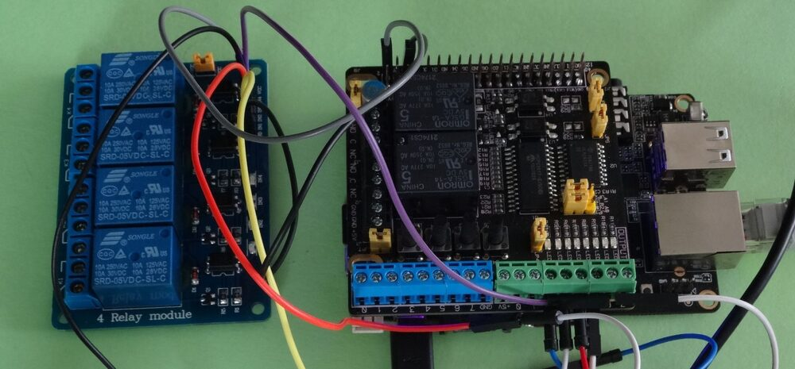
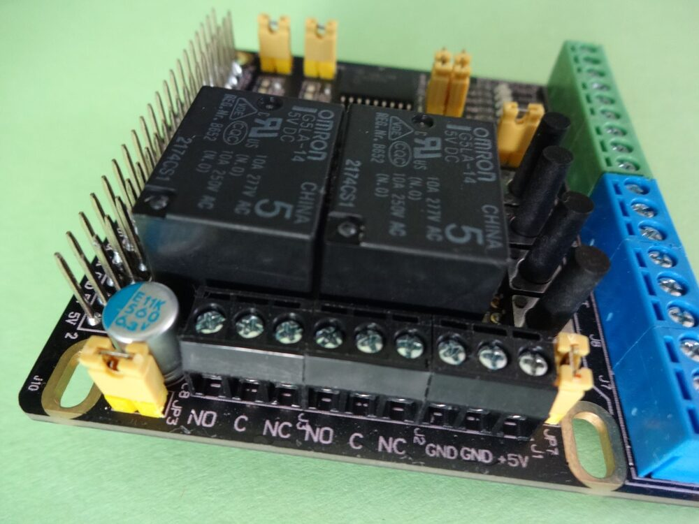
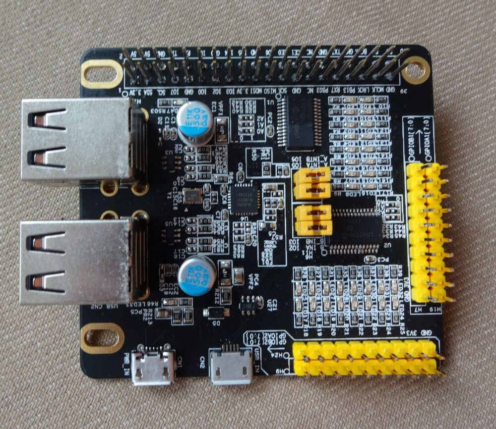
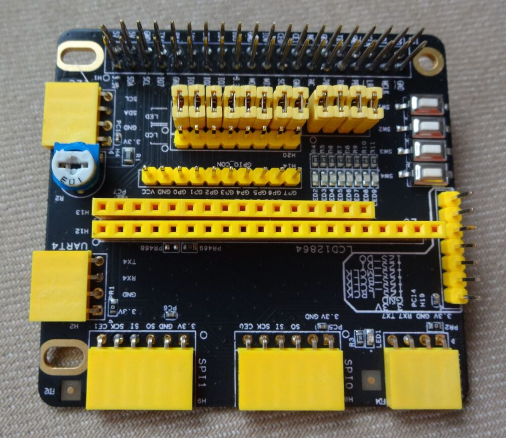

**English** | [Polski](README.pl.md)

# LeMaker expansion boards for the Banana Pro



Around 2015 LeMaker made three expansion boards that plug onto the 40-pin header of the Banana Pro. Here they are described with the pins they use and examples for today's Armbian (Debian 13, mainline kernel), using the libraries from this repository: **WiringBP** (C and the `gpio` command), **lgpio** and **LMK.GPIO** (Python).

| Board | What it has | Chip, bus | Libraries |
|---|---|---|---|
| [LN Digital](#ln-digital) | 8 outputs with LEDs (2 with relays), 8 inputs (4 with buttons) | MCP23S17 on SPI0 + ULN2803 | WiringBP `piFaceSetup()` / `mcp23s17Setup()`, lgpio (SPI) |
| [LN HUB-32IO](#ln-hub-32io) | 32 outputs/inputs with LEDs, 4-port USB hub | 2 × MCP23017 on I2C2 | WiringBP `mcp23017Setup()`, lgpio (I2C) |
| [LN IO](#ln-io) | 8 LEDs, 4 buttons, connectors for LCD 1602/12864, I2C, 2 × SPI, 2 × UART, I2S | none (only wiring) | WiringBP, LMK.GPIO |

> **Status (November 2026):** written from the LeMaker schematics and examples; the examples compile against the `wiringbp` package, but they were **not yet tested with the boards**. Jumper functions come from the schematics, check them on your board.

## Before you start

1. The libraries: the [packages](../README.md#packages-deb) `wiringbp` (C, `gpio`), `python3-lgpio` and `python3-lmk-gpio`.
2. SPI for LN Digital and the SPI connectors of LN IO: in `/boot/armbianEnv.txt` add `spi-spidev` to `overlays=` and the line `param_spidev_spi_bus=0`, then reboot. You get `/dev/spidev0.0` (CE0). The test script does it for you: `sudo ./test-bananapipro.sh --przygotuj` ([testy](../../testy/README.md)). On the old sunxi 3.4 kernel this was the `spi-sun7i` module in `/etc/modules`; that does not apply any more.
3. I2C2 on pins 3 and 5 (LN HUB-32IO, I2C connector of LN IO) is on by default in Armbian (`/dev/i2c-1`).
4. Run the programs with `sudo` (`/dev/spidev*`, `/dev/i2c-*` and `/dev/mem` belong to root).

The examples: [przyklady/c/](przyklady/c/) (WiringBP, `make` builds all) and [przyklady/python/](przyklady/python/).

## LN Digital



A clone of the PiFace Digital for the Raspberry Pi: an MCP23S17 port expander on SPI, port A drives 8 outputs through a ULN2803 (open collector, each with an LED), port B reads 8 inputs. Outputs P0 and P1 can switch the two relays, inputs IN0-IN3 have buttons S1-S4 to GND.

### Pins on the 40-pin header

| Pin | LN Digital | Banana Pro (SoC pin, kernel GPIO, wPi) |
|---:|---|---|
| 1 | 3.3 V | |
| 2, 4 | 5 V (board and relay supply, through JP3) | |
| 6, 9, 14, 20, 25, 30, 34, 39 | GND | |
| 18 | MCP23S17 RESET | PH21, 245, wPi 5 |
| 19 | SPI MOSI | PI12, 268 |
| 21 | SPI MISO | PI13, 269 |
| 22 | MCP23S17 INTB (interrupt from the inputs) | PI16, 272, wPi 6 |
| 23 | SPI SCK | PI11, 267 |
| 24 | SPI CE0 | PI10, 266 |

Pins 18 and 22 are taken by the board: do not use them for anything else while LN Digital is on the header (pin 18 low resets the chip).

### Connectors and jumpers (from the schematic)

| Part | What |
|---|---|
| J7, J8, J9 | inputs IN0-IN7 (screw terminals, through 100 Ω) and GND |
| J4, J5, J6 | outputs P0-P7 (open collector, switch to GND) and 5 V |
| J2, J3 | relay K1 and K2 contacts: NO, COM, NC |
| J1 | external 5 V supply (PWR_EXT) |
| S1-S4 | buttons on IN0-IN3 |
| JP1, JP2 | chip address bits A0, A1 (up to 4 boards on one SPI line) |
| JP3 | 5 V from the Banana Pro header |
| JP4 | ULN2803 COM to 5 V (protection diodes for relays and coils) |
| JP5, JP6 | relay K1 on output P0, relay K2 on output P1 |
| JP7 | external supply from J1 |



The relays can switch mains voltage: only with the board in a closed box, wires with proper insulation, and never touched while connected.

### Examples

```bash
# command line (gpio from WiringBP): base 100, SPI 0, chip address 0
sudo gpio -x mcp23s17:100:0:0 mode 100 out     # pins 100-107 = outputs P0-P7
sudo gpio -x mcp23s17:100:0:0 write 100 1      # P0 on (LED, relay K1 with JP5)
sudo gpio -x mcp23s17:100:0:0 mode 108 up      # pins 108-115 = inputs IN0-IN7, pull-up
sudo gpio -x mcp23s17:100:0:0 read 108         # IN0 (button S1): 0 = pressed
```

- [ln-digital-test.c](przyklady/c/ln-digital-test.c): outputs one after another, then the inputs (`mcp23s17Setup()`; the program from the 2015 blog post, with its input loop fixed),
- [ln-digital-przyciski.c](przyklady/c/ln-digital-przyciski.c): buttons S1-S4 toggle the outputs (`piFaceSetup()`, after the LeMaker demo),
- [ln_digital.py](przyklady/python/ln_digital.py): the same in Python with `lgpio` (MCP23S17 registers over SPI).

`piFaceSetup(base)` gives the PiFace layout: writing `base+0..7` sets the outputs, reading `base+0..7` reads the inputs. `mcp23s17Setup(base, 0, 0)` gives the chip as it is: `base+0..7` port A (outputs), `base+8..15` port B (inputs).

## LN HUB-32IO



32 extra pins from two MCP23017 chips on I2C (addresses **0x20** and **0x21**), each pin with an LED, plus a 4-port USB hub. The hub works on its own: connect its micro USB port to a USB port of the Banana Pro; it has a second micro USB socket for an external supply (for hungry USB devices).

### Pins on the 40-pin header

| Pin | LN HUB-32IO | Banana Pro |
|---:|---|---|
| 1, 2, 4 | 3.3 V, 5 V | |
| 3 | I2C SDA | PB21, I2C2 (`/dev/i2c-1`) |
| 5 | I2C SCL | PB20, I2C2 |
| GND | GND | |

The LeMaker schematic printed in the 2015 post is too small to read the other header pins (for example interrupt lines); check with a multimeter or the full schematic before using pins that the board may take.

### Examples

```bash
sudo i2cdetect -y 1                              # 20 and 21 should be listed
sudo gpio -x mcp23017:100:0x20 mode 100 out      # first chip: pins 100-115
sudo gpio -x mcp23017:100:0x20 write 100 1
```

- [hub-32io-miganie.c](przyklady/c/hub-32io-miganie.c): all 32 LEDs blink, then a running light (`mcp23017Setup()`, after the LeMaker demo),
- [hub_32io.py](przyklady/python/hub_32io.py): the same with `lgpio` (I2C).

## LN IO



A board without chips: it brings the header signals out to labelled connectors and adds 8 LEDs and 4 buttons. Jumpers choose whether GPIO0-GPIO7 go to the LEDs or to the LCD connectors, and whether the buttons are connected.

### Pins on the 40-pin header

GPIOx = the name on the LN IO schematic, equal to the wPi number.

| Pin | LN IO | Banana Pro (SoC pin, kernel GPIO, wPi) |
|---:|---|---|
| 3, 5 | I2C SDA, SCL (connector H4) | PB21, PB20 (I2C2, `/dev/i2c-1`) |
| 7 | GPIO7: LED 7 / LCD D7 | PH2, 226, wPi 7 |
| 8, 10 | UART TX, RX (connector H2) | PH4, PH5 (UART4, `/dev/ttyS1`) |
| 11 | GPIO0: LED 0 / LCD D0 | PI19, 275, wPi 0 |
| 12 | GPIO1: LED 1 / LCD D1 | PI3, 259, wPi 1 |
| 13 | GPIO2: LED 2 / LCD D2 / button 1 | PI18, 274, wPi 2 |
| 15 | GPIO3: LED 3 / LCD D3 / button 2 | PI17, 273, wPi 3 |
| 16 | GPIO4: LED 4 / LCD D4 / button 3 | PH20, 244, wPi 4 |
| 18 | GPIO5: LED 5 / LCD D5 / button 4 | PH21, 245, wPi 5 |
| 19, 21, 23 | SPI MOSI, MISO, SCK (connectors H8, H9) | PI12, PI13, PI11 (SPI0) |
| 22 | GPIO6: LED 6 / LCD D6 | PI16, 272, wPi 6 |
| 24, 26 | SPI CE0 (H8), CE1 (H9) | PI10, PI14 |
| 29 | LCD RS | PB3, 35, wPi 21 |
| 31, 32 | UART RX7, TX7 (connector H3) | PI21, PI20 (UART7, `/dev/ttyS2`) |
| 33 | LCD E | PB13, 45, wPi 23 |
| 35, 36, 37, 38, 40 | I2S LRCK, BCLK, MCLK, DI, DO (connector H19) | PB7, PB6, PB5, PB12, PB8 |

Pin 40 (PB8) also switches the 5 V supply of the SATA disk on the Banana Pro: do not use the I2S output when a SATA disk is connected.

### Connectors and jumpers (from the schematic)

| Part | What |
|---|---|
| CN1 / H20 (2 × 8) | GPIO0-GPIO7 to the LEDs or to the LCD data lines |
| H11 (2 × 4) | buttons 1-4 to GPIO2-GPIO5 (a button connects the pin to GND) |
| H13 | LCD 1602 (16 pins, 8-bit mode), contrast potentiometer R2 |
| H12 | LCD 12864 (20 pins) |
| H2, H3 | UART4 (pins 8/10) and UART7 (pins 31/32) |
| H4 | I2C |
| H8, H9 | SPI with CE0 and with CE1 |
| H19 | I2S |

The buttons and LEDs 2-5 share GPIO2-GPIO5: for the buttons, take the LED jumpers of these pins off (the old LeMaker test drove the pins high and the button shorted them to GND).

### Examples

```bash
sudo gpio mode 0 out; sudo gpio write 0 1        # LED 0
sudo gpio mode 2 up;  sudo gpio read 2           # button 1: 0 = pressed
```

[ln-io.c](przyklady/c/ln-io.c) (after the LeMaker self-test, fixed for the current kernel): `sudo ./ln-io diody|przyciski|lcd|i2c|spi|uart`

| Command | Test |
|---|---|
| `diody` | running light on the 8 LEDs |
| `przyciski` | prints button presses for 15 s |
| `lcd` | text on an LCD 1602 in H13 (`lcdInit()`, RS = wPi 21, E = wPi 23, data wPi 0-7) |
| `i2c` | PCF8591 A/D converter at 0x48 in H4: sets the analog output, reads 4 inputs (`pcf8591Setup()`) |
| `spi` | AT45DB041D flash in H8: writes and reads one byte (`wiringPiSPIDataRW()`) |
| `uart` | wires H2 TX to H3 RX7 and H2 RX to H3 TX7: one byte each way (`serialOpen()`); the ports are found by controller address, because the old kernel named them ttyS2/ttyS3 |

[ln_io.py](przyklady/python/ln_io.py): LEDs and buttons (with interrupts) in Python with LMK.GPIO.

## Using the boards together

The boards can be stacked like Arduino shields, but some pins clash:

- LN Digital takes pins 18 and 22 (chip reset and interrupt): on LN IO take off the jumpers of GPIO5 and GPIO6 (LEDs, LCD D5/D6, button 4).
- LN Digital uses SPI CE0: connect other SPI devices to the CE1 connector (H9) of LN IO.
- LN HUB-32IO and the I2C connector of LN IO share I2C2: devices must have different addresses (0x20 and 0x21 are taken).

## Sources

- Blog posts with photos (in Polish): [dedicated I/O boards for the Banana Pro](https://cyryllo.pl/blog/dedykowane-moduly-io-dla-banana-pro/), [LN Digital, a PiFace clone](https://cyryllo.pl/blog/ln-digital-klon-modulu-piface-dla-banana-pro/)
- LeMaker examples: [LeMaker/expansion_boards_demo](https://github.com/LeMaker/expansion_boards_demo); LN Digital Python libraries (not used here): [LeMaker/LNdigitalIO](https://github.com/LeMaker/LNdigitalIO), [LeMaker/LN_Digital_Installer](https://github.com/LeMaker/LN_Digital_Installer)
- Schematics: LeMaker forum (2015, no longer online), copies in the first blog post.
