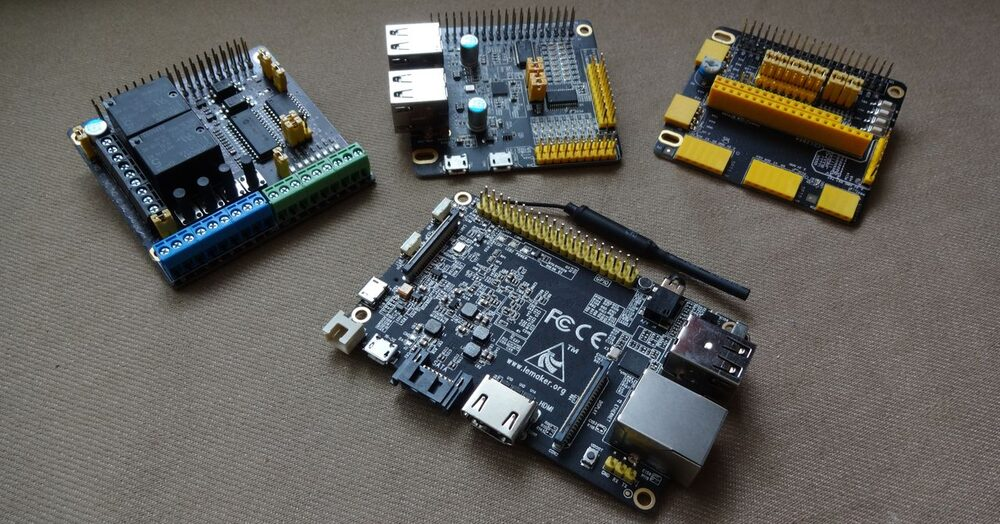
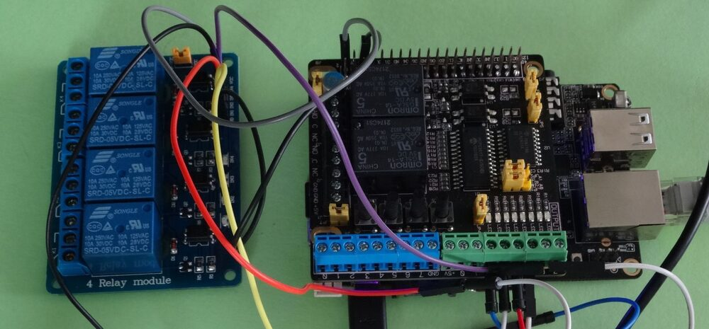
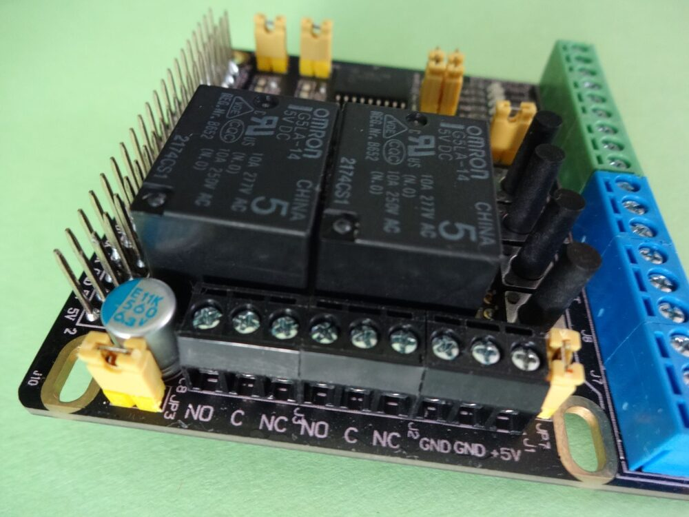
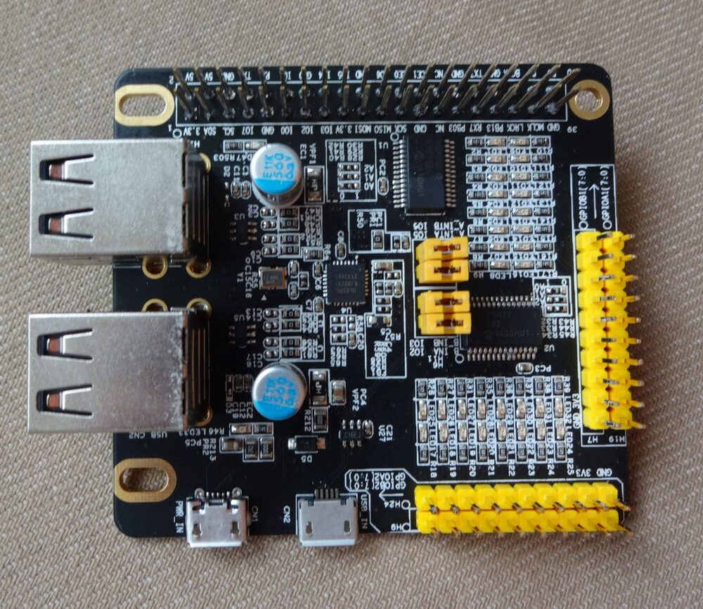
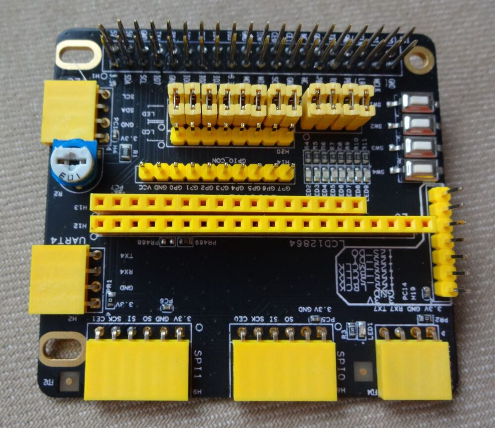

[English](README.md) | **Polski**

# Płytki rozszerzeń LeMaker dla Banana Pro



Około 2015 roku LeMaker wypuścił trzy płytki rozszerzeń zakładane na 40-pinowe złącze Banana Pro. Tutaj są opisane razem z pinami, których używają, i przykładami dla dzisiejszego Armbiana (Debian 13, jądro mainline), z bibliotekami z tego repozytorium: **WiringBP** (C i polecenie `gpio`), **lgpio** i **LMK.GPIO** (Python).

| Płytka | Co ma | Układ, magistrala | Biblioteki |
|---|---|---|---|
| [LN Digital](#ln-digital) | 8 wyjść z diodami (2 z przekaźnikami), 8 wejść (4 z przyciskami) | MCP23S17 na SPI0 + ULN2803 | WiringBP `piFaceSetup()` / `mcp23s17Setup()`, lgpio (SPI) |
| [LN HUB-32IO](#ln-hub-32io) | 32 wyjścia/wejścia z diodami, 4-portowy hub USB | 2 × MCP23017 na I2C2 | WiringBP `mcp23017Setup()`, lgpio (I2C) |
| [LN IO](#ln-io) | 8 diod, 4 przyciski, złącza LCD 1602/12864, I2C, 2 × SPI, 2 × UART, I2S | brak (same połączenia) | WiringBP, LMK.GPIO |

> **Stan (listopad 2026):** opis powstał ze schematów i przykładów LeMakera; przykłady kompilują się z pakietem `wiringbp`, ale **nie były jeszcze sprawdzone z płytkami**. Funkcje zworek pochodzą ze schematów, sprawdź je na swojej płytce.

## Zanim zaczniesz

1. Biblioteki: [pakiety](../README.pl.md#pakiety-deb) `wiringbp` (C, `gpio`), `python3-lgpio` i `python3-lmk-gpio`.
2. SPI dla LN Digital i złączy SPI na LN IO: w `/boot/armbianEnv.txt` dopisz `spi-spidev` do `overlays=` i linię `param_spidev_spi_bus=0`, potem restart. Pojawi się `/dev/spidev0.0` (CE0). Zrobi to też skrypt testowy: `sudo ./test-bananapipro.sh --przygotuj` ([testy](../../testy/README.pl.md)). Na starym jądrze sunxi 3.4 był to moduł `spi-sun7i` w `/etc/modules`; to już nie obowiązuje.
3. I2C2 na pinach 3 i 5 (LN HUB-32IO, złącze I2C na LN IO) jest w Armbianie włączone domyślnie (`/dev/i2c-1`).
4. Programy uruchamiaj przez `sudo` (`/dev/spidev*`, `/dev/i2c-*` i `/dev/mem` należą do roota).

Przykłady: [przyklady/c/](przyklady/c/) (WiringBP, `make` buduje wszystkie) i [przyklady/python/](przyklady/python/).

## LN Digital



Klon PiFace Digital dla Raspberry Pi: ekspander MCP23S17 na SPI, port A steruje 8 wyjściami przez ULN2803 (otwarty kolektor, każde z diodą), port B czyta 8 wejść. Wyjścia P0 i P1 mogą włączać dwa przekaźniki, wejścia IN0-IN3 mają przyciski S1-S4 do masy.

### Piny złącza 40-pin

| Pin | LN Digital | Banana Pro (pin układu, GPIO jądra, wPi) |
|---:|---|---|
| 1 | 3,3 V | |
| 2, 4 | 5 V (zasilanie płytki i przekaźników, przez JP3) | |
| 6, 9, 14, 20, 25, 30, 34, 39 | GND | |
| 18 | RESET układu MCP23S17 | PH21, 245, wPi 5 |
| 19 | SPI MOSI | PI12, 268 |
| 21 | SPI MISO | PI13, 269 |
| 22 | INTB układu MCP23S17 (przerwanie z wejść) | PI16, 272, wPi 6 |
| 23 | SPI SCK | PI11, 267 |
| 24 | SPI CE0 | PI10, 266 |

Piny 18 i 22 zajmuje płytka: nie używaj ich do niczego innego, gdy LN Digital jest założony (stan niski na pinie 18 resetuje układ).

### Złącza i zworki (ze schematu)

| Element | Co |
|---|---|
| J7, J8, J9 | wejścia IN0-IN7 (zaciski śrubowe, przez 100 Ω) i GND |
| J4, J5, J6 | wyjścia P0-P7 (otwarty kolektor, zwierają do GND) i 5 V |
| J2, J3 | styki przekaźników K1 i K2: NO, COM, NC |
| J1 | zewnętrzne zasilanie 5 V (PWR_EXT) |
| S1-S4 | przyciski na IN0-IN3 |
| JP1, JP2 | bity adresu układu A0, A1 (do 4 płytek na jednej linii SPI) |
| JP3 | 5 V ze złącza Banana Pro |
| JP4 | COM układu ULN2803 do 5 V (diody zabezpieczające przy przekaźnikach i cewkach) |
| JP5, JP6 | przekaźnik K1 na wyjściu P0, przekaźnik K2 na wyjściu P1 |
| JP7 | zasilanie zewnętrzne z J1 |



Przekaźniki mogą przełączać napięcie sieciowe: tylko z płytką w zamkniętej obudowie, przewodami z właściwą izolacją i bez dotykania podłączonej płytki.

### Przykłady

```bash
# w konsoli (gpio z WiringBP): baza 100, SPI 0, adres układu 0
sudo gpio -x mcp23s17:100:0:0 mode 100 out     # piny 100-107 = wyjścia P0-P7
sudo gpio -x mcp23s17:100:0:0 write 100 1      # P0 włączone (dioda, przekaźnik K1 z JP5)
sudo gpio -x mcp23s17:100:0:0 mode 108 up      # piny 108-115 = wejścia IN0-IN7, podciąganie
sudo gpio -x mcp23s17:100:0:0 read 108         # IN0 (przycisk S1): 0 = naciśnięty
```

- [ln-digital-test.c](przyklady/c/ln-digital-test.c): wyjścia po kolei, potem wejścia (`mcp23s17Setup()`; program z wpisu na blogu z 2015 roku, z poprawioną pętlą wejść),
- [ln-digital-przyciski.c](przyklady/c/ln-digital-przyciski.c): przyciski S1-S4 przełączają wyjścia (`piFaceSetup()`, na podstawie przykładu LeMakera),
- [ln_digital.py](przyklady/python/ln_digital.py): to samo w Pythonie z `lgpio` (rejestry MCP23S17 przez SPI).

`piFaceSetup(baza)` daje układ jak w PiFace: zapis `baza+0..7` ustawia wyjścia, odczyt `baza+0..7` czyta wejścia. `mcp23s17Setup(baza, 0, 0)` daje układ wprost: `baza+0..7` port A (wyjścia), `baza+8..15` port B (wejścia).

## LN HUB-32IO



32 dodatkowe piny z dwóch układów MCP23017 na I2C (adresy **0x20** i **0x21**), każdy pin z diodą, do tego 4-portowy hub USB. Hub działa sam: jego gniazdo micro USB łączy się z portem USB Banana Pro; drugie gniazdo micro USB służy do zewnętrznego zasilania (dla prądożernych urządzeń USB).

### Piny złącza 40-pin

| Pin | LN HUB-32IO | Banana Pro |
|---:|---|---|
| 1, 2, 4 | 3,3 V, 5 V | |
| 3 | I2C SDA | PB21, I2C2 (`/dev/i2c-1`) |
| 5 | I2C SCL | PB20, I2C2 |
| GND | GND | |

Schemat LeMakera z wpisu z 2015 roku jest za mały, żeby odczytać pozostałe piny złącza (np. linie przerwań); zanim użyjesz pinów, które płytka może zajmować, sprawdź je miernikiem albo na pełnym schemacie.

### Przykłady

```bash
sudo i2cdetect -y 1                              # powinny być 20 i 21
sudo gpio -x mcp23017:100:0x20 mode 100 out      # pierwszy układ: piny 100-115
sudo gpio -x mcp23017:100:0x20 write 100 1
```

- [hub-32io-miganie.c](przyklady/c/hub-32io-miganie.c): wszystkie 32 diody migają, potem wędrujące światło (`mcp23017Setup()`, na podstawie przykładu LeMakera),
- [hub_32io.py](przyklady/python/hub_32io.py): to samo z `lgpio` (I2C).

## LN IO



Płytka bez układów: wyprowadza sygnały złącza na opisane złącza i dodaje 8 diod i 4 przyciski. Zworki wybierają, czy GPIO0-GPIO7 idą do diod czy do złączy LCD, i czy przyciski są podłączone.

### Piny złącza 40-pin

GPIOx = nazwa na schemacie LN IO, równa numerowi wPi.

| Pin | LN IO | Banana Pro (pin układu, GPIO jądra, wPi) |
|---:|---|---|
| 3, 5 | I2C SDA, SCL (złącze H4) | PB21, PB20 (I2C2, `/dev/i2c-1`) |
| 7 | GPIO7: dioda 7 / LCD D7 | PH2, 226, wPi 7 |
| 8, 10 | UART TX, RX (złącze H2) | PH4, PH5 (UART4, `/dev/ttyS1`) |
| 11 | GPIO0: dioda 0 / LCD D0 | PI19, 275, wPi 0 |
| 12 | GPIO1: dioda 1 / LCD D1 | PI3, 259, wPi 1 |
| 13 | GPIO2: dioda 2 / LCD D2 / przycisk 1 | PI18, 274, wPi 2 |
| 15 | GPIO3: dioda 3 / LCD D3 / przycisk 2 | PI17, 273, wPi 3 |
| 16 | GPIO4: dioda 4 / LCD D4 / przycisk 3 | PH20, 244, wPi 4 |
| 18 | GPIO5: dioda 5 / LCD D5 / przycisk 4 | PH21, 245, wPi 5 |
| 19, 21, 23 | SPI MOSI, MISO, SCK (złącza H8, H9) | PI12, PI13, PI11 (SPI0) |
| 22 | GPIO6: dioda 6 / LCD D6 | PI16, 272, wPi 6 |
| 24, 26 | SPI CE0 (H8), CE1 (H9) | PI10, PI14 |
| 29 | LCD RS | PB3, 35, wPi 21 |
| 31, 32 | UART RX7, TX7 (złącze H3) | PI21, PI20 (UART7, `/dev/ttyS2`) |
| 33 | LCD E | PB13, 45, wPi 23 |
| 35, 36, 37, 38, 40 | I2S LRCK, BCLK, MCLK, DI, DO (złącze H19) | PB7, PB6, PB5, PB12, PB8 |

Pin 40 (PB8) włącza też zasilanie 5 V dysku SATA w Banana Pro: nie używaj wyjścia I2S, gdy podłączony jest dysk SATA.

### Złącza i zworki (ze schematu)

| Element | Co |
|---|---|
| CN1 / H20 (2 × 8) | GPIO0-GPIO7 do diod albo do linii danych LCD |
| H11 (2 × 4) | przyciski 1-4 do GPIO2-GPIO5 (przycisk zwiera pin do GND) |
| H13 | LCD 1602 (16 pinów, tryb 8-bitowy), potencjometr kontrastu R2 |
| H12 | LCD 12864 (20 pinów) |
| H2, H3 | UART4 (piny 8/10) i UART7 (piny 31/32) |
| H4 | I2C |
| H8, H9 | SPI z CE0 i z CE1 |
| H19 | I2S |

Przyciski i diody 2-5 dzielą GPIO2-GPIO5: do przycisków zdejmij zworki diod na tych pinach (stary test LeMakera ustawiał te piny w stan wysoki, a przycisk zwierał je do masy).

### Przykłady

```bash
sudo gpio mode 0 out; sudo gpio write 0 1        # dioda 0
sudo gpio mode 2 up;  sudo gpio read 2           # przycisk 1: 0 = naciśnięty
```

[ln-io.c](przyklady/c/ln-io.c) (na podstawie autotestu LeMakera, poprawiony pod obecne jądro): `sudo ./ln-io diody|przyciski|lcd|i2c|spi|uart`

| Polecenie | Test |
|---|---|
| `diody` | wędrujące światło na 8 diodach |
| `przyciski` | wypisuje naciśnięcia przycisków przez 15 s |
| `lcd` | napis na LCD 1602 w H13 (`lcdInit()`, RS = wPi 21, E = wPi 23, dane wPi 0-7) |
| `i2c` | przetwornik A/C PCF8591 pod 0x48 w H4: ustawia wyjście analogowe, czyta 4 wejścia (`pcf8591Setup()`) |
| `spi` | pamięć flash AT45DB041D w H8: zapis i odczyt jednego bajtu (`wiringPiSPIDataRW()`) |
| `uart` | kabelki H2 TX do H3 RX7 i H2 RX do H3 TX7: po jednym bajcie w każdą stronę (`serialOpen()`); porty są szukane po adresie kontrolera, bo stare jądro nazywało je ttyS2/ttyS3 |

[ln_io.py](przyklady/python/ln_io.py): diody i przyciski (z przerwaniami) w Pythonie z LMK.GPIO.

## Kilka płytek naraz

Płytki można łączyć piętrowo jak nakładki Arduino, ale niektóre piny się pokrywają:

- LN Digital zajmuje piny 18 i 22 (reset układu i przerwanie): na LN IO zdejmij zworki GPIO5 i GPIO6 (diody, LCD D5/D6, przycisk 4).
- LN Digital używa SPI CE0: inne urządzenia SPI podłącz do złącza CE1 (H9) na LN IO.
- LN HUB-32IO i złącze I2C na LN IO dzielą I2C2: urządzenia muszą mieć różne adresy (0x20 i 0x21 są zajęte).

## Źródła

- Wpisy na blogu ze zdjęciami: [dedykowane moduły I/O dla Banana PRO](https://cyryllo.pl/blog/dedykowane-moduly-io-dla-banana-pro/), [LN Digital, klon PiFace](https://cyryllo.pl/blog/ln-digital-klon-modulu-piface-dla-banana-pro/)
- Przykłady LeMakera: [LeMaker/expansion_boards_demo](https://github.com/LeMaker/expansion_boards_demo); biblioteki Pythona dla LN Digital (tu nieużywane): [LeMaker/LNdigitalIO](https://github.com/LeMaker/LNdigitalIO), [LeMaker/LN_Digital_Installer](https://github.com/LeMaker/LN_Digital_Installer)
- Schematy: forum LeMakera (2015, już nie działa), kopie w pierwszym wpisie na blogu.
