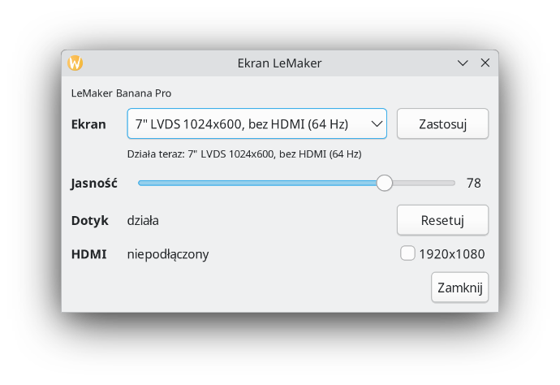

[English](README.md) | **Polski**

# Ekran LeMaker (`lemaker-screen`)

Proste narzędzie do ustawiania ekranów LCD LeMakera na Banana Pi i Banana Pro z Armbianem. Nie trzeba edytować plików ani pamiętać nazw nakładek:

- **wybór ekranu:** bez LCD (tylko HDMI), 5", 7", 7" razem z monitorem HDMI,
- **jasność** podświetlenia,
- **reset dotyku**, gdy dotyk sam klika albo przestaje reagować,
- **tryb HDMI 1080p**, potrzebny, gdy LCD i HDMI działają razem,
- podgląd stanu: który ekran jest ustawiony, który działa teraz, czy trzeba ponownie uruchomić płytkę.

Dwie wersje: **okienko** (menu → Ustawienia → **LeMaker screen**) i **polecenia w konsoli** (`lemaker-screen`), także na obrazie bez pulpitu i przez SSH. Domyślnie po angielsku; po polsku z opcją `--lang=pl` albo zmienną `LEMAKER_SCREEN_LANG=pl` (np. `lemaker-screen-gui --lang=pl`).



Narzędzie korzysta z nakładek, które są w oficjalnym Armbianie od listopada 2026 (`lemaker-lcd5`, `lemaker-lcd7`, `lemaker-lcd7-hdmi`). Na starszym Armbianie najpierw zaktualizuj system: `sudo apt update && sudo apt full-upgrade`. Ekranu 3,5" nie ma na liście, bo nie ma go w Armbianie (ręcznie: [overlays/README.pl.md](../overlays/README.pl.md)).

## Instalacja

Na płytce pobierz pakiet ([dist/lemaker-screen_1.0.0_all.deb](dist/lemaker-screen_1.0.0_all.deb)) i zainstaluj go:

```bash
wget https://github.com/cyryllo/banana-a20/raw/master/lemaker-screen/dist/lemaker-screen_1.0.0_all.deb
sudo apt install ./lemaker-screen_1.0.0_all.deb
```

Do okienka potrzebne są pakiety `python3-gi`, `gir1.2-gtk-3.0` i `pkexec`, które obraz z pulpitem XFCE już ma (`apt` doinstaluje brakujące). Na obrazie bez pulpitu działają same polecenia.

## Okienko

Menu → Ustawienia → **LeMaker screen** (albo polecenie `lemaker-screen-gui`, po polsku: `lemaker-screen-gui --lang=pl`):

| Część | Co robi |
|---|---|
| Screen (ekran) | wybierz ekran z listy i kliknij **Apply**; system zapyta o hasło, a potem, czy uruchomić płytkę ponownie (nowy ekran działa po restarcie). Pod listą: który ekran działa teraz |
| Brightness (jasność) | suwak działa od razu, bez hasła |
| Touch (dotyk) | czy układ dotyku działa; **Reset**: układ kalibruje się od nowa |
| HDMI | czy monitor jest podłączony; pole **1920x1080**: wymuszenie trybu HDMI potrzebnego przy LCD + HDMI |

Objaśnienia przycisków pokazują się po najechaniu myszą. Okno ma ok. 470×250 pikseli, więc mieści się też na ekranie 5".

## Polecenia w konsoli

```bash
lemaker-screen                        # obecne ustawienia
sudo lemaker-screen set 7             # ekran 7" (5, 7, 7-hdmi albo off)
sudo lemaker-screen set 5 --reboot    # ekran 5" i od razu restart
lemaker-screen brightness 60          # jasność 60 %
lemaker-screen brightness +10         # jaśniej o 10 punktów (-10 ciemniej)
sudo lemaker-screen touch-reset       # reset dotyku
sudo lemaker-screen hdmi-1080p on     # HDMI 1920x1080 (on albo off)
lemaker-screen --help                 # pomoc
```

| Ekran | Polecenie | Uwagi |
|---|---|---|
| bez LCD | `set off` | tylko HDMI |
| 5" RGB 800x480 | `set 5` | działa też razem z HDMI, włącza tryb HDMI 1080p |
| 7" LVDS 1024x600 | `set 7` | bez monitora HDMI, 64 Hz |
| 7" LVDS razem z HDMI | `set 7-hdmi` | z monitorem HDMI, 50 Hz, włącza tryb HDMI 1080p |

## Co dokładnie zmienia

- W `/boot/armbianEnv.txt` ustawia nakładkę `lemaker-lcd...` w linii `overlays=`. Inne nakładki, np. `pwm` czy `spi-spidev`, zostają.
- Usuwa stare `user_overlays=bananapro-lemaker-lcd...` z obrazów sprzed listopada 2026, bo dwie nakładki ekranu naraz psują start.
- Przy 5" i 7" z HDMI dopisuje `video=HDMI-A-1:1920x1080@60` w `extraargs=`, bo LCD i HDMI korzystają z tego samego zegara i bez tego LCD miga.
- Przed każdą zmianą robi kopię: `/boot/armbianEnv.txt.lemaker-screen.bak`.
- Jasność zmienia przez logind (bez hasła, w sesji na płytce) albo bezpośrednio jako root. Wartość wraca po restarcie.
- Reset dotyku odpina i podpina sterownik `edt_ft5x06`, a układ dostaje wtedy impuls RESET.

## Budowanie pakietu

```bash
./zbuduj-deb.sh        # wynik: dist/lemaker-screen_<wersja>_all.deb
```

Do testów bez płytki można wskazać udawany katalog główny: `LEMAKER_SCREEN_ROOT=/ścieżka python3 lemaker_screen.py`.

## Licencja

GPL-3.0-or-later.
