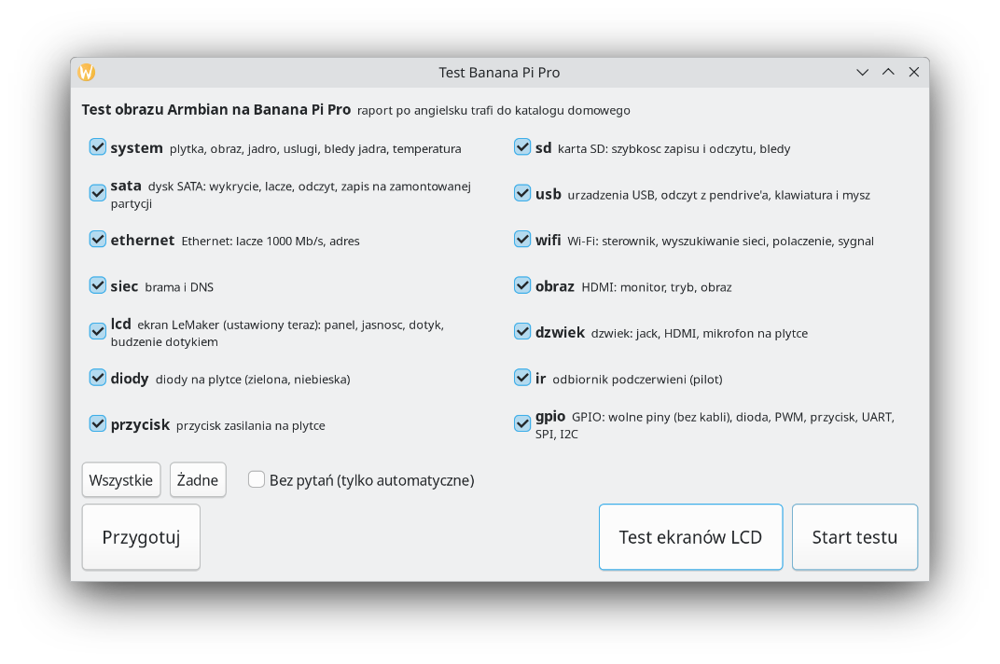

**English** | [Polski](README.pl.md)

# Testing Armbian images on the Banana Pi Pro

The board maintainer's checklist for testing Armbian images (Debian and Ubuntu, minimal and desktop) on the Banana Pi Pro (LeMaker Banana Pro, Allwinner A20) before a release, with a script and a window that do most of it by themselves.

Armbian asks the maintainer to sign off that the board is tested and ready for the release ([board maintainer rules](https://docs.armbian.com/contribute/board-maintainer/)). The images prepared for a release are in https://fi.mirror.armbian.de/incoming/igorpecovnik/ and https://rsync.armbian.com/incoming/ . Something not working is normal: what matters is that it is documented and reported.

## Getting it

On the board, with the test image written to the SD card:

```bash
mkdir -p ~/testy && cd ~/testy
for f in test-bananapipro.sh test-bananapipro-gui.py test-bananapipro.desktop; do
  wget -q https://raw.githubusercontent.com/cyryllo/banana-a20/master/testy/$f
done
chmod +x test-bananapipro.sh test-bananapipro-gui.py
```

Wi-Fi is set up the usual way, in the first-boot wizard or later with `armbian-config` (Network); the test only checks the connection.

## 1. Prepare (once per image)

```bash
sudo ./test-bananapipro.sh --przygotuj
```

Installs the tools (`gpiod`, `i2c-tools`, `alsa-utils`, `iw`) and adds the `pwm` and `spi-spidev` overlays with `param_spidev_spi_bus=0` to `/boot/armbianEnv.txt` (backup: `armbianEnv.txt.przed-testem`), needed for the hardware PWM and SPI tests. It asks before rebooting.

## 2. Test: script or window

**Script** (minimal and desktop images, also over SSH):

```bash
sudo ./test-bananapipro.sh                     # all modules, with questions
sudo ./test-bananapipro.sh --tylko sata,gpio   # chosen modules
sudo ./test-bananapipro.sh --bez-pytan         # automatic checks only
sudo ./test-bananapipro.sh --lista             # list of modules
```

**Window** (desktop images): `python3 ~/testy/test-bananapipro-gui.py`, or copy `test-bananapipro.desktop` to `~/.local/share/applications/` (change `Exec=` to the full path). Tick the modules, **Start testu**, give the password, then answer with the big buttons (made for the touch screen). At the end: **Otwórz raport** / **Kopiuj raport**.

Start the window **from the desktop**, not over SSH: the password window (polkit) belongs to the desktop session. Without a keyboard, use the on-screen keyboard `onboard` (`sudo apt install onboard at-spi2-core`, then in its settings turn on the floating icon).



| Option | What it does |
|---|---|
| (none) | all modules, with questions |
| `--tylko a,b` | only the given modules |
| `--bez-pytan` | automatic checks only, e.g. over SSH without a screen |
| `--przygotuj` | tools and overlays for the GPIO tests |
| `--ekrany` | LeMaker panels one after another (see below) |
| `--aktualizacja` | first `apt update` and `apt full-upgrade`, then the test |
| `--maszynowo` | output for the window (`WYNIK\|...`, `PYTANIE\|...`, `CZEKAJ\|...`) |

The output goes to the home directory:

- `raport-bananapipro-<date>.md`: the report in English (Markdown), ready to paste into the Armbian forum or a GitHub issue,
- `raport-bananapipro-<date>-szczegoly.txt`: full `dmesg`, lists of devices, display modes, mixer and packages (for bug reports).

At the end of a full run the script asks whether to upload the system log with `armbianmonitor -u` (a public link on paste.armbian.com, added to the report). The questions on the board are in Polish, the report is in English.

## 3. LeMaker panels, one after another

```bash
sudo ./test-bananapipro.sh --ekrany
```

The script asks which panels you have, then sets each screen in turn: 7", 7" with an HDMI monitor, 5", no LCD. After each step it reboots (or powers off when the panel has to be swapped) and you run the same command (or **Kontynuuj test ekranów** in the window) again. For each screen it checks the device tree, the picture, the brightness, 5 taps, the touch area, waking by touch (desktop) and LCD with HDMI together. At the end it restores the original `armbianEnv.txt` and writes `raport-bananapipro-ekrany-<date>.md`.

## Modules

A = automatic, Q = the script asks, W = with wires or parts (the script asks first whether they are connected).

| Module | What | How |
|---|---|---|
| `system` | board, image, kernel, overlays, failed services, boot time, kernel errors, temperature, CPU frequency | A |
| `sd` | SD card write and read speed, `mmc` errors | A |
| `sata` | disk detected, link speed, raw read speed, write and read of a 512 MB file on a mounted partition (deleted afterwards), link errors | A (with a disk) |
| `usb` | devices, USB stick read speed, keyboard and mouse | A + Q |
| `ethernet` | 1000 Mb/s link, IP address | A |
| `wifi` | interface, driver, scan, connection (SSID, signal, link rate), 20 pings to the gateway over Wi-Fi | A |
| `siec` | gateway, DNS | A |
| `obraz` | HDMI monitor, mode, picture | A + Q |
| `lcd` | the LeMaker panel set now: overlay, picture, brightness (dims and brightens), touch driver, `vcc-supply`, 5 taps counted from the input device, touch area, wake by touch (desktop) | A + Q |
| `dzwiek` | sound cards, headphone output, onboard microphone (recorded, level measured, played back), HDMI audio | A + Q |
| `diody` | the two LEDs on the board blink | A + Q |
| `ir` | IR receiver, codes from any remote | A + Q |
| `przycisk` | POWER button (the test takes the button exclusively, so the system does not power off) | A + Q |
| `gpio` | free header pins: internal pull-up reads 1, pull-down reads 0, no wires needed; pins used by I2C, UART, SPI or the LCD touch are not touched | A |
| `gpio` | LED on pin 11 blinks, hardware PWM on pin 12 fades, button on pin 13 (interrupts), UART loopback pins 8-10, SPI loopback pins 19-21, I2C bus on pins 3-5 | W |
| `obciazenie` | both cores busy for 60 s: highest temperature, lowest CPU frequency, lowest supply voltage (AXP209 ADC), new kernel errors | A |
| `pakiety` | kernel package, dpkg/apt state, held packages | A |

Also by hand: the minimal and the desktop image boot, `sudo reboot` and `sudo poweroff` work, upgrade from the previous release (`--aktualizacja`, reboot, test again).

Nothing has to be enabled for SATA, Wi-Fi, Ethernet, sound, IR or the LEDs: the Banana Pro device tree in Armbian has them on. Only the LCD panels (`overlays=lemaker-lcd...`) and some GPIO functions (`pwm`, `spi-spidev`) need settings in `armbianEnv.txt`; `--przygotuj` and `--ekrany` do it.

## After the test

- Everything works: sign off the board in the release testing form (linked from the [board maintainer rules](https://docs.armbian.com/contribute/board-maintainer/)) or post on the forum with the report.
- Something does not work: open an issue in [armbian/build](https://github.com/armbian/build/issues) with the report, the details file and the `armbianmonitor -u` link. Armbian treats these as most important: the image does not boot, corrupt packages, SD card or eMMC not working as expected. Wi-Fi, Bluetooth, GPIO and overlays have a lower priority.
