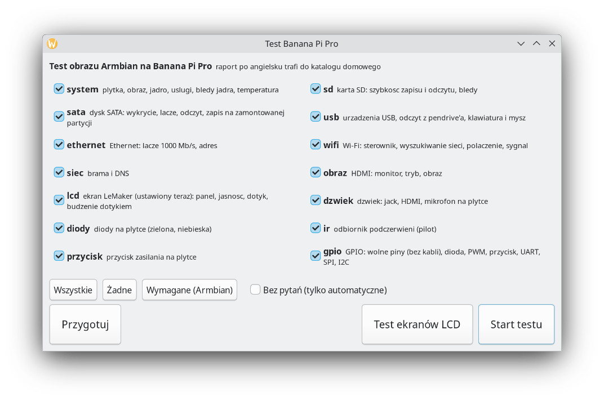

[English](README.md) | **Polski**

# Test obrazów Armbiana na Banana Pi Pro

Lista kontrolna opiekuna płytki Banana Pi Pro (LeMaker Banana Pro, Allwinner A20) do testów obrazów Armbiana (Debian i Ubuntu, minimalne i z pulpitem) przed wydaniem, razem ze skryptem i oknem, które większość z niej sprawdzają same.

Armbian wymaga od opiekuna zatwierdzenia (sign-off), że płytka jest przetestowana i gotowa do wydania ([zasady dla opiekunów](https://docs.armbian.com/contribute/board-maintainer/)). Obrazy przygotowane do wydania są w https://fi.mirror.armbian.de/incoming/igorpecovnik/ i https://rsync.armbian.com/incoming/ . To, że coś nie działa, jest normalne: ważne, żeby było opisane i zgłoszone.

## Pobranie

Na płytce, z nagranym obrazem do testu:

```bash
mkdir -p ~/testy && cd ~/testy
for f in test-bananapipro.sh test-bananapipro-gui.py test-bananapipro.desktop; do
  wget -q https://raw.githubusercontent.com/cyryllo/banana-a20/master/testy/$f
done
chmod +x test-bananapipro.sh test-bananapipro-gui.py
```

Wi-Fi ustawia się jak zwykle, w kreatorze pierwszego uruchomienia albo później w `armbian-config` (Network); test tylko sprawdza połączenie.

## 1. Przygotowanie (raz na obraz)

```bash
sudo ./test-bananapipro.sh --przygotuj
```

Instaluje narzędzia (`gpiod`, `i2c-tools`, `alsa-utils`, `iw`) i dopisuje do `/boot/armbianEnv.txt` nakładki `pwm` i `spi-spidev` z `param_spidev_spi_bus=0` (kopia: `armbianEnv.txt.przed-testem`), potrzebne do testów sprzętowego PWM i SPI. Przed restartem pyta.

## 2. Test: skrypt albo okno

**Skrypt** (obrazy minimalne i z pulpitem, także przez SSH):

```bash
sudo ./test-bananapipro.sh                     # wszystkie moduły, z pytaniami
sudo ./test-bananapipro.sh --tylko sata,gpio   # wybrane moduły
sudo ./test-bananapipro.sh --bez-pytan         # tylko sprawdzenia automatyczne
sudo ./test-bananapipro.sh --minimalny         # lista kontrolna Armbiana, bez interakcji
sudo ./test-bananapipro.sh --lista             # lista modułów
```

**Okno** (obrazy z pulpitem): `python3 ~/testy/test-bananapipro-gui.py` albo skopiuj `test-bananapipro.desktop` do `~/.local/share/applications/` (w `Exec=` pełna ścieżka). Zaznacz moduły (**Wymagane (Armbian)** zaznacza tylko listę kontrolną wydania i włącza "Bez pytań"), **Start testu**, podaj hasło, potem odpowiadaj dużymi przyciskami (zrobionymi pod ekran dotykowy). Na końcu: **Otwórz raport** / **Kopiuj raport**.

Okno uruchamiaj **z pulpitu**, nie przez SSH: okienko hasła (polkit) należy do sesji pulpitu. Bez klawiatury użyj klawiatury ekranowej `onboard` (`sudo apt install onboard at-spi2-core`, potem w jej ustawieniach włącz pływającą ikonę).



| Opcja | Co robi |
|---|---|
| (brak) | wszystkie moduły, z pytaniami |
| `--tylko a,b` | tylko podane moduły |
| `--bez-pytan` | tylko sprawdzenia automatyczne, np. przez SSH bez ekranu |
| `--minimalny` | lista kontrolna wydania Armbiana, bez żadnej interakcji: system, SD, SATA, USB, Ethernet, Wi-Fi, sieć, HDMI, karty dźwiękowe, obciążenie, pakiety (ekrany LCD i GPIO testuje się osobno) |
| `--przygotuj` | narzędzia i nakładki do testów GPIO |
| `--ekrany` | ekrany LeMaker po kolei (niżej) |
| `--aktualizacja` | najpierw `apt update` i `apt full-upgrade`, potem test |
| `--maszynowo` | wyjście dla okna (`WYNIK\|...`, `PYTANIE\|...`, `CZEKAJ\|...`) |

Wynik trafia do katalogu domowego:

- `raport-bananapipro-<data>.md`: raport po angielsku (Markdown), gotowy do wklejenia na forum Armbiana albo w zgłoszeniu na GitHubie,
- `raport-bananapipro-<data>-szczegoly.txt`: pełny `dmesg`, listy urządzeń, tryby obrazu, mikser i pakiety (do zgłoszeń błędów).

Na końcu pełnego testu skrypt pyta, czy wysłać dziennik systemu przez `armbianmonitor -u` (publiczny link na paste.armbian.com, dopisywany do raportu). Pytania na płytce są po polsku, raport po angielsku.

## 3. Ekrany LeMaker po kolei

```bash
sudo ./test-bananapipro.sh --ekrany
```

Skrypt pyta, jakie masz ekrany, i ustawia je po kolei: 7", 7" z monitorem HDMI, 5", bez LCD. Po każdym kroku restartuje płytkę (albo ją wyłącza, gdy trzeba przełożyć ekran), a Ty uruchamiasz to samo polecenie (albo **Kontynuuj test ekranów** w oknie) jeszcze raz. Dla każdego ekranu sprawdza drzewo urządzeń, obraz, jasność, 5 stuknięć, obszar dotyku, budzenie dotykiem (pulpit) i LCD razem z HDMI. Na końcu przywraca oryginalny `armbianEnv.txt` i zapisuje `raport-bananapipro-ekrany-<data>.md`.

## Moduły

A = automatycznie, P = skrypt pyta, K = z kabelkami lub elementami (skrypt najpierw pyta, czy są podłączone).

| Moduł | Co | Jak |
|---|---|---|
| `system` | płytka, obraz, jądro, nakładki, nieudane usługi, czas startu, błędy jądra, temperatura, taktowanie | A |
| `sd` | szybkość zapisu i odczytu karty SD, błędy `mmc` | A |
| `sata` | wykrycie dysku, prędkość łącza, odczyt surowy, zapis i odczyt pliku 512 MB na zamontowanej partycji (potem usuwany), błędy łącza | A (z dyskiem) |
| `usb` | urządzenia, odczyt z pendrive'a, klawiatura i mysz | A + P |
| `ethernet` | łącze 1000 Mb/s, adres IP | A |
| `wifi` | interfejs, sterownik, wyszukiwanie, połączenie (SSID, sygnał, prędkość łącza), 20 pingów do bramy przez Wi-Fi | A |
| `siec` | brama, DNS | A |
| `obraz` | monitor HDMI, tryb, obraz | A + P |
| `lcd` | ustawiony teraz ekran LeMaker: nakładka, obraz, jasność (przygasa i rozjaśnia się), sterownik dotyku, `vcc-supply`, 5 stuknięć liczonych z urządzenia wejścia, obszar dotyku, budzenie dotykiem (pulpit) | A + P |
| `dzwiek` | karty dźwiękowe, wyjście słuchawkowe, mikrofon na płytce (nagranie, pomiar poziomu, odtworzenie), dźwięk HDMI | A + P |
| `diody` | dwie diody na płytce migają | A + P |
| `ir` | odbiornik podczerwieni, kody z dowolnego pilota | A + P |
| `przycisk` | przycisk POWER (test przejmuje przycisk na wyłączność, więc system się nie wyłącza) | A + P |
| `gpio` | wolne piny złącza: podciąganie w górę daje 1, w dół 0, bez kabli; pinów używanych przez I2C, UART, SPI i dotyk LCD test nie dotyka | A |
| `gpio` | dioda na pinie 11 miga, sprzętowe PWM na pinie 12 płynnie rozjaśnia, przycisk na pinie 13 (przerwania), mostek UART piny 8-10, mostek SPI piny 19-21, magistrala I2C na pinach 3-5 | K |
| `obciazenie` | oba rdzenie obciążone 60 s: najwyższa temperatura, najniższe taktowanie, najniższe napięcie zasilania (przetwornik AXP209), nowe błędy jądra | A |
| `pakiety` | pakiet jądra, stan dpkg/apt, wstrzymane pakiety | A |

Ręcznie: obraz minimalny i z pulpitem startuje, `sudo reboot` i `sudo poweroff` działają, aktualizacja z poprzedniego wydania (`--aktualizacja`, restart, test jeszcze raz).

Dla SATA, Wi-Fi, Ethernetu, dźwięku, podczerwieni i diod nie trzeba niczego włączać: drzewo urządzeń Banana Pro w Armbianie ma je włączone. Ustawień w `armbianEnv.txt` wymagają tylko ekrany LCD (`overlays=lemaker-lcd...`) i część funkcji GPIO (`pwm`, `spi-spidev`); robią to `--przygotuj` i `--ekrany`.

## Po teście

- Wszystko działa: zatwierdź płytkę w formularzu testów wydania (link w [zasadach dla opiekunów](https://docs.armbian.com/contribute/board-maintainer/)) albo napisz na forum, dołącz raport.
- Coś nie działa: zgłoś to jako issue w [armbian/build](https://github.com/armbian/build/issues), dołącz raport, plik ze szczegółami i link z `armbianmonitor -u`. Według Armbiana najważniejsze są: obraz się nie uruchamia, uszkodzone pakiety, karta SD lub eMMC działa źle. Wi-Fi, Bluetooth, GPIO i nakładki mają niższy priorytet.
